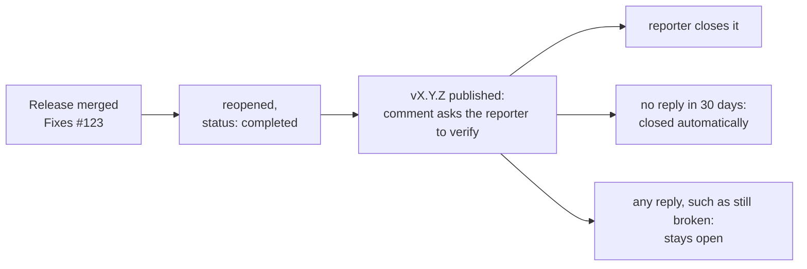

# Contributing

Thanks for wanting to contribute to PrintGuard. Start by reading [docs/architecture.md](docs/architecture.md) so you know how the pieces fit together: one Python engine owns every decision, the hub server runs it, and anything the engine needs from hardware, the network or disk goes through the `Platform` contract.

- [Development setup](#development-setup)
- [Documentation is part of the change](#documentation-is-part-of-the-change)
- [Regenerating the docs screenshots](#regenerating-the-docs-screenshots)
- [Adding a printer integration](#adding-a-printer-integration)
- [Adding a notification provider](#adding-a-notification-provider)
- [Adding a plugin to the catalogue](#adding-a-plugin-to-the-catalogue)
- [Ground rules](#ground-rules)
- [Release cycle](#release-cycle)
- [What a merge does to the issues it fixes](#what-a-merge-does-to-the-issues-it-fixes)

## Development setup

```bash
uv sync                              # Python engine + hub server
uv run printguard                    # hub on :8000 (MediaMTX is bundled in Docker; for video in dev, brew install mediamtx >= 1.19.0 and set MEDIAMTX_BINARY=$(which mediamtx))
cd web && npm install && npm run dev # React UI with hot reload on :5173, proxied to :8000
```

If you're working on the desktop app, you can run the tray app directly from source or build a local installer:

```bash
uv run --extra desktop printguard-desktop   # runs the hub in the system tray / menu bar
bash packaging/build.sh                      # builds a .dmg (macOS) or .zip (Windows) into dist/
```

Run the test suite before and after your changes:

```bash
uv run pytest                        # engine simulation, adapter contracts, plugin sandbox and lint
cd web && npm run typecheck          # strict TypeScript over the UI and Playwright suites
cd web && npm run test:sandbox       # browser plugin sandbox, dashboard, a11y and markdown tests (Chromium + WebKit)
cd feedback-worker && npm ci && npm run typecheck && npm test   # training inbox Cloudflare Worker
```

CI's **tests** check runs all four of these (running `uv run pytest` on both Python 3.12 and the Docker image's Python 3.14). pytest spreads the tests across every core with pytest-xdist, so add `-n0` to run them one at a time when you're debugging. Note that `test:sandbox` needs `npx playwright install chromium webkit` once.

Here is where different tests live:

- `tests/test_engine.py`: simulates cameras and printers against `FakePlatform`, covering fair scheduling, watching/standby gating, the watchdog, alerts and the command protocol. Extend this whenever you touch core engine behaviour.
- `tests/test_adapters.py`: pins exact HTTP/client payloads for every printer integration and notification channel. Add your payloads here for any new adapter.
- `tests/test_plugin_runtime.py`: executes real JavaScript inside the shipped QuickJS Wasm runtime to test hub-side plugin isolation.
- `tests/test_plugin_lint.py`: verifies every shipped plugin matches its own manifest (requires `npm install` in `web/` since the linter runs in Node).
- `tests/test_plugin_network.py`, `tests/test_urls.py`, `tests/test_plugin_schema.py`: pin plugin network/SSRF rules, URL match patterns and the manifest JSON Schema.
- `tests/test_app.py`, `tests/test_platform.py`, `tests/test_desktop.py`, `tests/test_feedback_pull.py`: cover FastAPI routes, real hub `Platform` implementations, desktop launch logic and the training-frame pull script.
- Dedicated `tests/test_<name>.py` files cover the REST API, MCP server, MQTT bridge, API tokens, update checks, G-code parsing, MediaMTX client, plugin installs, `state.json` recovery and feedback uploads.

On the frontend, `npm run test:sandbox` runs everything under `web/tests/` against the faked hub in `fixtures.ts`: `sandbox.spec.ts` (browser plugin isolation), `dashboard.spec.ts` (dashboard flows and reconnection), `a11y.spec.ts` (WCAG 2.2 AA checks via axe on every page and dialog) and `markdown.spec.ts` (plugin README sanitisation). CI rejects any leftover `test.only`. If you edit `web/public/plugin-sandbox.html` or `web/public/plugin-panel.html`, remember both files allowlist their inline scripts by CSP hash, so update the hash in the CSP meta tag whenever you change the inline script.

[`feedback-worker/`](feedback-worker) holds the Cloudflare Worker powering [training frames](docs/feedback.md) (limits live in `src/limits.ts`, all unit-tested; install with `npm ci` since npm 10 struggles to resolve Vitest peers from scratch). Only I deploy it. The R2 bucket needs a lifecycle rule matching `EXPIRY_DAYS`, since the Worker only tracks upcoming expiry and relies on R2 to delete expired objects:

```bash
cd feedback-worker
npx wrangler r2 bucket create printguard-feedback --jurisdiction eu
npx wrangler r2 bucket lifecycle add printguard-feedback expire-after-30-days --expire-days 30 --jurisdiction eu
npx wrangler r2 bucket lifecycle list printguard-feedback --jurisdiction eu
npx wrangler deploy --secrets-file <file>   # TOKEN_SECRET, REMINDER_TO and REMINDER_FROM on first deploy
```

Note that rotating `TOKEN_SECRET` issues fresh hub IDs and makes previously uploaded frames untraceable for [deletion requests](docs/feedback.md#having-your-frames-deleted). Also, because every request (even rejected ones) counts toward Cloudflare's free Worker quota, put a WAF rate-limiting rule on the route in the Cloudflare dashboard, and make sure the `ratelimits` namespace IDs in `wrangler.jsonc` aren't shared with another Worker.

Finally, `web/launch/launch.spec.ts` runs an end-to-end smoke test against real builds: it spins up a fake MJPEG server with one healthy print and one failing print, registers both cameras and monitors, and confirms only the failing print triggers an alert. CI runs **launch** on PRs into `main` across the Docker container, macOS app (via Playwright WebKit) and Windows app (driving its real WebView2 window over DevTools via `PRINTGUARD_DEBUG_PORT`). To run it locally against a fresh hub (with Chrome installed):

```bash
cd web && PRINTGUARD_URL=http://localhost:8000 npx playwright test --project=launch
```

## Documentation is part of the change

A change isn't finished while the docs still describe the old behaviour. Treat docs just like tests: if your PR changes anything covered below, update the matching pages in the same PR and delete anything that's now outdated.

| If you change | Update |
|---|---|
| Install steps, ports, image tags, headline features | [README.md](README.md) |
| Supported printer services, camera sources or alert channels | The lists in [README.md](README.md) and `web/src/guide.tsx` |
| Engine protocol, events, `Platform` contract, scheduler, logging, repo layout | [docs/architecture.md](docs/architecture.md) |
| Printer integrations, setup steps, print library or temperatures | [docs/printers.md](docs/printers.md) |
| Camera sources | [docs/cameras.md](docs/cameras.md) |
| Monitor/camera settings or risk history | [docs/monitoring.md](docs/monitoring.md) |
| Kept print frames, training uploads or Worker limits | [docs/feedback.md](docs/feedback.md) |
| Alert channels or notification behaviour | [docs/notifications.md](docs/notifications.md) |
| Detection models, runtimes, execution providers, image variants or GPU setup | [docs/hardware.md](docs/hardware.md) |
| Proxies, origin checks, ports, hardening, env vars or data directory | [docs/deployment.md](docs/deployment.md) |
| REST routes, MCP tools, scopes, payloads or Home Assistant entities | [docs/api.md](docs/api.md) |
| Installing plugins, permissions or sandbox guarantees | [docs/plugins.md](docs/plugins.md) |
| Plugin API, manifest fields, limits, sandboxes or catalogue rules | [docs/plugin-development.md](docs/plugin-development.md) |
| Common user-facing failure modes or fixes | [docs/troubleshooting.md](docs/troubleshooting.md) |
| Anything user-visible | [CHANGELOG.md](CHANGELOG.md) (see [Release cycle](#release-cycle)) |
| Dashboard appearance | Screenshots (see below) |
| Dev setup, tests, adapter guides or release flow | This file |

If you ever add a brand-new doc page, add it to [docs/README.md](docs/README.md), the Documentation table in `README.md`, and the centred nav bar at the top of every page.

Style notes for docs and release notes:

- Write in clear, natural British English (`colour`, `customise`, `licence`, `optimised`, `behaviour`). Be direct and practical, with no marketing fluff or emojis in prose.
- Never use em dashes. Use commas, colons, brackets or separate sentences instead.
- Prefer tables and Mermaid diagrams over long walls of text.
- Link to the canonical page instead of repeating the same explanation in two places.
- Write changelog entries for someone deciding whether to update, not about internal implementation details.

## Regenerating the docs screenshots

All screenshots in `docs/assets/`, `web/public/guide/` and `plugins/*/shots/` are generated automatically from mock data by Playwright (no live hub, broker or camera needed). Regenerate them whenever the UI changes:

```bash
cd web
npx playwright install chromium      # one-time browser download
npm run screenshots                  # regenerates docs/assets/*.png, web/public/guide/*.jpg and plugins/*/shots
```

Each screenshot corresponds to an entry in `SCENES` inside `web/screenshots/capture.spec.ts` (scenes listing `plugins` run the real plugins from `plugins/` inside the sandbox). The same script captures the dark/light cropped images for the in-app guide from `CROPS` (referenced via `shot: "<id>"` in `web/src/guide.tsx`) and plugin screenshots from `PLUGIN_SHOTS`. Because the plugin catalogue pins the last commit touching each plugin folder, commit any changed plugin screenshots and rerun `uv run python plugins/pin.py`.

## Adding a printer integration

Integrations talk to printer servers (like OctoPrint or Moonraker) to read job state and pause, resume, cancel, preheat or start prints. HTTP-based adapters use `platform.http` so `tests/test_adapters.py` can pin every single request. Services that use custom protocols (like Bambu Lab MQTT or Creality WebSockets) can bring in a vendor client library in `pyproject.toml` and monkeypatch their private connection helpers in tests.

1. Add `printguard/engine/integrations/<service>.py` subclassing [`IntegrationAdapter`](printguard/engine/integrations/base.py):
   - Set `id` (storage/API key) and `label` (display name in the UI).
   - Implement `fetch_state()`, mapping onto the canonical `DeviceStatus` values. Remember `offline` means unreachable (not idle), so detection stays active. Raise an exception with a clear message if unreachable or returning non-API output (the watchdog logs it and **Test connection** displays it). Populate `remaining_s`, `nozzle` and `bed` (via `Heater.reported()`) where available.
   - Implement `send()` for `pause`, `resume` and `cancel`, raising `RuntimeError` if rejected.
   - If the printer accepts temperature targets, set `heater_control = True` and implement `heat()`, raising `RuntimeError` on failure.
   - If the printer can print uploaded files, set `formats` to supported extensions and implement `print_file()`, raising `RuntimeError` on failure.
   - If the printer exposes a webcam, implement `cameras()` returning `{key, name, source}` entries so PrintGuard auto-registers them.
   - If the adapter keeps a persistent connection, implement `close()` and `connection_key()` so testing an edited printer doesn't tear down the live polling connection.
   - Set `slow_action_s` if the printer waits to finish a move or reheat before replying to commands.
   - Define `schema` as a JSON Schema: mark credentials with `secret: true`, provide helpful `placeholder` values, set `default` on optional `enum` fields, and list `required` fields (enforced by `Adapter.require()`).
   - Set `docs_url` to the official API docs (required for review), plus optional `setup_url` and a one-line `setup_hint` for on-printer steps.
2. Register an instance in [`printguard/engine/integrations/__init__.py`](printguard/engine/integrations/__init__.py).
3. Pin its requests/payloads in `tests/test_adapters.py`.
4. Update [docs/printers.md](docs/printers.md) (adding a `<details>` block if setup needs extra steps), `README.md` and `web/src/guide.tsx`.

You don't need to touch any frontend code: the setup form, connection test, polling, inference gating, defect actions, preheating and print library all wire themselves up from the adapter automatically.

## Adding a notification provider

Notifiers send defect snapshots and watchdog fault warnings.

1. Add `printguard/engine/notifiers/<service>.py` subclassing [`NotifierAdapter`](printguard/engine/notifiers/base.py):
   - Implement `send(http, config, title, body, image, *, urgent=True)`. Attach the JPEG `image` when supported (`multipart_form()` in `engine/adapters.py` helps build multipart bodies), raise `RuntimeError` with the service's error on rejection, and use quieter delivery when `urgent=False` (for recoveries and plugin notices).
   - Set `id`, `label`, `schema`, `docs_url` (and optional `setup_url`/`setup_hint`), just like printer integrations.
   - Set `desktop_only = True` if the channel only works inside the desktop app.
2. Register an instance in [`printguard/engine/notifiers/__init__.py`](printguard/engine/notifiers/__init__.py).
3. Pin its request shape in `tests/test_adapters.py`.
4. Add it to [docs/notifications.md](docs/notifications.md#channels), `README.md` and `web/src/guide.tsx`.

Again, no UI changes needed: settings forms, test buttons and alert dispatch follow automatically.

## Adding a plugin to the catalogue

Anyone can host a PrintGuard plugin on GitHub and install it directly. The built-in catalogue is the curated list I have personally reviewed and pinned so it shows up as **verified**.

1. Follow [docs/plugin-development.md](docs/plugin-development.md). Keep it plain, unminified JavaScript with no build step so it's readable during review.
2. Open a PR adding your plugin folder under `plugins/`.
3. Commit your plugin files, then run `uv run python plugins/pin.py` and commit the updated `plugins/catalogue.json`. `pin.py` runs the static permission linter (requires `npm install` in `web/`), pins the latest commit touching your folder and hashes every file.

If you change PrintGuard's plugin permissions, surfaces or events themselves, rerun `uv run python plugins/schema.py` to regenerate [`plugins/plugin.schema.json`](plugins/plugin.schema.json) (tests will fail if it's out of sync) and update [`plugins/plugin.d.ts`](plugins/plugin.d.ts) to match.

When reviewing catalogue PRs, I mainly check that the plugin doesn't ask for unused permissions, does nothing surprising with the ones it requests, and only declares expected network hosts.

## Ground rules

- **Keep engine logic free of I/O.** Never import from `server/` inside `printguard/engine/`. Anything needing hardware, network or disk belongs on the `Platform` protocol (implemented in `server/platform.py` and `tests/fakes.py`). Vendor-library adapters are the main exception (listed in [the architecture page](docs/architecture.md#the-platform-contract)).
- **Fail loudly.** Never swallow errors on the alert path with bare `except: pass`; emit `error` or `warning` events so users know when something breaks.
- **Keep it minimal.** Consolidate existing code instead of adding parallel paths, and skip speculative abstractions or defensive fallbacks.
- **No comments in the UI.** TypeScript/React code under `web/src/` carries no comments or JSDoc; let clear names speak for themselves. [`plugins/`](plugins) is the exception (`plugin.d.ts` has TSDoc for editor hover help, and shipped plugins are commented as examples). In Python, give every module, class and public method a Google-style docstring (`Args:`, `Returns:`, `Raises:` explaining meaning without repeating type annotations) and keep inline comments only for genuinely non-obvious *whys*.
- **Docs travel with the code.** See [above](#documentation-is-part-of-the-change).

## Release cycle

Merging into `main` triggers a public release, so work collects on a `release/vX.Y.Z` branch first. Open your PR against the current `release/vX.Y.Z` branch (or against `main` if none is open and I'll retarget it). Fork PRs can't run the signed macOS build in **launch**, so they always merge into a release branch first. Don't bump the version in feature/fix PRs; just add a bullet under the release's heading in [CHANGELOG.md](CHANGELOG.md) if the change is user-visible.

The release branch owns the version bump and changelog heading:

```bash
uv version --bump patch   # or minor / major (updates pyproject.toml and uv.lock)
```

[CHANGELOG.md](CHANGELOG.md) uses [Keep a Changelog](https://keepachangelog.com/en/1.1.0/) format:

```markdown
## [X.Y.Z] - YYYY-MM-DD

### Added | Changed | Fixed | Removed | Security

- User-facing summary of what changed.
```

That section is published verbatim as the GitHub release notes. The date must match the day the release merges into `main` in London time (both the PR check and the release workflow enforce this; if midnight passes before merging, update the date first, or fix it in a follow-up PR if a release job stops early).

Five required checks guard `main` (PRs into a release branch run the first four without **launch** or the date check):

| Check | What it verifies |
|---|---|
| **tests** | `uv run pytest` on Python 3.12 (3.12.4+) and 3.14, UI + Playwright `typecheck`, browser sandbox/dashboard/a11y/markdown suites in Chromium and WebKit, and `feedback-worker` typecheck + tests |
| **audit** | `uv audit` and `npm audit` pass with no known vulnerabilities in `uv.lock` or either `package-lock.json` |
| **image** | All production Docker variants build cleanly (including the UI); PRs into `main` also build `arm64` for the standard image |
| **launch** | PRs into `main` only: boots the built container plus both macOS and Windows desktop apps and confirms they catch a failing print |
| **version** | Version isn't already tagged and matches a `CHANGELOG.md` section dated today (London time) on PRs into `main` |

Retargeting a PR onto `main` re-triggers all checks including **launch**. Title/body edits re-run checks without rebuilding desktop apps (reusing the commit's existing **launch** result).

All GitHub Actions are pinned to full commit SHAs with version comments, Docker/QEMU/BuildKit/SBOM images are pinned by digest, and MediaMTX, Intel GPU packages and `create-dmg` are pinned by SHA-256 or commit in `packaging/build.sh` and workflows. Dependabot opens weekly bump PRs; retarget them at the open release branch. Node versions in CI match the `Dockerfile`'s `node:22-alpine` digest, and `hatchling` is pinned in `pyproject.toml`.

Once a release PR merges to `main`, the [release workflow](.github/workflows/release.yml):

1. Builds and pushes multi-arch Docker images (`amd64`/`arm64` plus `-intel` and `-nvidia` for `amd64`) to `ghcr.io/oliverbravery/printguard` under `X.Y.Z`, `X.Y` and `latest`.
2. Creates a draft GitHub release for `vX.Y.Z` using the changelog section verbatim (only after images succeed; reruns update an unpublished draft and refuse to overwrite a published release).
3. Builds the macOS (signed and notarised via `APPLE_*` secrets, keeping the notarisation key isolated inside `packaging/notarise.sh`) and Windows desktop installers and attaches both to the draft.
4. Publishes the release and tags the merge commit so download links and update checks only appear once desktop builds are attached.

Always merge the release PR with a **merge commit** (never squash or rebase), because `plugins/catalogue.json` pins commits on the release branch that must remain reachable on `main`.

## What a merge does to the issues it fixes

Put `Fixes #123` on the release PR into `main` (and write `Reported in #123` on PRs into a release branch so issues don't close before the release ships).

I like to confirm a fix actually worked for the person who reported it before calling an issue done. When a release merges into `main`, [the issues workflow](.github/workflows/issues.yml) automatically reopens any issue closed by the merge and swaps its status label to `status: completed` (issues already closed by the reporter stay closed). Once the release publishes, the workflow posts a comment naming the new version and asking the reporter to verify and close it. If there's no reply after 30 days, it closes automatically; any reply keeps it open.


