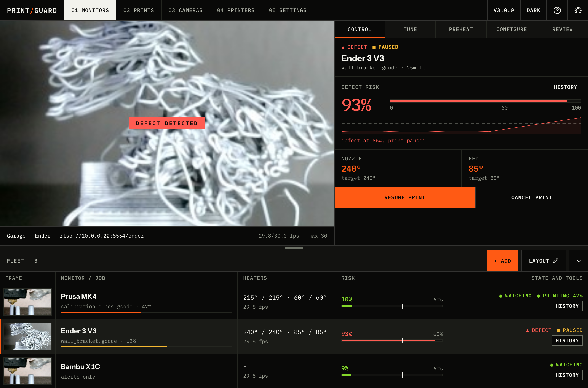
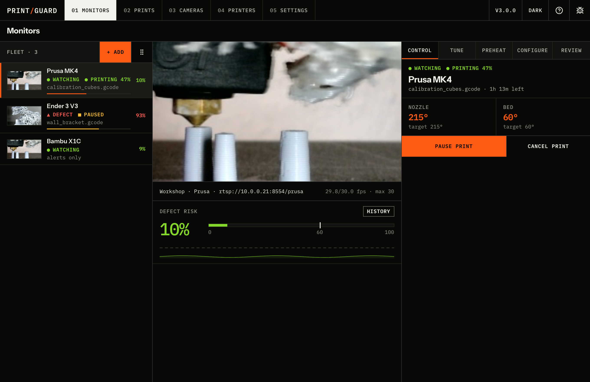
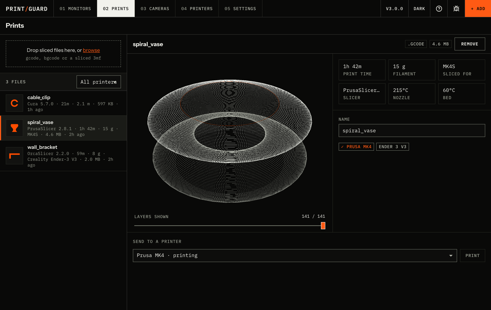
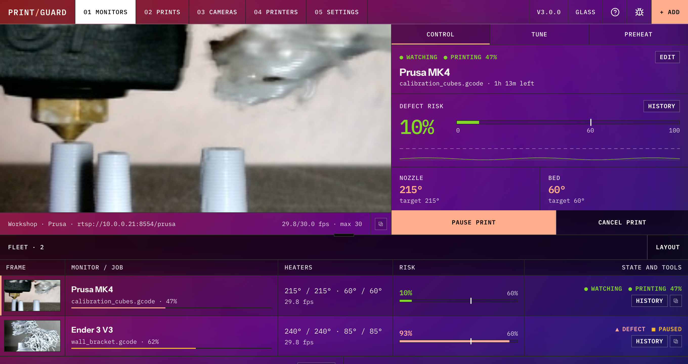
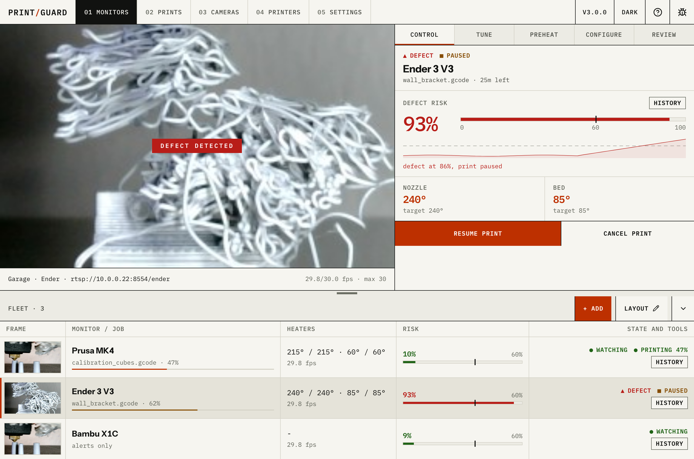
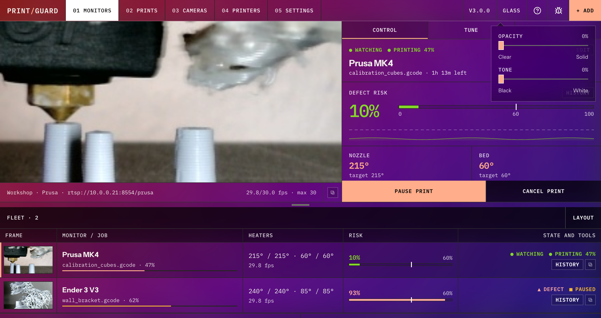
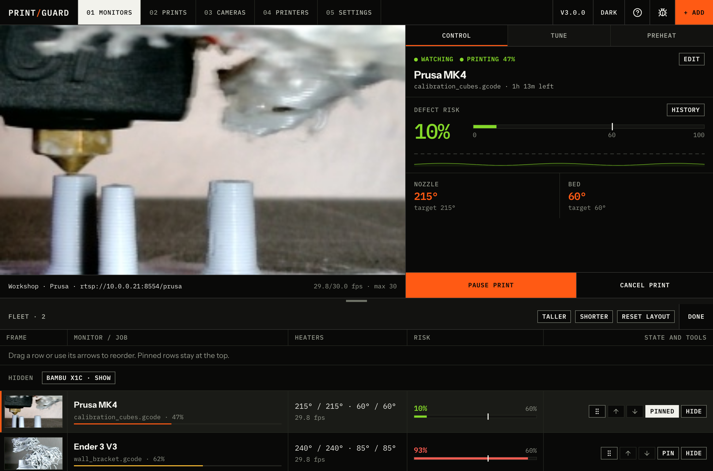

<div align="center">

# PrintGuard

Self-hosted 3D print failure detection that runs on your own hardware, pauses the print when something goes wrong and sends you a snapshot alert.

[](https://github.com/oliverbravery/PrintGuard/releases/latest)
[](https://github.com/oliverbravery/PrintGuard)
[](LICENSE.md)
[](https://github.com/oliverbravery/PrintGuard/pkgs/container/printguard)
[](https://github.com/sponsors/oliverbravery)

[Quick start](#quick-start) · [Features](#what-it-does) · [Documentation](#documentation) · [Troubleshooting](docs/troubleshooting.md) · [Contributing](CONTRIBUTING.md) · [Sponsor](#sponsor)

</div>

PrintGuard runs a lightweight vision model locally on whatever machine you put next to your printer, watching your camera feeds for failures like spaghetti, detached parts and layer splits. If a defect stays on screen for long enough, it pauses or cancels the print through your printer server and sends a snapshot straight to your phone.

There is no cloud account, no subscription and no paywall. Everything runs on your own hardware, so your camera frames never leave your network unless you send alert snapshots to your own notification channels or MQTT broker, or choose to [share frames after a print](docs/feedback.md) to help me train better models.

The detection models are my own, trained in [Edge-FDM-Fault-Detection](https://github.com/oliverbravery/Edge-FDM-Fault-Detection). PrintGuard 3.0 ships with three options, and Settings charts them side by side against Obico's Spaghetti Detective (the only other open model). Tested on 1,534 curated frames from 30 PrintGuard hubs that none of the models had ever seen before:

| | Standard | Light | Legacy | Spaghetti Detective |
|---|---|---|---|---|
| Failed prints caught | 10 of 20 | 5 of 20 | 1 of 20 | 3 of 20 |
| Good prints alarmed | 1 of 70 | 1 of 70 | 1 of 70 | 0 of 70 |
| Size | 12.9 MB | 9.5 MB | 4.8 MB | 193 MB |
| One CPU thread, M1 Max | 28.7 ms | 11.2 ms | 5.3 ms | 360 ms |

**Standard** is the default and the best all-rounder. **Light** is there if you are running on a slower machine or watching several cameras at once, and **Legacy** keeps the original ShuffleNetV2 model from my [university dissertation](https://github.com/oliverbravery/Edge-FDM-Fault-Detection/blob/main/dissertation.pdf) available if you want it.



## What it does

| | |
|---|---|
| Detect | Runs locally on your CPU, GPU or NPU and shares one model fairly across as many cameras as your hardware can keep up with. Automatically goes on standby when a linked printer is idle |
| Act | Pauses or cancels failing prints through OctoPrint, Klipper, Creality, Elegoo, Prusa, Bambu Lab or Ultimaker |
| Alert | Sends snapshot alerts over ntfy, Pushover, Telegram, Discord or desktop notifications, and warns you if a camera drops out, a feed freezes or a printer stops responding |
| Control | Shows live temperatures and print progress, lets you preheat with a single click, and gives you a print library with a 3D toolpath viewer to start jobs on idle printers |
| Tune | Gives every monitor its own alert threshold, consecutive frame count and cooldown, backed by risk score history and alert snapshots so you can dial it in properly |
| Automate | Connects to Home Assistant over MQTT discovery and exposes a REST API and MCP server protected by scoped tokens |
| Extend | Supports sandboxed JavaScript plugins from the built-in catalogue, with strict per-plugin permissions |
| Make it yours | Includes Light, Dark and Glass themes plus a custom theme editor, a rearrangeable layout and a responsive UI that works properly on a phone |

## Quick start

PrintGuard runs as a **hub**, a self-contained server on a machine you own that keeps watching your printers even when every browser tab is closed. The macOS/Windows desktop app and the Docker container run the exact same hub under the hood, so just pick whichever fits your setup.

### Desktop app for macOS and Windows

If you want to run PrintGuard on the computer next to your printer without touching Docker or a terminal, use the desktop app. It sits quietly in your menu bar or system tray, so closing the window leaves your printers watched, and you can open the dashboard from your phone at `http://<computer>:8000`. The macOS build is for Apple silicon.

<div align="center">

[](https://github.com/oliverbravery/PrintGuard/releases/latest/download/PrintGuard-macos-arm64.dmg)
&nbsp;
[](https://github.com/oliverbravery/PrintGuard/releases/latest/download/PrintGuard-windows-x64.zip)

</div>

Turn on **Start at login** from the tray menu and you can leave it running in the background.

> [!NOTE]
> The macOS app is signed and notarised. The Windows build is unsigned for now, so Windows SmartScreen will warn you on first launch: click **More info** and then **Run anyway**. On Linux, use the [Docker hub](#docker-for-an-always-on-server-or-nas) instead.

### Docker for an always-on server or NAS

Everything (including MediaMTX for video streaming) is bundled into a single container:

```bash
docker run -d --name printguard --restart unless-stopped \
  -p 8000:8000 -p 8554:8554 \
  --add-host host.docker.internal:host-gateway \
  -v printguard:/data \
  ghcr.io/oliverbravery/printguard
```

Once it's up, open `http://<host>:8000` in your browser.

| Platform | How |
|---|---|
| Unraid | Search for **PrintGuard** in Community Applications (or import the [template](templates/printguard.xml)) and install straight from the UI |
| Docker Compose | `curl -fsSLO https://raw.githubusercontent.com/oliverbravery/PrintGuard/main/docker-compose.yaml && docker compose up -d` |
| Anything else | Use the `docker run` command above. Multi-arch images are built for `amd64` and `arm64`, including Raspberry Pi 4 and 5 |

For GPU image tags, extra ports for push streams or passing through a USB webcam, see [hardware](docs/hardware.md), [deployment](docs/deployment.md) and [cameras](docs/cameras.md).

> [!WARNING]
> PrintGuard does not have built-in user logins, so never port-forward it directly to the internet. If you want remote access, see [exposing a hub safely](#exposing-a-hub-safely).

### First five minutes

A short walkthrough opens the first time you visit the dashboard, and a setup checklist stays on the main page until you add your first monitor.

1. Add a camera on the **Cameras** page and crop it tightly around the print bed.
2. Add your printer on the **Printers** page and run **Test connection**.
3. Set up an alert channel under **Settings** -> **Alerts**.
4. Click **+ Add** at the top of the fleet list to create a monitor linking that camera and printer, choose whether a defect alerts, pauses or cancels, and switch on push notifications.

## Printers and cameras

Add your printer once and link it to a monitor. If your printer server exposes a webcam, PrintGuard automatically picks it up and registers it as a camera for you.

| | Supported |
|---|---|
| Print services | OctoPrint, Klipper (Moonraker), Creality, Elegoo, Prusa (PrusaLink), Bambu Lab, Ultimaker |
| Cameras | Printer webcams, USB webcams plugged into the hub, RTSP, RTMP, HTTP/MJPEG, WHEP and your phone or laptop camera |
| Alerts | ntfy, Pushover, Telegram, Discord and native desktop notifications (in the desktop app) |

Creality, Bambu Lab, Elegoo, Prusa and Ultimaker printers all talk to PrintGuard over their local network APIs, never through vendor clouds. See [docs/printers.md](docs/printers.md) for printer setup, [docs/cameras.md](docs/cameras.md) for camera sources and [docs/notifications.md](docs/notifications.md) for alert channels.

## Tune every monitor

Your fleet sits in a list down the side, and clicking a monitor brings up its live feed, defect score and printer controls beside it. In the **Tune** tab you can set each monitor's own alert threshold, how many flagged frames in a row it takes before acting, its cooldown period, and whether it should just alert, pause or cancel.

Every monitor also has a **History** page showing its risk score over the last hour, 6 hours, 24 hours or all saved data, alongside a snapshot of every alert that fired. That makes it easy to adjust your thresholds based on what your actual camera sees rather than guessing. When a print finishes, you can also review a handful of its frames and [send them to me](docs/feedback.md) to help train future versions of the model.



On the **Cameras** page you can rotate each feed, crop it down to the area of the bed you want the model to focus on, and tweak brightness, contrast and sharpness. You can also lower a camera's detection rate to ease CPU load on a busy host. [docs/monitoring.md](docs/monitoring.md) walks through what each setting does and how to pick sensible values.

## Print library

Drop sliced files onto the **Prints** page and PrintGuard draws the toolpath right in your browser before uploading, letting you rename the job and adjust first-layer nozzle or bed temperatures on the fly. Clicking a saved file opens an interactive 3D toolpath viewer with a layer slider, estimated print time and filament usage read straight from the slicer metadata.



Tag a file with the printers it was sliced for so you can't accidentally send it to the wrong machine, and PrintGuard will only let you start a print when the printer is idle (showing you the bed camera first so you can check the plate is clear). OctoPrint, Klipper, Creality, Elegoo and Ultimaker accept `.gcode`, PrusaLink also accepts `.bgcode` and Bambu Lab accepts sliced `.3mf` files. See [docs/printers.md](docs/printers.md#sending-prints) for the details.

## Home Assistant

Point PrintGuard at your MQTT broker under **Settings** -> **Home Assistant** and every monitor shows up automatically via MQTT discovery, complete with a defect binary sensor, live risk score, latest snapshot and an **Enabled** toggle. If a printer is linked, you also get its status, print progress, temperatures and **Pause**, **Resume** and **Cancel** buttons. Control goes both ways, so your Home Assistant automations can drive PrintGuard directly. [docs/api.md](docs/api.md#home-assistant) lists every entity.

## MCP and the REST API

If you want to wire PrintGuard into your own scripts or let an AI agent keep an eye on your printers, point an MCP client at `https://<host>/mcp/` or talk to the REST API at `/api/v1`. Both let you check printer and camera status, grab live camera frames, score an image on demand, pause/resume/cancel prints, set heater temperatures and kick off prints from the library.

Access is controlled with scoped bearer tokens that you generate in Settings: `read` covers status, frames and the library, `control` adds printer actions and `manage` adds full configuration. `GET /api/health` is public and returns readiness and version info. See [docs/api.md](docs/api.md) for the full reference.

## Plugins

PrintGuard has a sandboxed JavaScript plugin system so extra features don't bloat the core app. You can install reviewed plugins straight from the built-in catalogue in Settings, or load your own from a GitHub repo or `.zip` file. Every plugin installs switched off and shows you every permission it wants (and why) before you enable it.

Four official plugins ship in the catalogue:

- **Picture in picture** floats a live camera feed above your other windows
- **Alert sounds** plays a sound effect the moment a defect is detected
- **Progress reports** sends periodic print progress updates to your alert channels
- **Spotify** puts the album art of whatever you're listening to behind the dashboard



[docs/plugins.md](docs/plugins.md) explains how installing and permissions work. Writing a plugin needs no build step and no external dependencies; [docs/plugin-development.md](docs/plugin-development.md) has the full API.

## Themes and layout

Pick between **System**, **Light**, **Dark** and **Glass**, or build your own colour palette in the theme editor. Themes live on the hub, so every browser or phone you open it from stays in sync.

<table>
<tr>
<td width="50%"></td>
<td width="50%"></td>
</tr>
<tr>
<td align="center"><b>Light</b></td>
<td align="center"><b>Glass</b></td>
</tr>
</table>

Click the six-dot button above the fleet list to drag monitors into any order (or move them with the arrow buttons), pin important ones to the top and hide any you don't want to see. On a phone, the fleet fills the screen and tapping a monitor opens its full view.



The dashboard is responsive across phones and tablets, works cleanly with a keyboard and screen reader, and meets WCAG 2.2 AA contrast. If you ever forget what something does, hit the **?** button in the top bar for a built-in guide.

## Hardware acceleration

A Raspberry Pi 4 can run all three models on its CPU without any extra hardware. PrintGuard ships every model for both [LiteRT](https://github.com/google-ai-edge/LiteRT) and [ONNX Runtime](https://onnxruntime.ai/), benchmarks both on startup and automatically sticks with whichever is faster on your machine. When ONNX Runtime wins, it picks the best accelerator available: Core ML on macOS, Windows ML on Windows 11 24H2 or newer, OpenVINO on Intel GPUs/NPUs and TensorRT on NVIDIA.

If you're running Docker on a machine with a GPU, there are two dedicated image tags:

```bash
ghcr.io/oliverbravery/printguard:latest-intel    # with --device /dev/dri
ghcr.io/oliverbravery/printguard:latest-nvidia   # with --gpus all
```

See [docs/hardware.md](docs/hardware.md) for which tag to pull, what each provider needs and how to pin a specific runtime.

## Exposing a hub safely

Anyone who can reach PrintGuard can see your cameras and pause or cancel your prints, so never expose port 8000 directly to the internet. Put an identity layer in front of it first. [docs/deployment.md](docs/deployment.md) walks through Tailscale (which is what I use myself), Cloudflare Tunnel with Access, and `oauth2-proxy`, plus a short hardening checklist.

## Updates and support

The hub checks GitHub releases once a day with no telemetry, and when a new version drops the version badge in the top bar turns into an update button with the full changelog inside (on phones, you'll find it under **Settings** -> **Updates**).

If you hit a bug, click the bug icon in the top bar to send me an anonymous report with redacted logs, or download the exact same diagnostics zip yourself to inspect or attach to a GitHub issue. [docs/troubleshooting.md](docs/troubleshooting.md) also covers common issues and fixes.

## Documentation

| Page | Covers |
|---|---|
| [Printers](docs/printers.md) | Connecting each printer service, sending prints, temperatures and preheating |
| [Cameras](docs/cameras.md) | Printer webcams, stream URLs, USB cameras and streaming from a browser |
| [Monitoring](docs/monitoring.md) | Thresholds, defect actions, cropping cameras and reading risk history |
| [Notifications](docs/notifications.md) | Alert channels, what gets sent and the fault grace period |
| [Training frames](docs/feedback.md) | Sharing labelled frames after a print, what gets sent and the daily limits |
| [Hardware](docs/hardware.md) | Detection models, Docker image variants, runtimes and GPU/NPU acceleration |
| [Deployment](docs/deployment.md) | Safe remote access, hardening, environment variables and backups |
| [API & MCP](docs/api.md) | REST API, MCP server, Home Assistant MQTT and scoped tokens |
| [Plugins](docs/plugins.md) | Installing plugins, permissions and the sandbox |
| [Writing plugins](docs/plugin-development.md) | The plugin API, both sandboxes and publishing to the catalogue |
| [Architecture](docs/architecture.md) | How the engine, protocol, platform contract, scheduler and watchdog fit together |
| [Troubleshooting](docs/troubleshooting.md) | Common symptoms, fixes and how to grab logs |
| [Changelog](CHANGELOG.md) | Release notes for every version |

## Contributing

If you want to run PrintGuard from source, run the test suite or add a new printer integration or notification channel, check out [CONTRIBUTING.md](CONTRIBUTING.md). Issues, bug reports and pull requests are always welcome.

## Sponsor

PrintGuard is free, open source under GPL-2.0 and will never lock features behind a paywall. If it has saved a few of your prints and you'd like to support it, [GitHub Sponsors](https://github.com/sponsors/oliverbravery) helps cover the hosting costs and the hardware I buy to test integrations on. One-off and monthly contributions are both hugely appreciated.

## Licence

[GPL-2.0-only](LICENSE.md).
