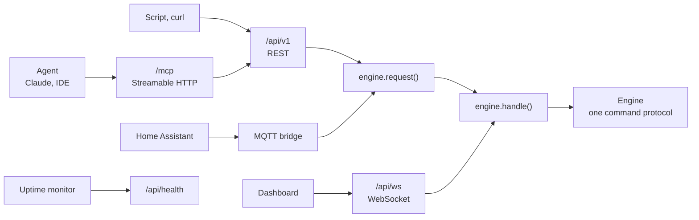

<div align="center">

# API and MCP

[Docs](README.md) · [Printers](printers.md) · [Cameras](cameras.md) · [Monitoring](monitoring.md) · [Notifications](notifications.md) · [Training frames](feedback.md) · [Hardware](hardware.md) · [Deployment](deployment.md) · **API & MCP** · [Plugins](plugins.md) · [Writing plugins](plugin-development.md) · [Architecture](architecture.md) · [Troubleshooting](troubleshooting.md)

</div>

PrintGuard exposes its engine to scripts, AI agents and Home Assistant. Every surface sends the exact same commands as the dashboard, so none of them can drift out of sync with the UI.

- [Surfaces](#surfaces)
- [Health and version](#health-and-version)
- [Authentication and scopes](#authentication-and-scopes)
- [REST API](#rest-api)
- [MCP server](#mcp-server)
- [Home Assistant](#home-assistant)
- [The resource model](#the-resource-model)
- [Reading detection state](#reading-detection-state)

## Surfaces



| Surface | Endpoint | Auth |
|---|---|---|
| MCP server | `/mcp` (Streamable HTTP) | Bearer token |
| REST API | `/api/v1` | Bearer token |
| Health probe | `/api/health` | None |
| Home Assistant | Your MQTT broker | Broker credentials |

MCP tools are generated automatically from the REST routes and call them in-process (the three image tools read the engine directly so they can return native image content).

## Health and version

`GET /api/health` is an unauthenticated readiness endpoint for Docker healthchecks and uptime monitors. Responses are never cached and include the running version:

```json
{"ok": true, "version": "X.Y.Z"}
```

It returns `200 OK` as soon as the engine has started. Camera, printer and alert health live behind the authenticated API and intentionally don't affect this check.

## Authentication and scopes

Because PrintGuard has no built-in user login, put a proxy or VPN in front of it first (see [Deployment](deployment.md)). On top of that, the API and MCP server use scoped bearer tokens so you can limit what a script or AI agent is allowed to touch.

Scopes are cumulative:

| Scope | What it allows |
|---|---|
| `read` | Read monitor, printer and camera status, grab live frames, view risk history and alert snapshots, read recent events, inspect the print library and classify an uploaded image |
| `control` | Everything in `read`, plus pause, resume, cancel, preheating heaters and starting prints from the library |
| `manage` | Everything in `control`, plus adding, editing and deleting cameras, printers, monitors and print files, changing settings, running connection/alert tests and discovering cameras |

Create tokens under **Settings -> API and MCP**. Give it a name, pick a scope and click **Generate**. The token (prefixed with `pg_`) is shown only once:

```http
Authorization: Bearer pg_Zr8...agent
```

| Token state | Behaviour |
|---|---|
| No tokens created (default) | Read endpoints stay open to whoever can reach the hub; `control` and `manage` stay locked |
| At least one token exists | Every API and MCP request requires a valid bearer token matching the endpoint's scope. MCP returns `401` before opening a session and hides tools outside the token's scope. `/api/v1/openapi.json` stays public since it contains only the API schema and none of your hub data |

> [!IMPORTANT]
> PrintGuard only stores a hash of each token alongside its first 10 characters as a hint, so lost
> tokens can't be recovered. Revoke the old one (takes effect immediately) and generate a new one.
> No REST route or MCP tool can mint or revoke tokens, so even a `manage` agent can't escalate its
> own privileges (note that a plugin granted [`tokens`](plugins.md#permissions) can). Always use
> HTTPS so bearer tokens never cross the wire in plain text.

## REST API

Base path: `/api/v1`. Everything uses JSON except live camera frames and alert snapshots (`image/jpeg`), print file downloads, and raw binary bodies uploaded to `/classify` or `/prints`. The OpenAPI schema lives at `/api/v1/openapi.json` (there are no hosted Swagger/ReDoc UI pages so the hub doesn't pull assets from external CDNs).

Creating or deleting a camera, printer or monitor returns the updated list (as do deleting a print file and `/cameras/refresh-printers`). Every other mutation returns the single modified resource (for `/prints/{id}/start`, that's the printer). The two test endpoints return the engine's `printer_test` or `notify_test` event directly (`event` and `req_id` included).

| Status | Meaning |
|---|---|
| `400` | The engine rejected the command: unknown ID on update/delete/start, linking a monitor to a non-existent camera or printer, an invalid enum/value like `rotation: 45`, an unsupported print file, an unreadable image, or a printer command timing out (`did not answer within 15 s, so check whether it took the command`) |
| `401` | Missing or invalid bearer token (once at least one token exists; when no tokens exist, read routes succeed and control/manage routes return `403`) |
| `403` | Token scope is too narrow for this endpoint, or host/origin check failed |
| `404` | Read of an unknown ID, or printer action/heat targeting an unknown printer |
| `413` | Image over 32 MB or print file over 512 MB |
| `422` | Malformed request body, including `NaN`/`Infinity` anywhere in JSON (including inside printer/notifier configs, `mqtt` or preheat presets). For `/prints` query parameters `nozzle`/`bed`, invalid values return `400` |
| `503` | `/classify` queue is full (2 scoring + 8 waiting); includes `Retry-After: 1` |
| `504` | Engine didn't finish within the command timeout |

Unknown fields in request bodies are ignored, `null` leaves existing fields untouched, and out-of-range numeric settings are clamped rather than rejected. Strings or booleans passed where numbers are expected return `422` (never coerced). Three things are strictly rejected instead of clamped: heater targets outside 0 to 350°C (nozzle) or 0 to 150°C (bed), an `mqtt` port outside 1 to 65535 (or non-integer), and enabling `mqtt` without a `host`. Printer configs, notifier configs and `mqtt` return `400` if a value doesn't match the field's declared type (everything is text except `mqtt.enabled` and `mqtt.tls`), or if `mqtt` contains unknown keys.

Command timeouts are enforced by the engine identically across REST, MCP and plugins:

| Operation | Timeout |
|---|---|
| Printer action or heater target | 15 s (25 s for Creality; 105 s for Elegoo since a Centauri Carbon 2 waits until reheated to confirm resume) |
| Adding a camera | 40 s (waiting for first frame) |
| `/cameras/refresh-printers` | 115 s (printers' cameras open sequentially) |
| Changing `model` or `inference_runtime` via `PATCH /settings` | 85 s (draining in-flight frames and loading/benchmarking) |
| Uploading a print file | 120 s (after body finishes streaming) |
| `/prints/{id}/start` | 600 s (uploading to the printer) |
| Everything else, including risk history | 15 s |

The dashboard's WebSocket has no timeout and waits as long as a command takes.

Like the dashboard, `/api/v1` and `/mcp` enforce [host and origin checking](deployment.md#host-and-origin-checking): external domains must be listed in `PRINTGUARD_ORIGINS`, and browser requests carrying an `Origin` header from another site receive `403`. Scripts, `curl` and AI agents send no `Origin` header and work normally.

<details open>
<summary><b>Read</b></summary>

| Method | Path | Description |
|---|---|---|
| `GET` | `/state` | Full hub snapshot: cameras, printers, monitors, prints, print reviews, plugins, settings, stats, update info, form metadata and `startup_warnings` (problems spotted at boot like a skipped GPU, reset setting or dropped record, kept until restart). See [Architecture](architecture.md#the-protocol) and [The resource model](#the-resource-model) |
| `GET` | `/monitors` | List monitors with their linked camera, printer and latest alert |
| `GET` | `/monitors/{id}` | Single monitor |
| `GET` | `/monitors/{id}/history` | [Risk history](monitoring.md#risk-history): one-minute buckets (each with `watched` seconds), alert log, snapshot index and summary stats (`watch_min` excludes gaps over 30 s) |
| `GET` | `/monitors/{id}/snapshots/{snap_id}` | Alert snapshot JPEG (`404` if missing or deleted, without leaking paths) |
| `GET` | `/printers` | List printers with status, progress and active job |
| `GET` | `/printers/{id}` | Single printer |
| `GET` | `/cameras` | List cameras with FPS stats, health and latest classification |
| `GET` | `/cameras/{id}` | Single camera |
| `GET` | `/cameras/{id}/frame` | Latest camera frame as `image/jpeg` (`404` if camera is on standby or offline) |
| `POST` | `/classify` | Score any supplied JPEG or PNG (up to 32 MB / 50 MP) without registering a camera. Wide images are tiled into overlapping squares and return the highest-risk score. Over 32 MB returns `413`; over 50 MP or non-JPEG/PNG returns `400`. Runs up to 2 concurrently (shared with MCP), queues 8 more, returns `503` past that |
| `GET` | `/prints` | List print library files with format, size, printer tags and slicer metadata |
| `GET` | `/prints/{id}` | Single print file |
| `GET` | `/prints/{id}/file` | Download the raw stored print file |
| `GET` | `/events` | Last 100 alerts, warnings and errors (rejected commands go only to their caller; printer status lives in `/printers`) |

</details>

<details>
<summary><b>Control</b></summary>

| Method | Path | Description |
|---|---|---|
| `POST` | `/printers/{id}/action` | `{"action": "pause" \| "resume" \| "cancel"}` |
| `POST` | `/printers/{id}/heat` | `{"nozzle", "bed"}` in °C (at least one required; `0` turns heater off). Values over 350/150 or unsupported printers return `400`; non-numbers return `422` |
| `POST` | `/prints/{id}/start` | `{"printer_id"}`: uploads and starts the print. Rejected if printer isn't idle, doesn't support the format, or isn't in the file's `printer_ids` tags |

</details>

<details>
<summary><b>Manage</b></summary>

| Method | Path | Description |
|---|---|---|
| `POST` | `/monitors` | Create a monitor linking a camera and optional printer |
| `PATCH` | `/monitors/{id}` | Update a monitor |
| `DELETE` | `/monitors/{id}` | Delete a monitor |
| `POST` | `/printers` | Add a printer (fails naming any blank required field) |
| `PATCH` | `/printers/{id}` | Update a printer (`config` replaces stored config while [preserving omitted secrets](#the-resource-model)) |
| `DELETE` | `/printers/{id}` | Delete a printer |
| `POST` | `/printers/test` | `{"provider", "config"}` connection test. Sent as-is without filling saved secrets |
| `POST` | `/cameras` | Add a camera (rejects duplicates or streams that produce no frames; see [Cameras](cameras.md#stream-urls)) |
| `PATCH` | `/cameras/{id}` | Update a camera |
| `DELETE` | `/cameras/{id}` | Delete a camera (refused for printer-owned or deployment-declared cameras) |
| `POST` | `/cameras/discover` | Scan for unregistered local devices and pushed MediaMTX streams |
| `POST` | `/cameras/refresh-printers` | Re-scan registered printers for newly exposed webcams |
| `POST` | `/prints?filename=` | Upload a sliced file (up to 512 MB raw body). Optional query params: `name`, comma-separated `printer_ids`, first-layer `nozzle` and `bed`. Rejects empty files or `.3mf` files with unsupported compression |
| `PATCH` | `/prints/{id}` | Rename a print or update its `printer_ids` tags |
| `DELETE` | `/prints/{id}` | Delete a print file |
| `PATCH` | `/settings` | Update `notifiers`, `mqtt`, `model`, `inference_runtime`, `preheat`, `fault_grace_s`, `update_check` or `feedback`. Each field replaces its stored value while [keeping omitted secrets](#the-resource-model). Wrong types return `422`. Dashboard-only settings (theme, layout, plugin catalogue) aren't exposed here |
| `POST` | `/notifiers/test` | `{"provider", "config"}` sends a test alert (fills blank secrets from the saved channel [for the same address](#the-resource-model)) |

</details>

Payload shapes for manage routes (every field is optional on `PATCH`):

| Resource | Fields |
|---|---|
| Monitor | `name`, `camera_id`, `printer_id` (send `""` to unlink), `enabled`, `threshold`, `consecutive`, `cooldown_s`, `on_defect`, `notify`, `pause_on_camera_loss`. Defaults and ranges in [Monitoring](monitoring.md#monitor-settings) |
| New camera | `name` and `source` (`{"kind": "url", "url"}` for streams, or an object returned by `/cameras/discover`) |
| Camera update | `name`, `brightness`, `contrast`, `sharpness`, `rotation` (`0`, `90`, `180` or `270`), `detect_fps`, `crop` (`{"x", "y", "w", "h"}` as fractions 0 to 1; full frame clears it) |
| Printer | `name`, `provider`, `model`, `config` |
| Print file update | `name`, `printer_ids` |
| Settings | `notifiers` (keyed by channel ID), [`mqtt`](#home-assistant), `model` (`standard`, `light`, `legacy`), `inference_runtime` (`auto`, `litert`, `onnx`), `preheat` (list of `{"name", "nozzle", "bed"}`), `fault_grace_s` (30 to 900, clamped), `update_check` (boolean), `feedback` (`ask` or `off`) |

Monitor thresholds/streaks/cooldown and camera brightness/contrast/sharpness/detect_fps/crop clamp out-of-range numbers and still return `200`; invalid `rotation` and out-of-range heater targets are rejected.

Check `integrations` and `notifiers` inside `GET /state` for the exact schema of every printer service and alert channel.

```bash
# List all printers
curl -H "Authorization: Bearer $TOKEN" https://host/api/v1/printers

# Grab the latest camera frame
curl -H "Authorization: Bearer $TOKEN" https://host/api/v1/cameras/$CAM/frame -o frame.jpg

# Pause a print
curl -X POST -H "Authorization: Bearer $TOKEN" -H "Content-Type: application/json" \
  -d '{"action":"pause"}' https://host/api/v1/printers/$PRINTER/action

# Preheat for PLA
curl -X POST -H "Authorization: Bearer $TOKEN" -H "Content-Type: application/json" \
  -d '{"nozzle":210,"bed":60}' https://host/api/v1/printers/$PRINTER/heat

# Classify an image on demand (no camera needed)
curl -X POST -H "Authorization: Bearer $TOKEN" -H "Content-Type: image/jpeg" \
  --data-binary @frame.jpg https://host/api/v1/classify
# -> {"prediction":"success","defect_score":0.08}

# Upload a sliced file tagged for one printer and start it
curl -X POST -H "Authorization: Bearer $TOKEN" -H "Content-Type: application/octet-stream" \
  --data-binary @benchy.gcode "https://host/api/v1/prints?filename=benchy.gcode&printer_ids=$PRINTER"
curl -X POST -H "Authorization: Bearer $TOKEN" -H "Content-Type: application/json" \
  -d "{\"printer_id\":\"$PRINTER\"}" https://host/api/v1/prints/$PRINT/start
```

## MCP server

Endpoint: `https://<host>/mcp/` (Streamable HTTP, using the same bearer token; `/mcp` without a trailing slash works identically). Tools map 1:1 to REST operations by `operation_id`, sharing the same payloads, responses and error messages. Clients only see tools permitted by their token's scope (or `read` tools if no tokens exist yet). Once any token is created, missing/invalid tokens get `401` before a session opens. Request bodies cap at 42 MB (enough for a base64-encoded 32 MB image), returning `413` above that; at most 2 large (>64 KB) bodies read concurrently with 8 queued and `503` past that.

Arguments containing `NaN` or `Infinity` return a tool error, as do any REST errors (forwarding the status code and reason).

| Scope | Tools |
|---|---|
| `read` | `get_state`, `list_monitors`, `get_monitor`, `get_monitor_history`, `list_printers`, `get_printer`, `list_cameras`, `get_camera`, `list_prints`, `get_print`, `recent_events` |
| `read` | `get_camera_frame`, `get_monitor_snapshot` (return native image content an AI agent can view directly; fail wherever their REST route returns `404`) |
| `read` | `classify_frame` (scores a base64 JPEG/PNG up to 32 MB / 50 MP with no registered camera needed) |
| `control` | `control_printer`, `heat_printer`, `start_print` |
| `manage` | `add_monitor`, `update_monitor`, `remove_monitor`, `add_printer`, `update_printer`, `remove_printer`, `test_printer`, `add_camera`, `update_camera`, `remove_camera`, `discover_cameras`, `refresh_printer_cameras`, `update_print`, `remove_print`, `update_settings`, `test_notifier` |

Uploading and downloading print files stay REST-only because of their raw binary bodies.

Example MCP client config:

```json
{
  "mcpServers": {
    "printguard": {
      "url": "https://host/mcp/",
      "headers": { "Authorization": "Bearer YOUR_TOKEN" }
    }
  }
}
```

Or test it interactively with [MCP Inspector](https://github.com/modelcontextprotocol/inspector):

```bash
npx @modelcontextprotocol/inspector
# Transport: Streamable HTTP · URL: https://host/mcp/
# Header: Authorization: Bearer YOUR_TOKEN
```

## Home Assistant

PrintGuard publishes each monitor to your MQTT broker as a Home Assistant device using standard [MQTT discovery](https://www.home-assistant.io/integrations/mqtt/#device-discovery), so you only need Home Assistant's built-in MQTT integration and no custom HACS component.

1. Open **Settings -> Home Assistant**.
2. Switch on **Publish to an MQTT broker** and enter your broker's host.
3. Add username, password and **Use TLS** if your broker requires them.
4. Click **Save broker settings** (if you change the host or port, re-enter the password). Your monitors show up under Home Assistant's MQTT integration straight away.

Leave the port blank to default to `1883` (or `8883` with TLS). Ports must be whole numbers from 1 to 65535, and enabling MQTT without a host is rejected. TLS verifies the broker's certificate against the host's system trust store, so self-signed certificates are rejected.

| Entity | Type | When it appears |
|---|---|---|
| Defect | Binary sensor (`problem`) | Always |
| Defect score | Sensor (0 to 100%) | Always |
| State | Sensor (`watching`, `idle`, `triggered`, `disabled`) | Always |
| Enabled | Switch | Always |
| Snapshot | Camera (updated on each defect alert; skipped if camera has no frame) | Always |
| Printer | Sensor (printer status) | When a printer is linked |
| Progress | Sensor (%) | When a printer is linked |
| Pause, Resume, Cancel | Buttons | When a printer is linked |
| Nozzle, Bed | Temperature sensors (°C) | Once reported by the printer |

Control works both ways, so Home Assistant automations can toggle monitors or pause prints. Defects and printer status changes publish immediately, while score, progress and temperatures publish in increments of 5 so they don't spam Home Assistant's recorder database. Entities automatically go unavailable if PrintGuard stops, the bridge is turned off or the broker disconnects. Up to 8 inbound commands execute in parallel (preserving per-monitor order so one slow printer never blocks another).

The default base topic is `printguard` and the discovery prefix is `homeassistant`; both can be customised in Settings (topics containing `+` or `#` are rejected once with an error). If you connect two PrintGuard hubs to the same broker, give each its own base topic so stopping one doesn't mark the other's entities unavailable.

Deleting a monitor removes its Home Assistant device and clears its retained topics (if the broker was offline at the time, cleanup runs on reconnect as long as PrintGuard hasn't restarted in between). Unlinking a printer removes its printer entities the same way.

Retained topics published by PrintGuard at QoS 1 (`<base>` = base topic, `<prefix>` = discovery prefix):

| Topic | Payload |
|---|---|
| `<base>/status` | `online` or `offline` (also configured as the bridge's LWT) |
| `<prefix>/device/printguard_<monitor id>/config` | Home Assistant MQTT discovery config |
| `<base>/monitor/<monitor id>/state` | JSON read by entities: `enabled`, `watching`, `defect` (`on`/`off`), `state`, `score`, plus `printer_status`, `progress`, `job`, `nozzle_temp`, `bed_temp` when a printer is linked |
| `<base>/monitor/<monitor id>/snapshot` | Latest defect alert JPEG |

Command topics subscribed at QoS 1 (never published to by PrintGuard):

| Topic | Accepted values |
|---|---|
| `<base>/monitor/<monitor id>/enabled/set` | `on`, `true`, `1` to enable; `off`, `false`, `0` to disable |
| `<base>/monitor/<monitor id>/printer_action/set` | `pause`, `resume`, `cancel` |

Unrecognised payloads, unknown monitor IDs and retained messages on command topics are ignored (so the broker doesn't replay an old cancel on reconnect; always publish commands unretained). Any command rejected by the engine surfaces as a dashboard error.

Via REST, MQTT lives under `mqtt` in `PATCH /settings` (`enabled`, `host`, `port`, `username`, `password`, `tls`, `base_topic`, `discovery_prefix`); reads omit `password`.

> [!WARNING]
> Anyone who can publish to your MQTT broker can pause or cancel your prints, so lock down broker
> credentials just as carefully as the dashboard.

## The resource model

Cameras and printers are independent resources managed in their own collections. Monitors link one camera (`camera_id`) and optionally one printer (`printer_id`), holding thresholds and defect actions. Deleting a camera or printer clears its reference on any monitor using it. Printer-owned cameras disappear with their printer; deployment-declared USB cameras stay offline until you remove their `devices:` entry and delete them.

Print files are the third resource, carrying `printer_ids` tags (deleting a printer leaves its ID on tagged files so they don't unexpectedly become untagged and eligible for other printers), `meta` (`slicer`, `time_s`, `filament_g`, `filament_mm`, `printer_model`, first-layer `nozzle` and `bed`, all nullable) and `thumbnail` (MIME type or `null`).

Stored secrets never leave the hub: the dashboard, REST API and MCP server all read the same scrubbed snapshot.

| Field in responses | What's returned |
|---|---|
| Secret adapter fields (API keys, passwords, access codes, bot tokens, ntfy topic URLs, Discord webhooks) | Omitted |
| MQTT password | Omitted |
| `secrets_set` on a printer | List of secret field names currently stored, e.g. `["api_key"]` |
| `secrets_set` in `/state` | Same map for alert channels and MQTT, e.g. `{"notifiers": {"pushover": ["api_token", "user_key"]}, "mqtt": ["password"]}` |
| URLs in configs or camera sources | Stripped of `user:pass@` (up to the last `@`), query values and fragments replaced with `[redacted]`, and path segments that look like UUIDs or 16+ char alphanumeric tokens (like UniFi Protect stream keys) replaced with `[redacted]` |
| Custom `catalogue_url` | Credentials stripped, query values and path replaced with `[redacted]` (default catalogue URL is shown verbatim) |
| Bambu camera access code | Omitted |
| Unknown notifier provider | Omitted |
| Plugin store data and API token list | Omitted from `/state` regardless of token scope |

Sending a config back via `PATCH /printers/{id}` or `PATCH /settings` follows the same secret rules as the dashboard forms:

| What you send | Hub behaviour |
|---|---|
| Secret omitted or blank | Keeps the saved secret |
| Unchanged redacted URL | Keeps the saved URL including hidden credentials |
| Secret set to `null` | Clears the saved secret (e.g. removing an MQTT password) |
| Changed `base_url`, `host`, `port` or `url` without resending secrets (note: blank MQTT port equals `8883` with TLS or `1883` without) | Returns `400` (`send <field> again, since a stored secret is only kept for the address it was saved with`). Since ntfy URLs and Discord webhooks are themselves secrets, a new URL replaces the old one |
| Changed printer `provider` | Drops all old config fields; send the full new config (undeclared fields are dropped) |
| URL still containing `[redacted]` | Returns `400` (`the address has a hidden part, type it in full`) |
| Invalid URL | Returns `400` |

Every printer integration normalises to the same schema:

| Field | Values |
|---|---|
| **Status** | `printing`, `paused`, `idle`, `error`, `offline`, `unknown` |
| **State** | `{"status", "progress" (0-100), "job", "remaining_s", "nozzle", "bed", "outcome"}` under `device_state` (`null` until first read). Heaters are `{"actual", "target"}` in °C or `null`; `remaining_s` is `null` if unavailable. `outcome` is how the last print ended (`finished`, `cancelled` or `error`) while the printer still says so, and `null` where it doesn't. `online` indicates whether the last poll succeeded |
| **Actions** | `pause`, `resume`, `cancel`, plus heater targets via `/heat` |

## Reading detection state

Two small details are worth knowing up front: cameras carry raw per-frame classifications (`last_result`), while per-monitor scores and thresholded alerts live on monitors.

Camera object (`GET /cameras` and `GET /cameras/{id}`):

```jsonc
{
  "id": "1a2b3c4d",
  "name": "Left printer",
  "source": { /* redacted of any access_code / credentials */ },
  "printer_id": "9c41d7e0" | null,
  "declared": false,                                        // passed in by deployment
  "max_fps": 5.0, "target_fps": 2.0, "achieved_fps": 1.9,   // target/achieved are 0 while offline
  "detect_fps": 60.0,                                       // user cap on target_fps
  "inferring": true, "in_use": true, "online": true,        // health flags
  "standby": false,                                         // true when unwatched and unviewed
  "reason": null,                                           // failure reason if offline
  "last_result": {                                          // latest per-frame model output
    "prediction": "success",                                //   "success" | "failure" at 0.5
    "defect_score": 0.08                                    //   model probability of a failing print
  },
  "brightness": 1.0, "contrast": 1.0, "sharpness": 0.0, "crop": null, "rotation": 0
}
```

`last_result` is `null` before the first scored frame, and `prediction` uses the model's fixed 0.5 boundary (no monitor threshold). If scoring a frame fails, the previous `last_result` stays put. Because `last_result` isn't cleared on standby, check `in_use: true` to be sure it's fresh.

Monitor object (`GET /monitors` and `GET /monitors/{id}`):

```jsonc
{
  "id": "5b20a6f3",
  "camera_id": "1a2b3c4d",
  "printer_id": "9c41d7e0" | "",
  "name": "Left printer", "enabled": true,
  "threshold": 0.6,            // defect score cutoff for this monitor
  "consecutive": 3, "cooldown_s": 60,
  "on_defect": "pause",        // "none" | "pause" | "cancel"
  "notify": true,
  "pause_on_camera_loss": false, // pause the printer once a camera fault is announced
  "watching": true,            // actively inferring right now
  "result": {                  // latest score, or null before first inference
    "score": 0.42, "ts": 1720000000.0
  },
  "alert": {                   // populated during an active defect, resets to null below threshold
    "score": 0.82, "action": "pause", "ts": 1720000000.0   // action: "none" | "pause" | "cancel" | "failed"
  }
}
```

`alert.action` is `"failed"` if the printer rejected or missed the pause/cancel. Inside `/state`, `alert` is omitted until the monitor's first alert.

### Prediction against defect score

The 0 to 1 defect score is the [detection model's](hardware.md#detection-models) probability that a frame shows a failing print (0.5 is the boundary). You'll see it in:

- WebSocket `result` events (`{"event": "result", "monitor_id", "camera_id", "score", "prediction", "ms", "ts"}`, where `prediction` uses that monitor's `threshold`, throttled to 5 Hz per monitor)
- `monitor.result` in `/monitors` and full `state` snapshots
- `monitor.alert.score` once an alert triggers
- The MQTT **Defect score** sensor (scaled 0 to 100)

For a quick raw per-camera read, check `last_result.prediction` on `GET /cameras/{id}`. For a monitor's thresholded state, read the monitor object or subscribe to `result` events.
