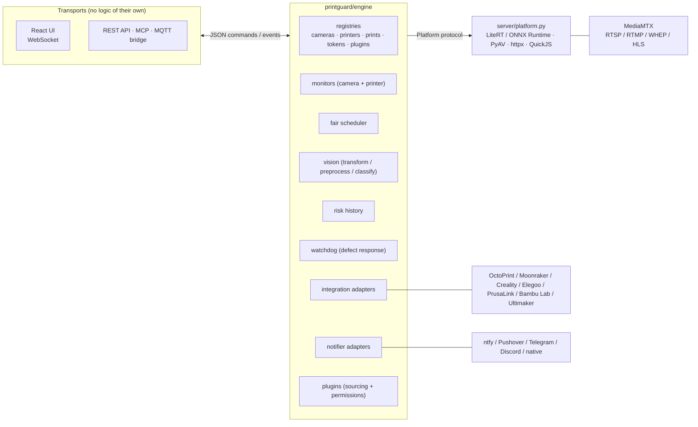
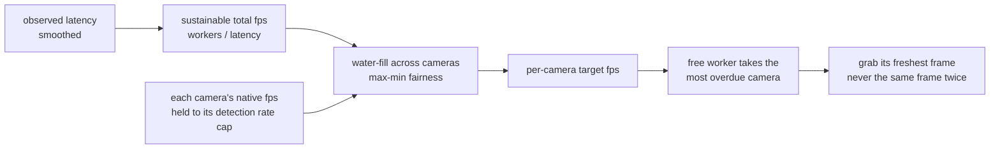
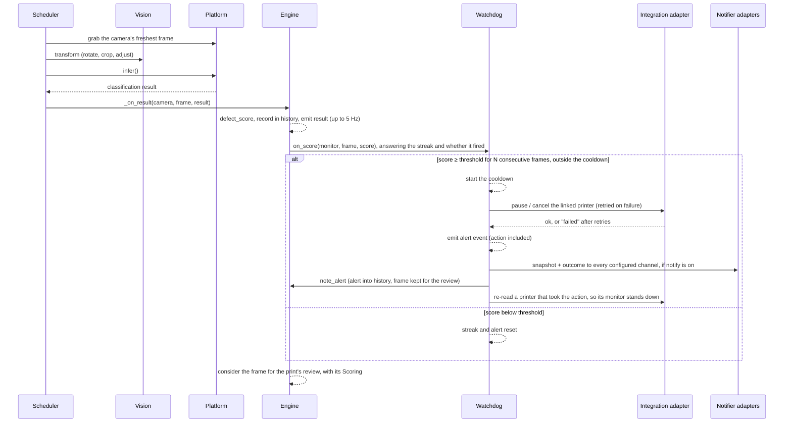
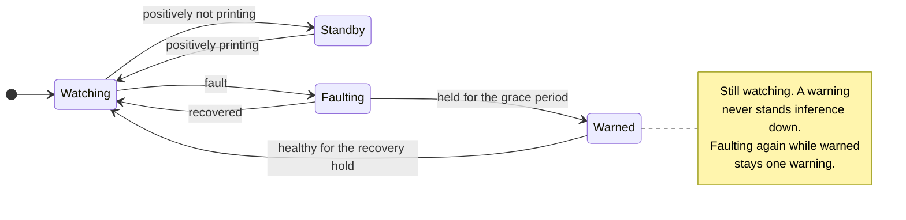
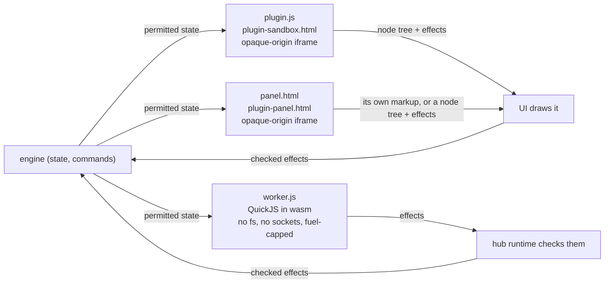

<div align="center">

# Architecture

[Docs](README.md) · [Printers](printers.md) · [Cameras](cameras.md) · [Monitoring](monitoring.md) · [Notifications](notifications.md) · [Training frames](feedback.md) · [Hardware](hardware.md) · [Deployment](deployment.md) · [API & MCP](api.md) · [Plugins](plugins.md) · [Writing plugins](plugin-development.md) · **Architecture** · [Troubleshooting](troubleshooting.md)

</div>

PrintGuard is designed as a modular monolith. One Python engine makes every decision, a hub server hosts it, and the React dashboard, REST API, MCP server and Home Assistant MQTT bridge are thin transports that just send it commands. Everything the engine needs from hardware, the network or disk sits behind a single `Platform` contract so the test suite can simulate the whole engine in memory against a fake. The only exceptions are printer/notifier adapters that wrap a vendor client library (listed under [The platform contract](#the-platform-contract)).

- [The shape of it](#the-shape-of-it)
- [The platform contract](#the-platform-contract)
- [The protocol](#the-protocol)
- [Resources and monitors](#resources-and-monitors)
- [Scheduling inference](#scheduling-inference)
- [The defect pipeline](#the-defect-pipeline)
- [Failing safely](#failing-safely)
- [The programmatic surface](#the-programmatic-surface)
- [Plugins](#plugins)
- [Updates and bug reports](#updates-and-bug-reports)
- [Logging](#logging)
- [Configuration](#configuration)
- [Repository layout](#repository-layout)

## The shape of it



### What the hub serves

[`server/app.py`](../printguard/server/app.py) serves everything from one FastAPI app on a single port:

| Route | Purpose |
|---|---|
| `/api/ws` | Engine WebSocket used by the dashboard |
| `/api/publish/{path}` | WebSocket receiving browser camera streams, remuxed into MediaMTX over RTSP by [`server/publish.py`](../printguard/server/publish.py) |
| `/hls/{path}` | Authenticated proxy to MediaMTX's HLS muxer (`hlsVariant: fmp4`, standard HLS rather than LL-HLS), waking idle cameras when a viewer connects. Enforces same-origin and strips MediaMTX CORS headers so external sites and plugin pages can't pull feeds |
| `/api/health` | Uncached `{ok, version}` readiness check for Docker healthchecks |
| `/api/prints`, `/api/prints/inspect`, `/api/prints/{id}/gcode`, `/api/prints/{id}/thumbnail` | Print library uploads, pre-upload inspection, G-code viewer and thumbnails |
| `/plugins/{id}/{path}` | Custom routes handled by plugin workers |
| `/oauth/callback` | OAuth redirect target for plugins |
| `/api/v1`, `/mcp` | Scoped REST API and MCP server (also at `/mcp/`) |
| `/` | Built React dashboard from `STATIC_DIR` |

All routes enforce [host and origin checking](deployment.md#host-and-origin-checking): unlisted external hosts get `403`, and WebSockets, print `POST`s and `/hls` validate `Origin`.

## The platform contract

[`engine/platform.py`](../printguard/engine/platform.py) declares every runtime service the engine depends on; [`server/platform.py`](../printguard/server/platform.py) implements it on the hub:

| Member | Hub implementation |
|---|---|
| `host` | Platform string (`macos`, `windows`, or `docker` + image variant) |
| `workers` | Concurrent inference worker count measured at model load |
| `inference_device` | Human-readable compute label displayed in the UI |
| `inference_runtime` | The runtime the model actually runs on (`onnx` or `litert`), which `auto` leaves to `configure`. Kept beside every review frame |
| `version` | Installed package version from `pyproject.toml` |
| `update_repo`, `update_asset` | GitHub repo and platform desktop installer asset name |
| `updater` | The desktop app's Velopack `Updater` (`download()`, `install()`), or `None` in the container and in a copy run from source, a disk image or PyInstaller's `dist/` before vpk packs it |
| `plugin_runtime` | `PluginRuntime` instance, or `None` when `PRINTGUARD_PLUGINS=off` |
| `secrets` | Deployment-level secrets outside `state.json` (like `MEDIAMTX_API` credentials) to scrub from logs and reports |
| `files` | `FileStore` implementation |
| `configure(settings)` | Loads `settings.model` on LiteRT, ONNX Runtime or whichever benchmarks faster, measuring worker concurrency. Previous runtimes close cleanly once in-flight frames (including `/classify`) finish |
| `take_notices()` | Drains `Notice` events raised by background hub threads (e.g. skipped GPU accelerator, unavailable/recovered live view). Polled by the engine ticker as `warning` events and read at boot into `startup_warnings` |
| `infer(rgb)` | Runs `vision.preprocess`, executes the active runtime, and returns `vision.classify` |
| `discover_cameras()` | Enumerates V4L2/AVFoundation/DirectShow devices plus pushed MediaMTX paths |
| `open_camera(id, source)` | Returns a `FrameSource` once a first frame arrives (up to `OPEN_WAIT_S` = 25 s). RTSP/RTMP/WHEP pull through MediaMTX; HTTP MJPEG and local devices open via PyAV; `path` reads MediaMTX directly; `bambu` reads A1/P1 port-6000 streams. Unplayable non-video returns `no decoder for this stream`, MediaMTX rejections return `PrintGuard can't use that address`, and errors scrub credentials |
| `release_camera(id, source)` | Closes the reader and deletes its MediaMTX pull path (if a capture thread is blocked inside a device syscall, `open_camera` refuses to double-open until it exits) |
| `http(...)` | `httpx` wrapper. Printer/notifier calls reject redirects (naming the target); plugin calls return 3xx as-is; other calls follow redirects unless they would change method (e.g. POST -> 301/302). Enforces decompressed `max_bytes` and gzip-only encoding for plugin/catalogue/update requests. `public_only` resolves DNS once, blocks private/local IPs and connects directly via [`server/public_network.py`](../printguard/server/public_network.py) |
| `open_socket(url, arrived, public_only)` | Opens a managed `websockets` client for plugins (no redirects, enforces `public_only`, sends `X-PrintGuard-Plugin` header blocked by `PluginGuard` middleware in `server/app.py`) |
| `encode_jpeg(rgb)` / `decode_jpeg(data)` | PyAV JPEG/PNG codec (`encode_jpeg` logs and returns `None` on failure; `decode_jpeg` accepts only JPEG/PNG up to `CLASSIFY_MAX_PIXELS` = 50 MP) |
| `load_state()` / `save_state(state)` | Atomic owner-only writes to `data/state.json`. `save_state` serialises on the caller thread and coalesces disk flushes on a background writer thread (raising one `Notice` per outage; `close()` flushes the final snapshot). Unparseable or structurally broken files rotate to `state.json.corrupt` (`.1`..`.4`) and start empty; unreadable/unmovable files abort startup with owner diagnostics |

Four supporting protocols sit alongside `Platform`:

| Protocol | Members | Hub implementation |
|---|---|---|
| `FrameSource` | `fps`, `online`, `standby`, `grab()`, `set_monitoring(active)`, `close()` | Per-camera PyAV reader thread |
| `FileStore` | `store(key, chunks)`, `read(key)`, `append(key, data)`, `read_range(key, offset, size)`, `remove(key)` | Owner-only files under `data/prints/` (print library, previews, review frames and recordings) |
| `PluginRuntime` | `attach()`, `on_event()`, `reload()`, `serve()`, `authorise()`, `gate_paths()`, `close()` | QuickJS WASI inside wasmtime |
| `Socket` ([`engine/sockets.py`](../printguard/engine/sockets.py)) | `send(text)`, `close()` | `websockets` connection + reader task |

`Notice` holds a message, `recovered` flag and optional camera ID; `Frame` holds the RGB numpy array, monotonic `seq` and capture timestamp.

[`tests/fakes.py`](../tests/fakes.py) implements the full contract in memory with synthetic cameras, canned inference scores and recorded HTTP, letting the test suite simulate outages, streaks and printer pauses in milliseconds.

> [!IMPORTANT]
> Never import from `server/` inside `printguard/engine/`, and keep engine logic free of direct I/O.
> When a new feature needs runtime access, extend `Platform` and implement it in both
> `server/platform.py` and `tests/fakes.py`.

HTTP adapters call `platform.http` so `tests/test_adapters.py` can pin exact requests. Vendor-library adapters manage their own sockets/clients:

| Module | External I/O |
|---|---|
| [`integrations/bambu.py`](../printguard/engine/integrations/bambu.py) | `paho-mqtt` persistent connection, TLS `ftplib` and raw sockets |
| [`integrations/elegoo.py`](../printguard/engine/integrations/elegoo.py) | `pycentauri` connection, DNS lookup and temp upload file |
| [`integrations/creality.py`](../printguard/engine/integrations/creality.py) | Persistent `websockets` connection per printer |
| [`integrations/prusa.py`](../printguard/engine/integrations/prusa.py) | `pyprusalink` with its own `httpx` client |
| [`notifiers/native.py`](../printguard/engine/notifiers/native.py) | `desktop-notifier` and temporary alert JPEG |
| [`logs.py`](../printguard/engine/logs.py) | Rotating log file |

Tests cover these by monkeypatching their private connection hooks (e.g. Bambu's `_pull_report` and `_publish`).

## The protocol

Every command accepted by `Engine._handlers`:

| Group | Commands |
|---|---|
| Cameras | `discover`, `camera.add`, `camera.update`, `camera.remove`, `camera.snapshot` |
| Printers | `printer.add`, `printer.update`, `printer.remove`, `printer.action`, `printer.heat`, `printer.test`, `printer.cameras.refresh` |
| Prints | `print.add`, `print.update`, `print.remove`, `print.start` |
| Monitors | `monitor.add`, `monitor.update`, `monitor.remove` |
| History | `history.get`, `snapshot.get`, `review.get`, `review.add`, `review.send`, `review.retry`, `review.dismiss`, `review.delete`, `recording.frame`, `recording.delete` |
| Plugins | `plugin.install`, `plugin.remove`, `plugin.update`, `plugin.code`, `plugin.catalogue`, `plugin.page`, `plugin.http`, `plugin.socket`, `plugin.call`, `plugin.answer`, `plugin.publish`, `plugin.secrets`, `plugin.oauth`, `plugin.effect` |
| System | `settings.update`, `notify.test`, `notify.send`, `token.create`, `token.remove`, `update.check`, `update.releases`, `update.install`, `report.send`, `report.bundle` |

Commands may pass a `req_id` echoed on the reply. Successful commands broadcast a `state` event (or their dedicated response event for read-only queries); failures return `error`. `FINISHING_COMMANDS` (`camera.remove`, `printer.update`, `printer.remove`, `printer.cameras.refresh`, `monitor.remove`, `print.remove`, `settings.update`, `plugin.install`, `plugin.remove`, `plugin.update`, `plugin.secrets`) run under `Engine._background` so they complete cleanly even if the calling WebSocket closes or times out.

Unknown IDs fail on both update and remove, unknown keys/bad values fail (with numeric monitor/camera bounds clamped, except `printer.heat` which rejects out-of-range targets), `camera.add` requires string device/path/url values, and `settings.update` accepts only `notifiers`, `update_check`, `auto_update`, `skipped_version`, `mqtt`, `theme`, `themes`, `glass`, `layout`, `model`, `inference_runtime`, `catalogue_url`, `fault_grace_s`, `preheat`, `feedback` and `recording_days` (`0`, `3`, `7` or `14`). Adapter configs and `mqtt` validate declared field types (and `mqtt` rejects unknown fields). Empty-message exceptions report their class name.

`printer.test`, `notify.test` and `report.send` succeed as commands and carry `ok` inside their own events. `review.send` and `review.retry` kick off background uploads (refused when `settings.feedback == "off"`), emitting `review_sent` after the closing `state` under the same `req_id`. Re-submitting an uploading print updates its selections without re-sending already-uploaded frames.

Events sent from the engine:

| Event | Contents |
|---|---|
| `state` | Full hub snapshot on connect, after state-mutating commands, after update checks/OAuth sign-in, and on the 1 s ticker. Pure reads (`history.get`, `snapshot.get`, `review.get`, `recording.frame`, `camera.snapshot`) skip saving and emit only their own event. `UNSAVED_COMMANDS` (`discover`, tests, `update.check`, `report.bundle`, plugin requests) skip saving and send their closing `state` only to the caller |
| `result` | Per-monitor score, thresholded verdict and smoothed latency `ms` (throttled to 5 Hz per monitor) |
| `alert` | Sustained defect with score and outcome (`none`, `pause`, `cancel` or `failed`) |
| `warning` | Watchdog faults/recoveries, MQTT outages/recoveries, `take_notices()`, printer webcam errors, alert JPEG encoding failures and dropped transport sinks (`recovered` indicates direction) |
| `device` | Printer status, progress, job, remaining time and heaters when changed or after a printer command |
| `print_started` | Print library file uploaded and started on a printer |
| `discovered` | Response to `discover` |
| `printer_test`, `notify_test`, `history`, `snapshot`, `review`, `recording_frame` | Caller-scoped responses for tests, history, snapshots, review details and recorded scrubber frames |
| `review_sent` | Review upload progress, refusal code and `retry_at` |
| `frame` | Response to `camera.snapshot` (fails if camera is offline/standby) |
| `releases` | Full release notes list for the update dialog |
| `token_created` | Newly minted API token secret (caller-only, never logged) |
| `report_sent`, `report_bundle` | Bug report status and downloadable diagnostics zip |
| `plugin_code`, `plugin_page`, `catalogue`, `plugin_effect` | Plugin source for browser sandboxes, zip page assets, catalogue (with `supported` checked against `min_printguard`) and worker-to-UI effects |
| `plugin_oauth` | OAuth authorisation URL to open in the dashboard |
| `http`, `socket` | Plugin HTTP responses and WebSocket frames |
| `call`, `answer`, `message` | Inter-plugin RPC and pub/sub events |
| `error` | Failures, including failed printer actions and rejected Home Assistant commands |

Fields inside `state_event()` ([`engine/engine.py`](../printguard/engine/engine.py)):

| Field | Contents |
|---|---|
| `host`, `version`, `update`, `installs_updates` | Deployment target, package version, release check status (`null` until checked, with `ready` naming a downloaded release) and whether the hub installs its own updates |
| `cameras`, `printers`, `prints`, `tokens`, `plugins` | Public registry views (no token hashes, no plugin code/secret values, no adapter secrets, no Bambu access codes, URLs redacted) |
| `monitors` | Monitor configs plus `watching`, latest `result` and active `alert` |
| `reviews`, `feedback_hub` | Per-print frame/recording summaries and review statuses, plus the public half of the hub's training token |
| `startup_warnings` | Boot-time warnings (skipped GPU, reset setting, dropped record) retained until restart and toasted once per page load |
| `settings` | Public settings (notifier configs without secrets, MQTT without password, theme/custom themes/glass/layout, model, runtime, catalogue URL, grace period, preheat presets, update check and automatic installs, skipped release, feedback/recording settings) |
| `secrets_set` | Map of stored secret field names for notifiers and MQTT (`{"notifiers": {...}, "mqtt": [...]}`) |
| `stats` | `inference_device`, `infer_ms` and `capacity_fps` |
| `integrations`, `notifiers` | Adapter schemas driving UI forms |
| `plugin_permissions`, `plugin_events`, `plugin_event_permissions`, `plugin_oauth_callback`, `plugin_platforms`, `plugin_assets` | Shared plugin sandbox policy |

[`server/events.py`](../printguard/server/events.py) gives each WebSocket its own queue: ordered events and command responses flush first without dropping, while slow clients conflate ticker `state` snapshots and per-monitor `result` events.

The engine WebSocket runs each command in its own task (up to 16 concurrent per tab) so slow operations like opening a stream never block a pause; non-yielding updates finish immediately in order. Strict JSON is enforced in both directions (`NaN`/`Infinity` rejected), frame size caps at 24 MiB (`WEBSOCKET_MAX_BYTES`) to accommodate 12 MB plugin zips, missing `Origin` is rejected, and the browser-publish socket closes on text frames or a 32 MB remux backlog.

Every `warning`, `error`, `printer_test` and `notify_test` message runs through credential scrubbing before logging or broadcasting (values under 8 chars only match whole tokens so short usernames don't mangle normal words; deployment credentials come from `Platform.secrets`).

[`engine/credentials.py`](../printguard/engine/credentials.py) strips secrets from snapshots and merges saved secrets back on `printer.update`, `settings.update`, `notify.test` and `printer.test` (when given a printer `id`): blank/omitted secrets preserve saved values, `null` clears them, unchanged redacted URLs preserve saved logins, changing a host/URL/port without resending secrets returns an error, changing a printer's `provider` resets its config, and submitting `[redacted]` in a URL is rejected.

## Resources and monitors

Cameras and printers are independent registries; monitors bind one camera and an optional printer alongside their thresholds and defect policy:

| Monitor field | Default | Clamped range |
|---|---|---|
| `enabled` | `true` | |
| `threshold` | `0.75` | `0.05` to `0.95` |
| `consecutive` | `3` | `1` to `30` |
| `cooldown_s` | `60` | `0` to `600` |
| `on_defect` | `"none"` | `"none"`, `"pause"`, `"cancel"` |
| `notify` | `false` | |
| `pause_on_camera_loss` | `false` | |

Camera `detect_fps` defaults to `60` and clamps to `0.1` to `60`.

Printer adapters exposing webcams declare `cameras()`, reconciled asynchronously in the background after adding/updating a printer, on `printer.cameras.refresh`, and once per printer after its first successful poll on boot. Reconciliation never interrupts a working camera or an unwatched camera (waiting `CAMERA_SETTLE_S` for cameras still opening), serialises per printer, updates existing printer cameras in place when connection details move (preserving name and tuning), never duplicates a manually registered stream, and resets cached printer status when connection settings change. Printer-owned cameras (`Camera.printer_id`) delete automatically with their printer.

Print files stream directly to `platform.files` via HTTP before `print.add` parses slicer metadata with [`engine/gcode.py`](../printguard/engine/gcode.py) (applying any first-layer temperature offsets). Pre-upload inspection hits `/api/prints/inspect` with just the head and tail of the file, and the browser injects a rendered thumbnail if the slicer omitted one. `print.start` re-polls the printer, verifies it is idle, prevents concurrent uploads to the same printer and calls `adapter.print_file()`.

Docker sets `PRINTGUARD_CAMERAS=auto`, causing `discover_cameras()` to tag passed-in USB devices as `declared` with deterministic IDs reconciled at boot:

| Device state at boot | Result |
|---|---|
| Present and declared | Registered (or re-marked `declared` keeping name/tuning) |
| Present, no longer declared | Dropped |
| Missing | Kept offline with `declared` cleared so it can be removed |

Monitors keep their `camera_id` if a declared or printer-owned camera temporarily disappears, resuming automatically if it returns; only explicit `camera.remove` or `printer.remove` clears monitor bindings.

## Scheduling inference

New cameras start with a 15 fps placeholder until attached, updating native FPS on each 1 s tick and re-attach. Allocation is dynamic:

1. Smoothed inference latency (including per-camera image adjustments) gives sustainable throughput `workers / latency`, where `workers` was measured once on model load.
2. Capacity is water-filled across active cameras using max-min fairness, capped by each camera's native FPS and user `detect_fps`.
3. Free workers always pick the most overdue camera and grab its latest frame at dispatch time. Frame sequence numbers ensure no frame is scored twice and backlogs never build up. When nothing is due, the dispatcher sleeps until the next camera's interval or any worker finishes.

Changing `settings.model` or `settings.inference_runtime` waits up to `RUNTIME_DRAIN_TIMEOUT_S` (10 s) for in-flight inferences before swapping runtimes; if draining times out, the switch aborts unchanged.



Because MediaMTX bursts its buffered GOP on RTSP connect, stream FPS comes from SDP `average_rate` when available (otherwise measured after warm-up; Bambu A1/P1 MJPEG streams are always measured because the raw demuxer reports a dummy 25 fps).

Capture is demand-driven: cameras stay awake only while an enabled monitor is watching or an HLS viewer is connected. If MediaMTX crashes and the supervisor restarts it, the hub re-registers all pull paths automatically once it answers.

## The defect pipeline



[`engine/vision.py`](../printguard/engine/vision.py) handles all image processing: `transform` applies rotation, crop (in rotated coordinates) and brightness/contrast/sharpness. `preprocess` replicates the exact torchvision eval pipeline each model trained with (bilinear shortest-edge resize, luminance conversion for Legacy, centre crop and normalisation using `metadata.json`: 256 -> 224 for Standard/Legacy, 293 -> 256 for Light). `squares` tiles wide crops into overlapping squares (`SQUARE_OVERLAP = 0.2`, up to `LONGEST_RATIO = 4`) and `scheduler.infer_squares` takes the highest risk score (uncropped cameras score the centre square once; `/classify` tiles the full image). Non-finite model outputs raise an inference error rather than polluting scores.

`adjust` processes frames in cache-friendly blocks (`ADJUST_BLOCK_PIXELS = 32,768`, with a 1-row border for sharpening) so float32 temporaries (~400 KB) stay inside a Raspberry Pi 5 core's 512 KB L2 cache. Brightness and contrast fuse into one multiply-add and box blur separates into row/column passes (within 1 pixel level of unfused math). Median Pi 5 timings at brightness 1.1, contrast 1.05, sharpness 0.5:

| Resolution | Whole frame (ms) | Blocked (ms) |
|---|---:|---:|
| 1280×720 | 57 | 14 |
| 1920×1080 | 137 | 32 |
| 2304×1296 | 225 | 45 |
| 3840×2160 | 642 | 146 |

Standard and Light end with a temperature-scaled sigmoid so their output is directly a calibrated `defect_score`; Legacy computes `0.5 * (1 + tanh((success² - failure²) / 2))` in float64 against its two class prototypes. All three use `0.5` as the decision boundary.

`_on_result` fans out each inference to all watching monitors on that camera, recording into in-memory [`engine/history.py`](../printguard/engine/history.py) (1,440 one-minute rollup buckets = 24 hours of watching, plus the latest 50 alerts). Alert snapshots persist on disk via [Print reviews](#print-reviews).

Triggering an alert starts `cooldown_s` (cleared when the printer finishes, preserved across pauses). Push notifications enforce a 30 s floor per monitor/outcome. Printer actions retry 3 times (`1 s` apart within `ACT_DEADLINE_S`), treating already-paused/finished states appropriately, and retry failed or unconfirmed stops after `ACT_FAILED_COOLDOWN_S` regardless of cooldown. Streaks clear on standby, camera swap, disconnect or stall. All notifiers fire in parallel with a 30 s timeout each.

Disk writes always run *after* print protection: inference and watchdog alerts happen first, and state/storage errors emit `error` events without ever interrupting a pause or alert.

### Print reviews

[`engine/reviews.py`](../printguard/engine/reviews.py) saves selected frames per print (scaled to 512px) in `platform.files`, surviving restarts. With `settings.feedback == "off"`, only alert snapshots are kept (switching it off dismisses `ready`/`queued` prints and deletes non-alert frames). A print spans from first watched frame until the printer reports idle/error or the monitor is disabled (pauses keep it open; active alert responses hold closure until their alert frame is saved; printerless monitors roll over every 24 hours).

| Kind | Limit | Selection rule |
|---|---|---|
| `alert` | Last 40 | Alert trigger frames (also shown in risk history). Dropping one drops its streak |
| `streak` | 60 | The `consecutive - 1` frames behind the first alert of a streak, naming it in `alert`. Over the cap the oldest alert's whole streak goes |
| `spike` | Top 5 | Frames at or over the threshold that fired nothing, at least 1 minute apart |
| `near` | Top 5 | Highest sub-threshold scores at least 1 minute apart |
| `spaced` | Up to 19 | Reservoir-style thinning (halves and doubles interval at 20) |
| `added` | Up to 60 | Manually added from the print recording |

`sample` holds frames over the threshold in memory as JPEGs, at most `consecutive - 1` per monitor. When `on_score` says a frame fired, the held frames are kept as `streak` and the alert frame's id is reserved before anything is awaited, since `keep_alert` runs in the already scheduled response. A held frame that falls out of the window, or whose streak breaks first, competes as a `spike`. A streak that has fired holds nothing more, so an alert-only monitor re-alerting on a lasting defect keeps only the alert frames. A spaced frame that turns out to be in a streak stays `spaced` and gains the `alert` link, and the frame that fires is never also kept as spaced.

`spaced` and `near` wait until `Review.underway`, set once the printer reports printing past 0%, so heating and levelling (an empty bed) aren't kept. A monitor with no printer, or one whose printer hasn't answered, can't tell and starts at once.

Every frame kept by `sample` or `keep_alert` carries its `Scoring`: `model`, `runtime`, `tiled` (the camera has a crop), `streak`, the printer's `status` and `progress`, and the monitor's `threshold`, `consecutive`, `cooldown_s` and `on_defect` at that moment. Frames added from the recording have none of it, since the index holds only time and score. An alert whose action is `pause` follows `pause` from `sent` to `held` once `settle` sees the printer paused, then `resumed` once it prints again, so a poll landing before the pause takes effect never reads as a resume. `settle` also records `Review.outcome` from the printer's `device_state.outcome` on the read that ends the print.

Storage caps at 20 prints or 200 MB across monitors (pruning oldest finished prints first, excluding `queued` prints; empty prints end `dismissed` and prune first).

When `settings.recording_days > 0`, prints also record one frame every 5 seconds into two files: appended JPEGs plus a 24-byte-per-frame binary index (time, score, offset, size) read via `read_range`, so abrupt shutdowns at worst drop the trailing entry. Recordings prune on send/ignore, after `recording_days`, on `recording.delete` or over the 2 GB total cap.

[`engine/feedback.py`](../printguard/engine/feedback.py) uploads reviewed prints one frame per HTTP request to [`feedback-worker/`](../feedback-worker) as a background task. Review uploads are intentionally excluded from REST, MCP and plugin permissions so training frames only leave when a human clicks **Send** in the dashboard. Each frame's `X-Frame` details are its `Scoring`, over the monitor's current rule for a frame without one, plus `outcome`, `alert`, `action` and `resumed`, with unknown values left out. The Worker takes every field after the original ten as optional, so older hubs keep uploading, and stores them as R2 custom metadata, which `pull.py` writes into `frames.jsonl` as it does the rest.

| `status` | Meaning |
|---|---|
| `running` | Print currently in progress |
| `ready` | Finished and waiting for review |
| `dismissed` | Empty or dismissed when feedback was switched off |
| `skipped` | Upload cancelled by user |
| `queued` | Uploading, or waiting on a rate/limit `retry_at` |
| `sent` | All chosen frames uploaded |

The Worker enforces all limits via a single Durable Object. Failed/rate-limited uploads retry automatically on the engine ticker (after `retry_at`, 6 hours if none given, or 1 minute if already passed). Oversized frames (>150 KB) re-encode once at 384px and skip if still too big (missing/rejected frames skip too; if all frames skip, the print returns to `ready` with an error). First upload registers a hub token (serialised across concurrent sends) whose public half surfaces as `feedback_hub`.

## Failing safely

Inference gating lives in [`monitors.monitor_watching`](../printguard/engine/monitors.py):

| Linked printer state | Watched? | Reasoning |
|---|---|---|
| Monitor disabled | No | Explicitly turned off |
| No printer linked | Yes | Nothing to gate on |
| No poll received yet | Yes | Fail safe until confirmed idle |
| `printing` | Yes | Print in progress |
| `idle`, `paused`, `error` | No (standby) | Positively not printing |
| `offline`, `unknown`, unreachable | Last known state | Mid-print dropout keeps watching; powered-off idle printer stays on standby |

Only a positive "not printing" puts a monitor on standby, and only positive "printing" wakes it (`Printer.observe` persists the last known state across restarts). Manual commands refresh printer state immediately via `Watchdog.refresh` (serialised against polls so stale polls can't overwrite fresh state).



The watchdog monitors four conditions: missing/offline watched camera, stalled camera (online with no completed inference for `STALL_GRACE_S` = 30 s), low coverage (<90% frame delivery over the last 10 minutes), and unreadable printer state while watching. Standby monitors forget prior camera faults so the next print gets a fresh grace period. A monitor with `pause_on_camera_loss` pauses its printer when an offline, stalled or missing camera is first announced, through the same retries as a defect pause. It never resumes the print, and after an outage it keeps the camera capturing, though nothing is inferred on it, and sends a recovery once the camera has held online for `RECOVER_HOLD_S`.

Fault warnings (both dashboard toasts and push notifications) wait for `settings.fault_grace_s` (default 120 s, clamped 30 to 900 s), repeat every 30 minutes while unresolved, and suppress flapping by doubling recovery hold times from 1 minute up to 15 minutes. Camera re-attach runs on its own timer so longer grace periods never slow down recovery. A stall that transitions into a disconnect consolidates into one fault. Nothing in the alert path uses silent `except: pass`.

All background loops run under `Engine._repeat`, catching exceptions, emitting throttled `error` events (every 30 s) and retrying 1 second later.

Watchdog constants ([`engine/watchdog.py`](../printguard/engine/watchdog.py)):

| Constant | Value | Purpose |
|---|---|---|
| `DEVICE_POLL_S` | 5 s | Printer poll interval (parallel, non-overlapping per printer) |
| `WATCH_TICK_S` | 2 s | Health evaluation cadence |
| `GRACE_DEFAULT_S`, `GRACE_MIN_S`, `GRACE_MAX_S` | 120 s, 30 s, 900 s | Fault grace period default and bounds |
| `REPEAT_EVERY_S` | 1800 s | Reminder interval for standing faults |
| `RECOVER_HOLD_S`, `FLAP_HOLD_MAX_S` | 60 s, 900 s | Recovery hold duration and flap backoff cap |
| `STALL_GRACE_S` | 30 s | Time without inference before counting as stalled |
| `COVERAGE_WINDOW_S`, `COVERAGE_MIN` | 600 s, 0.9 | Unstable-feed coverage window and floor |
| `RESTART_AFTER_S`, `RESTART_COOLDOWN_S` | 15 s, 60 s | Camera re-attach trigger and cooldown |
| `ACT_ATTEMPTS`, `ACT_RETRY_S` | 3, 1 s | Printer action retries and spacing |
| `ACT_DEADLINE_S` | 45 s | Total retry budget (plus adapter `slow_action_s`) |
| `ACT_FAILED_COOLDOWN_S` | 30 s | Retry floor after a failed/unconfirmed stop |
| `NOTIFY_COOLDOWN_S` | 30 s | Minimum gap between same-outcome defect pushes |

Engine and scheduler constants ([`engine/engine.py`](../printguard/engine/engine.py), [`engine/scheduler.py`](../printguard/engine/scheduler.py)):

| Constant | Value | Purpose |
|---|---|---|
| `STATE_TICK_S` | 1 s | State broadcast, print settlement, review uploads, notice collection |
| `REATTACH_EVERY_TICKS` | 10 | Retry cadence for unattached cameras |
| `RESULT_EVENT_INTERVAL_S` | 0.2 s | Per-monitor `result` throttle (5 Hz) |
| `REQUEST_TIMEOUT_S` | 15 s | Default `engine.request()` timeout (extended per command by `_time_allowed`: +`slow_action_s` and `READ_BACK_S` for printer commands, `CAMERA_OPEN_WAIT_S` for `camera.add`, 4× for `printer.cameras.refresh`, and drain + load allowance for model/runtime switches) |
| `READ_BACK_S` | 5 s | Post-command printer state read-back timeout |
| `CAMERA_OPEN_WAIT_S`, `CAMERAS_OPENED_IN_TURN` | 25 s, 4 | First-frame wait and refresh multiplier |
| `CAMERA_SETTLE_S` | 10 s | Wait before replacing an opening printer camera |
| `RUNTIME_LOAD_ALLOWANCE_S` | 60 s | Model load/benchmark budget after drain |
| `RECENT_EVENTS_MAX` | 100 | Ring buffer size for `recent_events()` |
| `UPDATE_CHECK_INTERVAL_S`, `UPDATE_RETRY_S` | 86400 s, 900 s | Daily update poll and retry after failure |
| `RUNTIME_DRAIN_TIMEOUT_S` | 10 s | Max wait for in-flight inferences on runtime switch |
| `NOTIFY_TIMEOUT_S` | 30 s | Per-channel notification timeout |
| `LOOP_RETRY_S`, `FAILURE_REPORT_EVERY_S` | 1 s, 30 s | Background loop retry wait and error throttle |
| `FEEDBACK_RETRY_S`, `FEEDBACK_RECHECK_S` | 21600 s, 60 s | Review upload retry intervals |
| `LATENCY_SMOOTHING` | 0.25 | EMA weight for latency tracking |
| `IDLE_POLL_S` | 0.25 s | Max dispatcher idle sleep |
| `STALE_RETRY_S` | 0.1 s | Retry delay after no new frame or inference error |
| `ERROR_THROTTLE_S` | 30 s | Per-camera inference error throttle |

## The programmatic surface

REST, MCP and the MQTT bridge all stay thin so they can't diverge from the dashboard:

- [`engine.request()`](../printguard/engine/engine.py) correlates `req_id` responses into async request/reply; `engine.snapshot()` encodes a camera's latest frame.
- [`server/api.py`](../printguard/server/api.py) mounts `/api/v1`, verifying bearer tokens and scopes *before* reading request bodies. Writes and history go through `engine.request()`; reads pull directly from `public_state()` (stripping plugin stores and token lists), `monitor_snapshot()`, `snapshot()`, `classify()` and `recent_events()` (last 100 alerts/warnings/errors, excluding noisy `device` events and command errors). Print uploads/downloads stream via [`server/prints.py`](../printguard/server/prints.py).
- [`server/mcp.py`](../printguard/server/mcp.py) builds tools from the REST app via `FastMCP.from_fastapi` (calling REST in-process using a per-boot internal token), swaps binary endpoints for native image tools (`get_camera_frame`, `get_monitor_snapshot`, `classify_frame`), and filters visible tools by token scope.
- [`server/mqtt.py`](../printguard/server/mqtt.py) subscribes via `add_sink`, publishes Home Assistant MQTT discovery payloads per monitor and routes inbound switches/buttons through `engine.request()`. All payload generation is pure, wrapped in an auto-reconnecting `aiomqtt` session.

See [API & MCP](api.md) for routes, scopes and MQTT topics.

## Plugins

The engine itself never executes third-party code. [`engine/plugins.py`](../printguard/engine/plugins.py) handles fetching (GitHub commits or zips), manifest validation, SHA-256 hashing and catalogue verification. `PERMISSIONS` is the single source of truth enforced identically on both hub and browser sides.



Browser sandboxes (`web/public/plugin-sandbox.html` and `plugin-panel.html`) are mounted via [`sandboxFrame`](../web/src/plugins.ts) with `default-src 'none'` and four layers of containment:

| Layer | What it prevents |
|---|---|
| `frame-src 'self'` in `web/index.html` | Navigating an iframe to external origins or `data:`/`blob:` pages |
| Destroying the iframe on a second `load` event | Staying alive after navigating to another hub URL |
| One-time `MessagePort` transfer at boot | A replaced document receiving state updates |
| SHA-256 CSP script hash (no `'unsafe-inline'`/`'strict-dynamic'`) + `blob:` execution for panel scripts | Remote script loading, and nested iframes recovering deleted WebRTC constructors |

Editing the inline bootstrap script in either sandbox HTML file requires updating its CSP hash (logged by the browser console).

Plugin effects are checked at the sandbox edge before hitting `engine.handle()`, so by the time a command enters the engine it looks identical to one from the dashboard. Plugin source code isn't broadcast on the 1 s `state` tick; tabs fetch it on demand via `plugin.code` (ignoring replies whose `req_id` doesn't match).

Hub routes mount at `/plugins/<id>/` (invalid status/headers return `502` and disable the plugin). `gate` plugins intercept all other HTTP requests and WebSocket handshakes except `/api/health` and their own routes, caching `true` for 10 s per request signature and failing closed if crashed, permission-paused or corrupt at boot.

Plugin store writes use key-level diffs (`{"written": {...}, "removed": [...]}`) so UI and worker halves never overwrite each other's keys; unchanged writes are no-ops, and rapid writes coalesce within 1 s. Booting with `PRINTGUARD_PLUGINS=off` disables all plugins on both hub and UI.

## Updates and bug reports

[`engine/updates.py`](../printguard/engine/updates.py) checks GitHub releases on boot and every 24 hours (retrying after 15 minutes on failure) while `settings.update_check` is on. Only the lightweight `update` summary (`current`, `latest`, `available`, `download`, `checked_at`, `releases_url`, `ready`) rides in `state`; full release notes fetch on demand via `update.releases` (with `files_url` to resolve relative links).

The desktop app installs its own updates through `platform.updater`, which wraps [Velopack](https://velopack.io) in [`server/desktop.py`](../printguard/server/desktop.py) and reads the `releases.osx.json` or `releases.win.json` feed attached to each GitHub release. While `settings.auto_update` is on (the default for a hub with no saved state), each check downloads a newer release, as a delta when the last one is installed, unless it is `settings.skipped_version`. The downloaded version appears as `update.ready`, which the dashboard offers once per version. While `auto_update` stays on, the engine ticker installs it once `UPDATE_INSTALL_GRACE_S` (1 hour) has passed and no monitor is `watching` or has its printer paused, and `update.install` installs straight away, downloading first if it has to. Velopack never installs a download at launch by itself, so a skipped release stays skipped. Installing hands the release to Velopack, shuts the app down the same way a termination signal does, and Velopack swaps the bundle and opens it again.

[`engine/reports.py`](../printguard/engine/reports.py) sends anonymous, user-initiated bug reports as a single Sentry feedback envelope over `platform.http` (no Sentry SDK, zero automatic telemetry). Reports carry the description, optional email, user attachments, dashboard URL/UA/viewport, scrubbed config/diagnostics (omitting MQTT address/login, theme, layout and active print filename) and both engine/UI log tails. `report.bundle` zips the exact same scrubbed files for local inspection or GitHub issues.

## Logging

[`engine/logs.py`](../printguard/engine/logs.py) configures one shared logger for Docker and desktop apps (writing to stdout, a 2 MB × 3 rotating `LOG_FILE` on desktop, and a 400-line in-memory ring buffer; desktop webview logs forward over a queue). Every formatted line and traceback runs through the credential scrubber. Alerts, warnings, errors and lifecycle milestones log at `INFO`; `device` updates, manual actions and camera disconnects log at `DEBUG`. Uvicorn shares the same handlers. The frontend keeps a matching ring buffer in [`web/src/log.ts`](../web/src/log.ts).

## Configuration

User settings live in `state.json`, and deployment variables are in [Deployment](deployment.md#environment-variables). These remaining environment variables are for development, packaging and testing:

| Variable | Purpose | Default |
|---|---|---|
| `MODEL_DIR` | Directory containing per-model subfolders | `models/` |
| `STATIC_DIR` | Built frontend directory | `web/dist` |
| `MEDIAMTX_BINARY` | MediaMTX binary (`>= 1.19.0`) supervised by the hub with random per-boot API/read credentials (unset = use external MediaMTX) | Unset |
| `MEDIAMTX_CONFIG` | MediaMTX config file (hub appends its login as the 2nd `authInternalUsers` entry, so custom configs must define exactly 1 entry there) | `mediamtx.yml` |
| `MEDIAMTX_API`, `MEDIAMTX_RTSP`, `MEDIAMTX_HLS` | MediaMTX endpoints (external MediaMTX using `mediamtx.yml` needs a user with `api` + `read` credentials embedded in all three URLs; logins are scrubbed from logs/reports) | `http://localhost:9997`, `rtsp://localhost:8554`, `http://localhost:8888` |
| `UPDATE_ASSET` | Release installer asset name (marks hub as desktop app) | Unset (set in desktop builds) |
| `PRINTGUARD_VARIANT` | Image variant suffix appended to `host` | Empty |
| `APP_ICON` | Native notification icon path (Windows desktop app) | Unset |
| `PRINTGUARD_DEBUG_PORT` | Exposes WebView2 DevTools port for Windows launch tests | Unset |
| `MEDIAMTX_BUNDLE`, `PRINTGUARD_ICON` | Exported by `packaging/build.sh` for PyInstaller | Set by build |
| `APPLE_SIGNING_IDENTITY`, `APPLE_API_KEY`, `APPLE_API_KEY_ID`, `APPLE_API_ISSUER` | macOS signing (`build.sh`) and notarisation (`notarise.sh`) | Unset |
| `PRINTGUARD_URL`, `PW_PORT`, `PRINTGUARD_CAMERA_HOST`, `PRINTGUARD_CDP`, `PRINTGUARD_LOG` | Launch test harness settings | `PW_PORT=4180`, `PRINTGUARD_CAMERA_HOST=127.0.0.1` |
| `R2_ACCOUNT_ID`, `R2_ACCESS_KEY_ID`, `R2_SECRET_ACCESS_KEY` | R2 credentials for `feedback-worker/pull.py` | Unset |

## Repository layout

```
printguard/
  engine/            core engine (all decisions, no direct I/O outside Platform)
    engine.py        command handlers, events, state snapshot and background loops
    platform.py      Platform, FrameSource, FileStore and PluginRuntime protocols
    registry.py      cameras, printers, prints, tokens and plugins registries
    bounds.py        numeric clamping (rejects NaN, Infinity, strings and booleans)
    settings.py      settings validation on updates and startup
    appearance.py    theme, custom themes, glass and layout state
    cameras.py       camera defaults, clamping and WebRTC URL helpers
    monitors.py      monitor config and watching/standby gating
    printers.py      printer validation, heater limits and preheat presets
    prints.py        print library metadata, format checks and tagging
    gcode.py         G-code / bgcode / 3mf metadata, thumbnails and temperature shifting
    scheduler.py     max-min fair inference scheduler
    vision.py        image transforms, preprocessing, square tiling and scoring
    history.py       in-memory risk buckets and alert log
    reviews.py       per-print frame selection and recording index
    feedback.py      background uploader for reviewed training frames
    watchdog.py      streaks, printer pause/cancel retries, notifications and health checks
    tokens.py        scoped bearer token hashing and verification
    credentials.py   secret redaction and merge-back on config edits
    updates.py       GitHub release checks and changelog fetching
    reports.py       anonymous bug reports and diagnostics zip builder
    logs.py          unified scrubbed logging and in-memory ring buffer
    plugins.py       plugin fetching, manifest validation, hash pinning and permissions
    oauth.py         PKCE OAuth flow for plugins
    sockets.py       managed WebSockets for plugins
    urls.py          browser-extension-style URL match patterns
    integrations/    printer adapters (OctoPrint, Klipper, Creality, Elegoo, PrusaLink, Bambu Lab, Ultimaker)
    notifiers/       alert adapters (ntfy, Pushover, Telegram, Discord, native desktop)
    adapters.py      shared adapter base contract
  server/            hub runtime (FastAPI, MediaMTX, LiteRT/ONNX Runtime, PyAV, QuickJS)
    app.py           FastAPI routes, WebSockets, HLS proxy, host/origin and plugin middleware
    platform.py      hub Platform implementation
    public_network.py DNS-pinning public-only client for plugins without net:local
    inference.py     model loading, runtime selection and worker benchmarking
    events.py        per-WebSocket event queue with state/result conflation
    publish.py       RTSP publisher for browser, MJPEG, USB and Bambu feeds
    state_file.py    atomic background state persistence and corruption recovery
    api.py           scoped REST API (/api/v1)
    mcp.py           MCP server derived from REST routes + image tools
    prints.py        streaming print library uploads and downloads
    mqtt.py          Home Assistant MQTT discovery bridge
    plugins.py       QuickJS WASI worker sandbox via wasmtime
    runtime/         vendored quickjs-ng WASI binary
    mediamtx.py      MediaMTX client and child-process supervisor
    bambu_camera.py  Bambu A1/P1 port-6000 chamber camera reader
    desktop.py       macOS and Windows system-tray desktop wrapper
web/                 React + Tailwind dashboard (presentation only)
  src/               store, WebSocket client, router and UI components
  public/            plugin-sandbox.html, plugin-panel.html, guide screenshots and icons
  launch/            end-to-end Playwright launch test
  tests/             Playwright tests for sandbox, dashboard, a11y and Markdown rendering
  screenshots/       Playwright screenshot generator for docs/assets
  scripts/           static plugin permission linter
feedback-worker/     Cloudflare Worker + R2 training inbox and pull script
plugins/             official plugins, catalogue.json, plugin.d.ts, schema.py and pin.py
models/              legacy/, light/ and standard/ TFLite + ONNX models and metadata
tests/               pytest suite (engine simulation, adapters, hub, plugin sandbox)
packaging/           PyInstaller spec, build.sh (PyInstaller, then Velopack's vpk), notarise.sh, macOS entitlements, Windows config and the SignPath artifact configuration
templates/           Unraid Community Applications template
ca_profile.xml       Unraid Community Applications maintainer profile
docs/                documentation pages and generated screenshots
.github/workflows/   CI, release automation and issue lifecycle workflows
.github/actions/     SignPath signing, shared by CI and the release
Dockerfile           multi-stage production image with MediaMTX and built UI
docker-compose.yaml  default Docker Compose setup
mediamtx.yml         bundled MediaMTX config
pyproject.toml       package metadata, dependencies and single version source
LICENSE.md           GPL-2.0 licence
THIRD_PARTY_NOTICES.md bundled third-party notices
```
