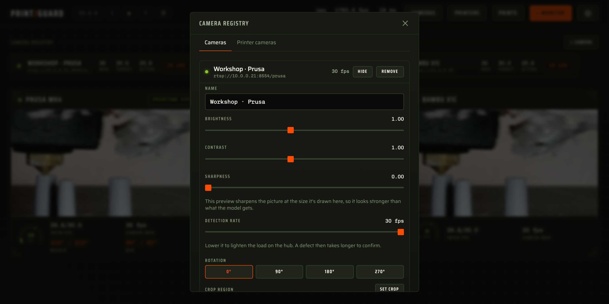

<div align="center">

# Cameras

[Docs](README.md) · [Printers](printers.md) · **Cameras** · [Monitoring](monitoring.md) · [Notifications](notifications.md) · [Training frames](feedback.md) · [Hardware](hardware.md) · [Deployment](deployment.md) · [API & MCP](api.md) · [Plugins](plugins.md) · [Writing plugins](plugin-development.md) · [Architecture](architecture.md) · [Troubleshooting](troubleshooting.md)

</div>

Where PrintGuard gets its video feeds from and how to add each type of camera.

- [Camera sources](#camera-sources)
- [Printer cameras](#printer-cameras)
- [Stream URLs](#stream-urls)
- [Cameras plugged into the hub](#cameras-plugged-into-the-hub)
- [This browser](#this-browser)
- [After a camera is added](#after-a-camera-is-added)

## Camera sources

Head to the **Cameras** page. Printer webcams live in their own tab, and the **+ Add** button next to the tabs lets you add the other three types.

| Source | What it is | Keeps watching when all browsers are closed |
|---|---|---|
| **Printer cameras** | A webcam exposed by a registered printer | Yes |
| **Stream URL** | An RTSP, RTMP, HTTP/MJPEG or WHEP feed | Yes |
| **This machine** | A USB camera plugged straight into the hub machine | Yes |
| **This browser** | The camera on the phone or laptop currently viewing the dashboard | Only while that tab stays open |

Each device or stream URL can only be registered once. Trying to add a duplicate (including a printer webcam that's already there) is rejected, and PrintGuard won't add a second copy of a printer webcam you already added by hand. URLs are normalised before checking, so differences in capitalisation, default ports, trailing slashes, query parameter order, embedded credentials or alternate host spellings like `127.1` all count as the same camera. If you register a USB device manually and later declare it in your compose file, it stays as that single camera and keeps its Remove button.

## Printer cameras

If a registered printer exposes a webcam, PrintGuard detects it and adds it automatically so you don't have to hunt down a stream URL. Hit **Refresh** on the **Printer cams** tab if you plug a camera in later; PrintGuard also checks each printer's cameras once after it first connects on startup. Neither check will disturb a camera that is already streaming frames or isn't being watched by any monitor.

If a printer's webcam can't be opened, PrintGuard shows a warning on the dashboard and skips adding it (hit **Refresh** once it's reachable). The same applies if a printer service fails when queried for webcams, with one quirk: if OctoPrint or Moonraker returns an error, it simply reports an empty list, so no camera appears without an extra warning. See [Where a printer's webcam is read from](printers.md#where-a-printers-webcam-is-read-from) for how relative paths from OctoPrint or Moonraker are resolved.

Printer cameras are owned by their printer, so they can't be deleted individually and are removed automatically when you remove the printer. If a printer stops exposing a camera, it stays listed until you remove the printer. [Supported print services](printers.md#supported-print-services) shows which integrations expose a webcam.

## Stream URLs

Paste in a stream URL and PrintGuard pulls RTSP, RTMP and WHEP feeds through its bundled MediaMTX server. For MJPEG streams, PrintGuard reads the frames directly and re-encodes them into H.264 for the dashboard's live view. Because detection runs straight on the decoded MJPEG frames, even if re-encoding ever fails, you only lose the live preview and never fault detection.

| Scheme | Typical source |
|---|---|
| `rtsp://`, `rtsps://` | IP cameras and most NVRs |
| `rtmp://` | Cameras and encoders serving RTMP |
| `http://`, `https://` | MJPEG feeds like `http://<host>/webcam/?action=stream` from mjpg-streamer or Crowsnest. Any URL whose path ends in `/whep` is pulled as WHEP |
| `whep://`, `wheps://` | WebRTC sources with a WHEP endpoint, such as go2rtc at `whep://<host>:1984/api/webrtc?src=<stream>` |

Cameras that use custom WebRTC signalling (like camera-streamer or stock Creality feeds) don't expose a WHEP endpoint. Use their MJPEG URL instead, or put [go2rtc](https://github.com/AlexxIT/go2rtc) in front of them.

If you have a camera that pushes a stream instead of serving one, point it at your hub on port `8554` (RTSP) or `1935` (RTMP). Pushed streams aren't listed in the dashboard picker, so either register them through the [REST API](api.md#rest-api) (where `POST /cameras/discover` lists pushed paths, ignoring paths belonging to already-registered cameras) or add them as a normal stream URL like `rtsp://localhost:8554/<path>` (or your hub's IP). In Docker with bridge networking, the container can't tell that the host's IP is itself, so use `localhost` there. Those two ports only need to be published if you actually push streams to the hub (see [what listens where](deployment.md#what-listens-where); the default compose file only exposes `8554`).

Make sure the hub itself can reach the URL. Inside Docker, `localhost` means the container itself, not the host machine (covered in [networking caveats](printers.md#networking-caveats)).

PrintGuard waits up to 25 seconds for a real video frame before saving a new stream. If nothing arrives, adding it fails with `no frames from camera` and the underlying reason (with credentials stripped). Seeing `no decoder for this stream` usually means the URL returned something that isn't video, like an HTML page or SVG. An already-saved camera that stops responding shows as offline with the same reason and keeps retrying in the background. You can't edit a camera's URL in place, so remove and re-add it if its address changes. If the bundled MediaMTX rejects an address, you'll see `PrintGuard can't use that address` along with why.

## Cameras plugged into the hub

In the desktop app, any webcams plugged into the computer show up under **This machine**, ready to add. On Windows, two identical cameras appear as `(1)` and `(2)` and both can be added (if you already added one by name back in 2.5.0, it counts as the first and is filtered out of the picker). On macOS, cameras are opened by name, so if you have two identical models only the first can be used.

In Docker, a USB webcam only shows up if you pass it into the container. Once passed through, PrintGuard registers it automatically. Run `ls /dev/v4l/by-id/` on your host to find stable device paths that won't shuffle around after a reboot, and map them in your compose file:

```yaml
    devices:
      - /dev/v4l/by-id/usb-046d_HD_Pro_Webcam_C920_A1B2C3-video-index0:/dev/nozzle-cam
```

Passed-in cameras show up under their hardware name, so rename them to something friendlier on the **Cameras** page. There is no Remove button while the device is still mounted into the container, because your compose file is the source of truth.

Be aware that Docker may refuse to start a container if a device listed under `devices:` isn't currently plugged in. If the container does start with a missing device, PrintGuard keeps the camera registered (along with its name, crop and tuning), marks it offline and alerts you that its monitor isn't being watched. Plug it back in and restart the container to pick up right where you left off. To remove a passed-in camera permanently, delete its `devices:` line, restart the container, and click the Remove button that now appears.

Docker can't hot-plug a new USB device into a running container, so adding another camera means adding a `devices:` entry and running `docker compose up -d`.

If you'd rather add passed-in cameras manually instead of auto-registering them, set `PRINTGUARD_CAMERAS=off` in your environment. Any cameras that were auto-registered previously are cleared on the next start (unless their device was missing at the time).

## This browser

You can turn an old phone or spare laptop into a printer camera just by opening the dashboard on it, adding **This browser** and leaving the tab open. It streams to the hub over a WebSocket and automatically reconnects if the hub restarts (on that same device and browser). If a browser can only record VP8, PrintGuard can still monitor it, though there won't be a live preview in the dashboard because the HLS player expects H.264. Chrome, Edge and Safari all record H.264. This tab isn't shown inside the desktop app itself, since **This machine** already handles local cameras directly.

> [!IMPORTANT]
> Browsers only allow camera access on secure origins, so this requires serving your hub over HTTPS or opening it on `localhost`. [Deployment](deployment.md) covers HTTPS with Tailscale or a Cloudflare Tunnel.

## After a camera is added

Open the camera on the **Cameras** page to give it a clear name and get it ready for the model: rotation, cropping to the build plate, brightness, contrast, sharpness and detection rate are all covered in [tuning the camera](monitoring.md#tuning-the-camera). Once it looks right, link it to a monitor.



If no monitor is actively watching a camera and nobody has its live feed open, PrintGuard puts the camera into standby after about 10 seconds and stops decoding video. That covers idle printers, switched-off monitors and unassigned cameras. As soon as a print starts or someone opens the dashboard, it wakes straight back up.
