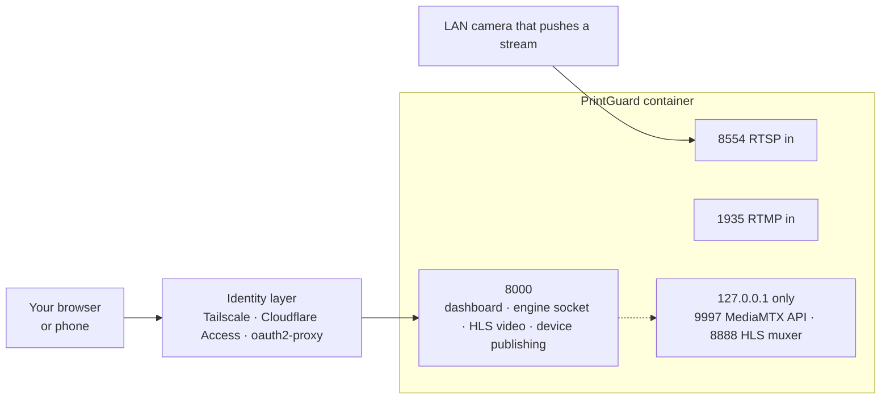

<div align="center">

# Deploying a hub securely

[Docs](README.md) · [Printers](printers.md) · [Cameras](cameras.md) · [Monitoring](monitoring.md) · [Notifications](notifications.md) · [Training frames](feedback.md) · [Hardware](hardware.md) · **Deployment** · [API & MCP](api.md) · [Plugins](plugins.md) · [Writing plugins](plugin-development.md) · [Architecture](architecture.md) · [Troubleshooting](troubleshooting.md)

</div>

PrintGuard deliberately doesn't ship with its own login system. Anyone who can reach port `8000` can see all of your cameras and pause or cancel your printers, so put a proper identity layer in front before letting it leave your home network.

- [What listens where](#what-listens-where)
- [Choosing an approach](#choosing-an-approach)
- [Option 1: Tailscale](#option-1-tailscale)
- [Option 2: Cloudflare Tunnel and Access](#option-2-cloudflare-tunnel-and-access)
- [Option 3: oauth2-proxy on your own domain](#option-3-oauth2-proxy-on-your-own-domain)
- [Host and origin checking](#host-and-origin-checking)
- [Plugins](#plugins)
- [Hardening checklist](#hardening-checklist)
- [What the hub reaches out to](#what-the-hub-reaches-out-to)
- [Environment variables](#environment-variables)
- [Your data and backups](#your-data-and-backups)
- [Running the container as your own user](#running-the-container-as-your-own-user)
- [Staying up to date](#staying-up-to-date)

> [!CAUTION]
> Never port-forward `8000`, `8554` or `1935` directly to the internet. Every option below keeps
> everything working (including live video) because HLS streams travel over plain HTTP on port `8000`.

## What listens where



| Port | Direction | When to expose it |
|---|---|---|
| `8000` | In | Always. Serves the dashboard, WebSocket, HLS video and browser camera publishing |
| `8554` | In | Only if a camera pushes RTSP into PrintGuard |
| `1935` | In | Only if a camera pushes RTMP into PrintGuard |
| `9997`, `8888` | Internal | Never. Bound to `127.0.0.1` inside the container (or on the desktop app host) |

If PrintGuard only pulls from your cameras and talks to your printers, you don't need `8554` or `1935` published at all. The shipped compose file publishes `8000` and `8554`; add `"1935:1935"` only if you need RTMP push, or remove `"8554:8554"` if nothing pushes to the hub.

Note that ports `8554` and `1935` accept unauthenticated pushes (so cameras can push to them), which means anyone who can reach those ports could publish a stream or overwrite an existing pushed stream path. Reading streams back from those ports requires a random per-startup login generated by the hub, so outsiders can't watch your feeds there.

The desktop app binds the same ports on all interfaces of your computer, so keep the same caution in mind on untrusted Wi-Fi. On the desktop app, internal ports `9997` (MediaMTX API) and `8888` (HLS muxer) listen on loopback, send no CORS headers and require a fresh random credential passed via environment variables on every launch (never written to disk), protecting them against browser DNS-rebinding tricks.

## Choosing an approach

| | [Tailscale](#option-1-tailscale) | [Cloudflare](#option-2-cloudflare-tunnel-and-access) | [oauth2-proxy](#option-3-oauth2-proxy-on-your-own-domain) |
|---|---|---|---|
| Exposed to the public internet | No | Yes, gated by an Access policy | Yes, gated by your proxy |
| Open router ports | None | None | None if tunnelled, otherwise 443 |
| Authentication | Your tailnet identity | Email code or SSO | GitHub, Google or any OIDC provider |
| Needs a domain | No | Yes | Yes |
| HTTPS for browser cameras | `tailscale serve` | Built in | Handled by your reverse proxy |
| Best for | A private hub for yourself (and anyone you invite) | Reaching your hub from devices without a VPN | A homelab that already runs a reverse proxy |

## Option 1: Tailscale

This is what I use for my own private hub. Nothing touches the public internet and your tailnet handles authentication automatically.

1. Install [Tailscale](https://tailscale.com/download) on the hub host and your phone/laptop, then run `tailscale up`.
2. Visit `http://<hub-machine-name>:8000` from any device on your tailnet (or invite other users from the Tailscale admin console).
3. If you want to stream a phone or laptop camera using **This browser**, browsers require HTTPS. Turn on `tailscale serve`:

   ```bash
   sudo tailscale serve --bg --https=443 8000
   ```

   Then add your MagicDNS address to [`PRINTGUARD_ORIGINS`](#host-and-origin-checking) and open `https://<hub-machine-name>.<tailnet>.ts.net`:

   ```yaml
       environment:
         PRINTGUARD_ORIGINS: "https://<hub-machine-name>.<tailnet>.ts.net"
   ```

## Option 2: Cloudflare Tunnel and Access

Gives you a public HTTPS URL with zero open firewall ports, while putting every HTTP request, WebSocket and video segment behind Cloudflare Access.

1. In [Cloudflare Zero Trust](https://one.dash.cloudflare.com), go to **Networks -> Tunnels**, create a tunnel, copy its token and add `cloudflared` to your `docker-compose.yaml`:

   ```yaml
     cloudflared:
       image: cloudflare/cloudflared:latest
       restart: unless-stopped
       command: tunnel run --token ${TUNNEL_TOKEN}
   ```

2. Map a public hostname (such as `hub.example.com`) to `http://printguard:8000`, and add `PRINTGUARD_ORIGINS: "https://hub.example.com"` to your `printguard` service's environment (see [Host and origin checking](#host-and-origin-checking)).
3. Under **Access -> Applications**, create a self-hosted application for that hostname with a policy allowing only your trusted email addresses.
4. If the host sits on a shared or untrusted LAN, bind port `8000` to localhost (`"127.0.0.1:8000:8000"`) so traffic can only enter through the tunnel.

## Option 3: oauth2-proxy on your own domain

If you already run a reverse proxy like Caddy or nginx, [oauth2-proxy](https://oauth2-proxy.github.io/oauth2-proxy/) puts GitHub, Google or any OIDC login in front of PrintGuard (WebSockets included):

```yaml
  oauth2-proxy:
    image: quay.io/oauth2-proxy/oauth2-proxy:latest
    restart: unless-stopped
    command:
      - --http-address=0.0.0.0:4180
      - --upstream=http://printguard:8000
      - --provider=github
      - --github-user=your-github-username
      - --email-domain=*
      - --redirect-url=https://hub.example.com/oauth2/callback
      - --cookie-secure=true
      - --reverse-proxy=true
    environment:
      OAUTH2_PROXY_CLIENT_ID: "<client id>"
      OAUTH2_PROXY_CLIENT_SECRET: "<client secret>"
      OAUTH2_PROXY_COOKIE_SECRET: "<cookie secret>"   # openssl rand -base64 32 | tr -- '+/' '-_'
    ports:
      - "4180:4180"
```

Terminate TLS in front of `:4180`, bind PrintGuard's own port to `127.0.0.1` so nobody can bypass the proxy, and set `PRINTGUARD_ORIGINS: "https://hub.example.com"`.

## Host and origin checking

To protect against DNS rebinding (where a malicious website points its own domain at your local IP to read your hub), PrintGuard only responds to hostnames it recognises:

| How you access the hub | Extra setup |
|---|---|
| An IP address, e.g. `http://192.168.1.20:8000` | None |
| `localhost` (used by the desktop app) | None |
| A single-label hostname with no dots, e.g. `http://tower:8000` or a Tailscale machine name | None |
| Local suffixes: `.local`, `.lan`, `.home`, `.home.arpa`, `.internal`, `.localhost` | None |
| Any other domain, e.g. `hub.example.com` or `<machine>.<tailnet>.ts.net` | Add it to `PRINTGUARD_ORIGINS` |

```yaml
    environment:
      PRINTGUARD_ORIGINS: "https://hub.example.com"   # comma-separate multiple URLs
```

Every entry must include its scheme (`http` or `https`). Case, default ports (`:80`, `:443`) and trailing dots don't matter, and invalid entries log a startup warning. Wildcards like `https://*.example.com` aren't supported and are ignored with a warning, so list each hostname explicitly. Internationalised domains (like `https://drucker.müller.example`) work either as Unicode or punycode.

Requests for an unlisted host receive a `403` explaining the exact `PRINTGUARD_ORIGINS` line to add (logged once per unique host up to 32 hosts). Requests missing a `Host` header also get a `403`. WebSockets close silently, so check the hub log if the dashboard hangs on connecting. This check applies to the REST API, MCP server and `/api/health` too, so point uptime monitors at a local IP/name or add their hostname to `PRINTGUARD_ORIGINS`.

Both `Host` and `X-Forwarded-Host` are checked, so it works out of the box behind Tailscale, Cloudflare and `oauth2-proxy`.

PrintGuard also validates the `Origin` header on browser requests to WebSockets, uploads, camera streams, REST API and MCP, requiring it to match the request's own scheme/host/port or an entry in `PRINTGUARD_ORIGINS`. Behind a TLS-terminating proxy, make sure your proxy sends `X-Forwarded-Proto` (`http`, `https`, `ws` or `wss`; invalid values simply disable self-matching while still allowing listed origins). Non-browser clients (scripts, AI agents) send no `Origin` and are allowed on HTTP endpoints; WebSockets always require a valid `Origin` because only browsers open them. That stops another browser tab from piggybacking on your auth-proxy session cookie to control your printers.

The dashboard also works under a path, such as `https://example.com/printguard/` (with the trailing slash) or a Home Assistant Ingress panel, as long as your proxy forwards WebSockets and passes the `Origin` header through. List the address you open the proxy at in `PRINTGUARD_ORIGINS` if the table above says it needs one. A plugin's sign-in is the exception. The provider sends you back to `/oauth/callback` at the root of that address, so sign a plugin in at the hub's own address and use it under the path afterwards.

The dashboard also sends `X-Frame-Options: SAMEORIGIN` and `Content-Security-Policy: frame-ancestors 'self'` to block clickjacking. Any origin listed in `PRINTGUARD_ORIGINS` (like a Home Assistant instance embedding PrintGuard) is added to `frame-ancestors` (and `X-Frame-Options` is omitted in that case because it can't express multiple origins).

## Plugins

Plugins run inside sandboxes with strict [permissions](plugins.md#permissions). Two hub-side permissions are worth paying extra attention to if your hub is exposed behind a proxy:

| Permission | What to keep in mind |
|---|---|
| **Serve its own pages** (`routes`) | Serves responses under `/plugins/<id>/` through your proxy just like the dashboard, though always in a sandboxed origin so it can never act as the dashboard itself |
| **Authorise every request** (`gate`) | Inspects every request (except `/api/health` and its own pages) including `Cookie` and `Authorization` headers, and can block it. An allow decision is cached for 10 seconds for identical requests (same method, path, query and inspected headers). If a `gate` plugin crashes, PrintGuard fails closed and blocks all requests until you intervene |

If a broken `gate` plugin locks you out, start the hub with `PRINTGUARD_PLUGINS` set to literally `off` to boot with all plugins disabled, then remove or fix it:

```yaml
    environment:
      PRINTGUARD_PLUGINS: "off"
```

Only install plugins whose authors you trust for the permissions they ask for, and stick to **verified** catalogue plugins whenever possible (see [Plugins](plugins.md)).

## Hardening checklist

| Check | Why it matters |
|---|---|
| Never port-forward `8000`, `8554` or `1935` on your router | PrintGuard has no built-in login |
| Only grant access to people you'd trust standing next to your printer | There are no per-user roles; everyone who passes your proxy can view cameras and control printers. Saved secrets can be overwritten, though never read back ([no stored secret leaves the hub](api.md#the-resource-model)) |
| Bind to `127.0.0.1` when a local proxy handles all traffic | Ensures nothing on your LAN can bypass the proxy |
| Keep `9997` and `8888` unpublished | MediaMTX's API and HLS muxer are loopback-only, authenticated with per-boot secrets and proxied via `:8000` |
| Only put addresses you actually use in `PRINTGUARD_ORIGINS` | Every listed origin is trusted for host, origin and framing checks |
| Only publish `8554` / `1935` on trusted LANs (or drop them completely) | Publishing to those ports is unauthenticated; if PrintGuard only pulls camera feeds, you don't need them open |
| Use HTTPS if you create API/MCP tokens | Bearer tokens shouldn't travel in plain text (see [API & MCP](api.md)) |
| Be selective with `printer:control` and `gate` plugin permissions | `PRINTGUARD_PLUGINS=off` gets you back in if a `gate` plugin locks you out |
| Keep the image updated | `latest` tracks every release |

## What the hub reaches out to

PrintGuard doesn't phone home. Here is every outbound connection it will ever make:

| Host | When |
|---|---|
| `api.github.com` | Startup and once daily for update checks (retrying after 15 minutes on failure, or on demand via **Check now**), plus resolving commits when installing/updating GitHub plugins |
| `raw.githubusercontent.com` | Fetching the plugin catalogue and plugin source files when browsing or installing plugins |
| `*.ingest.de.sentry.io` | Only when you manually submit a bug report |
| `printguard-feedback.oliverbravery.uk` | Only when you manually [send training frames](feedback.md) |
| Your printers, cameras, alert channels and MQTT broker | Whatever you configure |
| Microsoft (Windows ML) | Only on the Windows desktop app (Windows 11 24H2+), first launch, if Windows needs to fetch your GPU's execution provider |
| Plugin manifest URLs / OAuth providers | Only for enabled plugins you granted [`net`, `net:local` or `oauth`](plugins.md#permissions). Redirects are never followed, and without `net:local`, DNS results pointing to private/local IPs are blocked |

## Environment variables

Most configuration lives in the dashboard. These are the deployment-level environment variables (internal ones set by the image/desktop app are listed in [Architecture](architecture.md#configuration)):

| Variable | Default | Purpose |
|---|---|---|
| `PRINTGUARD_ORIGINS` | Unset | Comma-separated list of external origins (with `http://` or `https://`) you open the hub at, e.g. `https://hub.example.com` |
| `PRINTGUARD_PLUGINS` | On | Set to `off` (exact match) to boot with all plugins disabled |
| `PRINTGUARD_CAMERAS` | `auto` (in Docker) | Any other value (like `off`) stops auto-registering [passed-in USB cameras](cameras.md#cameras-plugged-into-the-hub) |
| `MEDIAMTX_API` | `http://localhost:9997` | MediaMTX control API URL. Note: if you run your own external MediaMTX and restart it, restart PrintGuard too so it re-registers camera paths. Using the shipped `mediamtx.yml` requires credentials in `MEDIAMTX_API`, `MEDIAMTX_RTSP` and `MEDIAMTX_HLS` (see [Architecture](architecture.md#configuration)) |
| `PORT` | `8000` | Port the hub listens on |
| `DATA_DIR` | `/data` (in Docker) | Directory for `state.json` and `prints/` |
| `LOG_LEVEL` | `INFO` | Set to `DEBUG` for command traces, printer state changes and full tracebacks |
| `LOG_FILE` | Unset (in Docker) | Optional log file path (rotates at 2 MB, keeping `.1` and `.2`). Set automatically by the desktop app |
| `NVIDIA_VISIBLE_DEVICES` | All GPUs | Restrict [`latest-nvidia`](hardware.md#nvidia-gpu) to a specific GPU UUID or index |
| `NVIDIA_DRIVER_CAPABILITIES` | `compute,utility` (in Docker) | Tells the NVIDIA Container Toolkit what to mount; leave as default |

Because PrintGuard launches its bundled MediaMTX with its own environment and MediaMTX interprets any `MTX_*` variable as config, avoid setting `MTX_*` variables on the hub container.

## Your data and backups

Almost everything PrintGuard stores lives in a single data directory (the only exception is `printguard-alert.jpg` in the OS temp folder, which the desktop app's native notifier overwrites with the latest alert image).

| Path | Contents |
|---|---|
| `state.json` | Cameras, printers, monitors, settings, themes, layout, installed plugins, print library metadata, review metadata, saved credentials (printer passwords, notifier keys, MQTT password, camera URL logins, Bambu access codes, plugin secrets), API token hashes and your training-inbox token. Written with owner-only permissions |
| `state.tmp` | Temporary file used for atomic writes to `state.json` |
| `state.json.corrupt` | Created if `state.json` is damaged on startup so you can [recover it](troubleshooting.md#starting-up). Subsequent corrupt files are saved as `.1` through `.4` without overwriting the first |
| `prints/` | Uploaded [print library files](printers.md#sending-prints) plus [kept print frames and recordings](feedback.md#whats-kept-on-your-hub). Incomplete uploads and unreferenced files are pruned on startup (skipped if `state.json.corrupt` exists or `state.json` is missing so restores stay intact; folders like NAS `@eaDir` are untouched). Files are written owner-only (pre-2.6.0 files keep their existing permissions) |

How PrintGuard handles `state.json` on startup:

| Condition | Behaviour |
|---|---|
| Missing | Starts clean with an empty hub |
| Has a UTF-8 BOM (e.g. edited in Notepad) | Reads fine as is |
| Invalid JSON, not an object, or wrong top-level type (e.g. `monitors` isn't a list) | Moves it to `state.json.corrupt` and starts empty |
| Actually a directory (happens if Docker bind-mounts a missing file) | [Refuses to start](troubleshooting.md#starting-up) and logs that it's a directory |
| Unreadable or can't be moved aside due to permissions | [Refuses to start](troubleshooting.md#starting-up) and logs the directory and current owner |
| Contains a malformed camera, printer, monitor, print, review, plugin or API token entry | Drops just that entry, logs a startup warning (`A saved camera (name) could not be read and was dropped`) and removes it on next save. Monitors pointing to a dropped printer keep working without that printer link |
| Contains `NaN` or `Infinity` (possible from 2.5 REST payloads) | Drops that number and logs it |
| Contains an invalid setting (e.g. `mqtt: null` or unknown `feedback` value) | Resets that setting to default with a startup warning (`The saved mqtt setting could not be used, so it was reset`) |

Where the data directory lives:

| Install method | Path |
|---|---|
| Docker | `/data` volume |
| macOS desktop app | `~/Library/Application Support/PrintGuard` |
| Windows desktop app | `%LOCALAPPDATA%\PrintGuard\PrintGuard` |

The desktop app also stores `printguard.log` (plus `.1`/`.2`) there, and Windows stores WebView2 profile data in `webview/` (on macOS, WebKit stores its data under `~/Library/WebKit`). **Start at login** lives in `~/Library/LaunchAgents` on macOS and the `Run` registry key on Windows; installed builds update that path automatically on launch, while copies launched from a DMG or from source leave it untouched.

To back up your hub, stop PrintGuard and copy the data directory (note: in Docker, unless you run as a [non-root user](#running-the-container-as-your-own-user), a bind-mounted `state.json` is owned by root so copying needs `sudo`). To migrate to a new machine, drop the backup in place before first boot. Risk history charts and the live alert log are in-memory only and aren't backed up.

## Running the container as your own user

The Docker image defaults to running as `root` for backwards compatibility with existing root-owned `/data` volumes from older versions. If you'd prefer to run as your own UID/GID, `chown` the data directory first:

```bash
docker compose down
sudo chown -R 1000:1000 ./data
```

```yaml
services:
  printguard:
    user: "1000:1000"
    group_add:
      - "44"    # video, for USB cameras under devices:
      - "993"   # render, for /dev/dri on latest-intel
```

| Requirement | Why |
|---|---|
| Data directory and contents owned by that user | PrintGuard refuses to start if it can't read `state.json` or write to the data directory or `prints/`, logging the directory and owner. If the disk fills or turns read-only later, it raises a dashboard warning on the next save (writes happen in the background so slow disks never stall detection) |
| Host `video` group in `group_add` | Needed for [passed-in USB cameras](cameras.md#cameras-plugged-into-the-hub) (`getent group video` gives the GID) |
| Host `render` group in `group_add` | Needed for `/dev/dri` on the [Intel GPU image](hardware.md#intel-gpu) (`getent group render` gives the GID) |

Nothing in PrintGuard requires privileged ports below 1024. Note that I've only tested non-root mode on the standard CPU image; the `video`/`render` group mappings follow standard Linux device permissions and haven't been tested directly, nor has `latest-nvidia`.

## Staying up to date

The hub checks GitHub releases on boot and once a day (with zero telemetry). When a new version is out, the version label in the top bar becomes an update button showing the full changelog (on phones, look under **Settings -> Updates**). You can switch automatic checks off there too.

To update a Docker Compose install:

```bash
docker compose pull && docker compose up -d --wait
```

The container's healthcheck polls `/api/health` every 30 seconds, so `--wait` exits once the new version is ready and `docker ps` reports healthy.

PrintGuard deliberately doesn't self-update its own container or ask for the Docker socket. Handing a camera-monitoring app the Docker socket effectively gives it root over the whole host, which isn't a trade-off I'm willing to make. If you want automatic container updates, use an external updater or your NAS's built-in container update flow.

The desktop app checks the exact same GitHub releases and gives you a direct download button for your platform.
