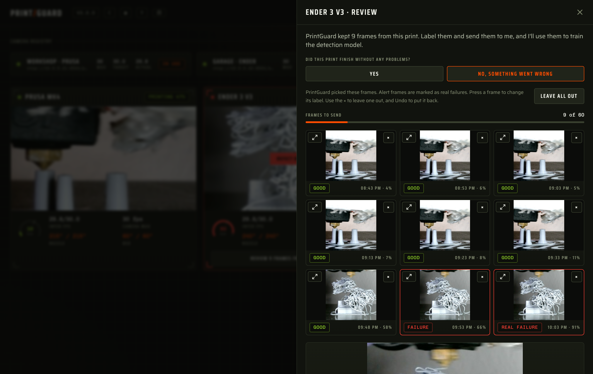
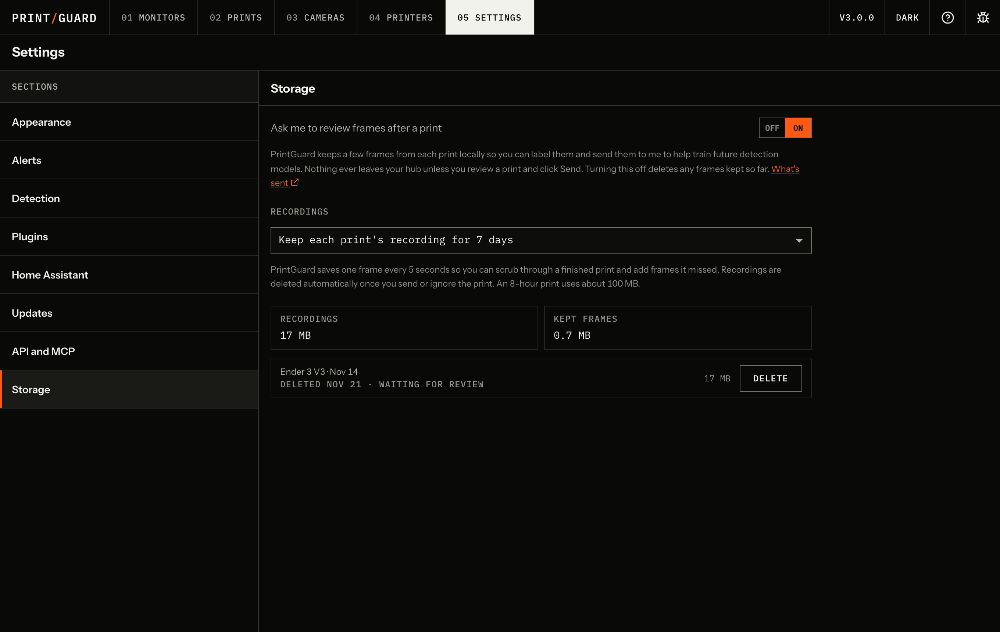

# Training frames

[Docs](README.md) · [Printers](printers.md) · [Cameras](cameras.md) · [Monitoring](monitoring.md) · [Notifications](notifications.md) · **Training frames** · [Hardware](hardware.md) · [Deployment](deployment.md) · [API & MCP](api.md) · [Plugins](plugins.md) · [Writing plugins](plugin-development.md) · [Architecture](architecture.md) · [Troubleshooting](troubleshooting.md)

PrintGuard keeps a handful of frames locally on your hub from each print. Once a print finishes, you can look through them, flag any frames where something went wrong and send them to me so I can keep improving the detection models across real printers, cameras and lighting. The 3.0 models were trained entirely on community frames like these. It's completely opt-in: nothing ever leaves your hub unless you review a print and click **Send**.

- [What's kept on your hub](#whats-kept-on-your-hub)
- [Reviewing a print](#reviewing-a-print)
- [What's sent](#whats-sent)
- [Limits](#limits)
- [Having your frames deleted](#having-your-frames-deleted)
- [Storage settings](#storage-settings)

## What's kept on your hub

| Frame type | Kept per print |
|---|---|
| Frames that triggered a defect alert | Up to the last 40 |
| Highest-scoring frames that stayed below the alert threshold (at least a minute apart) | Up to 5 |
| Regular frames spread evenly across the print | Up to 19, starting at one per minute |

Frames are saved exactly as the model saw them (after rotation, crop and brightness/contrast/sharpness adjustments), and anything larger than 512px on its shorter side is scaled down to 512px. Everything is stored inside the hub's data directory, so it survives restarts. Across all monitors, the hub keeps the last 20 prints or 200 MB (whichever hits first), pruning the oldest finished prints first. Any print currently queued to send is kept until it finishes uploading or you cancel it, and doesn't count against the 20-print cap. Alert frames are the same snapshots shown under **Risky moments** on the history page. Deleting a monitor removes all saved prints belonging to it, including any waiting to be reviewed or sent.

PrintGuard also records one frame every 5 seconds during a print so you can scrub through the whole job during review and pull in moments PrintGuard didn't pick automatically. An 8-hour print takes around 100 MB. Recordings are deleted automatically once you send or ignore the print, or after 7 days (you can change that to 3 or 14 days, or turn recordings off entirely). Total recording storage is capped at 2 GB, dropping the oldest first.

A print opens as soon as its monitor starts watching, even before the linked printer has answered, and losing contact with the printer doesn't close it. It closes when the printer reports idle or an error, or when you switch the monitor off (a paused print stays open in case you rescue and resume it). Monitors without a linked printer have no way of knowing when a print ends, so they roll over once every 24 hours.

## Reviewing a print

Open a monitor's **Review** tab to see its finished prints, newest first, with unreviewed ones marked. Click a print to see its kept frames next to the recording scrubber (prints with zero saved frames aren't listed).

1. Click the flag icon on any frame where something went wrong. On an alert frame, flagging marks it as a **Real failure** and leaving it unflagged marks it as a **False alarm**; on any other frame, flagging marks it as a **Failure**.
2. Click `×` on any frame you'd rather not share, or hit **Clear all** if you only want to pick a few specific frames from the recording.
3. Scrub through the recording on the left and click **Add as good** or **Add as failure** to include frames PrintGuard didn't automatically pick. Tick marks on the slider show where alerts and picked frames sit.
4. Click **Send**. You can send up to 60 frames a day, and the counter above the grid keeps track of how many you've selected.

Clicking **Ignore** deletes the print's saved frames and recording from your hub (showing you how much disk space it'll free first) and removes its alert snapshots from risk history.

## What's sent

When you press **Send**, PrintGuard uploads:

- The frames you chose to keep, along with your labels.
- Each frame's risk score, timestamp and kind (alert, near miss, regular, or added from the recording).
- A random ID for the print and for each frame.
- The monitor's alert threshold at the time of sending.
- The printer integration type (e.g. `klipper` or `none`), plus the printer model if you filled it in on the **Printers** page.
- Your PrintGuard version.
- A random hub ID generated the first time you send.

No monitor names, camera URLs or credentials are ever sent. Uploads go to a private Cloudflare R2 bucket in the EU through a small [Cloudflare Worker](../feedback-worker) whose code is right here in the repo for anyone to inspect. I download the frames, re-encode them so nothing but the raw pixels remains (discarding anything over 4096×4096 pixels) and delete them from the bucket. I keep the frame labels and upload timestamps, and anything I haven't pulled down is automatically deleted after 30 days. Everything sent is used purely to train PrintGuard's detection models.

Your hub doesn't include your IP in the payload, though the Worker sees your public IP on the incoming HTTP request like any web server does. It only uses it to enforce the per-network daily limit below:

| What the Worker stores | Retention | Purpose |
|---|---|---|
| A keyed hash of your IPv4 address (or `/48` prefix for IPv6), with counts of today's frames and new hubs | Until 03:00 UTC the next day | Per-network daily limit |
| Your hub ID with today's frame count, plus IDs and sizes of frames sent today | Until 03:00 UTC the next day | Per-hub daily limit and deduplicating retries |
| Your hub ID or IP hash with this minute's request count | 1 minute | Basic burst rate-limiting |

Your raw IP address is never written to storage, the hash can't be reversed without the Worker's secret key, and the Worker keeps no logs or traces.

## Limits

Because I run the inbox on Cloudflare's free tier out of pocket, there are a few hard caps to keep storage and requests within budget. If a print hits a limit, the remaining frames stay queued on your hub and automatically retry once the limit resets (or after 6 hours if the inbox is full, closed or unreachable, or sooner if the Worker reports a reset time).

| Limit | Cap | Message in the UI |
|---|---|---|
| Per hub | 60 frames a day | "You've sent as many frames as one PrintGuard can in a day." |
| Per network | 120 frames a day, 3 new hubs | "Your network has sent as many frames as it can today." |
| Global (everyone) | 1,000 frames a day | "PrintGuard has had all the frames it can take today." |
| Total bucket size | 5 GB | "The inbox for training frames is full." The Worker re-measures the bucket at most once an hour, so it reopens within an hour after I pull frames down |
| Single frame size | 150 KB | Silent. The hub shrinks the frame once and skips it if it's still over the cap |
| Request rate | 100 frames/min per hub, 10 new hubs/min per network | Silent. The hub retries a minute later |

Daily counters reset at midnight UTC, and the review page shows that time converted to your local time zone. Queued prints have **Try now** and **Cancel sending** buttons on their review page. Skipped frames don't count as sent. If a frame gets uploaded twice, the Worker acknowledges it without storing a duplicate or counting it twice (keeping the labels from the first upload). If zero frames from a print could be sent, the print returns to waiting for review. The hub strips control characters from printer models, and the Worker rejects frames with control characters or RFC 2047 encoded words (like `=?utf-8?q?x?=`) in labels, incomplete JPEGs, or images larger than 4096×4096.

Since the 1,000-frame global daily cap is shared across all users, a few busy days can fill it up; your queued frames just sit safely on your hub and go out once it resets.

## Having your frames deleted

Once you've sent at least one print, you'll find your hub ID under **Settings** -> **Storage**. If you ever want your frames removed, [open a GitHub issue](https://github.com/oliverbravery/PrintGuard/issues/new) with that ID and I'll delete everything sent under it. The ID is completely random and doesn't identify you.

One caveat: if I ever rotate the signing key the inbox uses for hub IDs, your hub will get a fresh ID on its next upload, and older frames from before the rotation can no longer be linked back to your hub to be deleted.

## Storage settings

If you don't want to participate, switch off **Ask me to review frames after a print** under **Settings** -> **Storage**. PrintGuard will then only keep alert snapshots for risk history and won't prompt you to review prints. That same tab shows every saved recording with its size and expiry date, lets you delete individual recordings or wipe them all, and lets you set how long recordings are kept.

Turning the review switch off also cleans up what's currently waiting on your hub: prints waiting for review or queued to send are dismissed, all non-alert frames are deleted, and an in-progress upload stops after the current frame. Frames that have already arrived in the inbox stay there. While it's off, nothing can be sent and **Send** stays disabled. If a file can't be deleted for some reason, PrintGuard logs a warning and still applies the setting.
