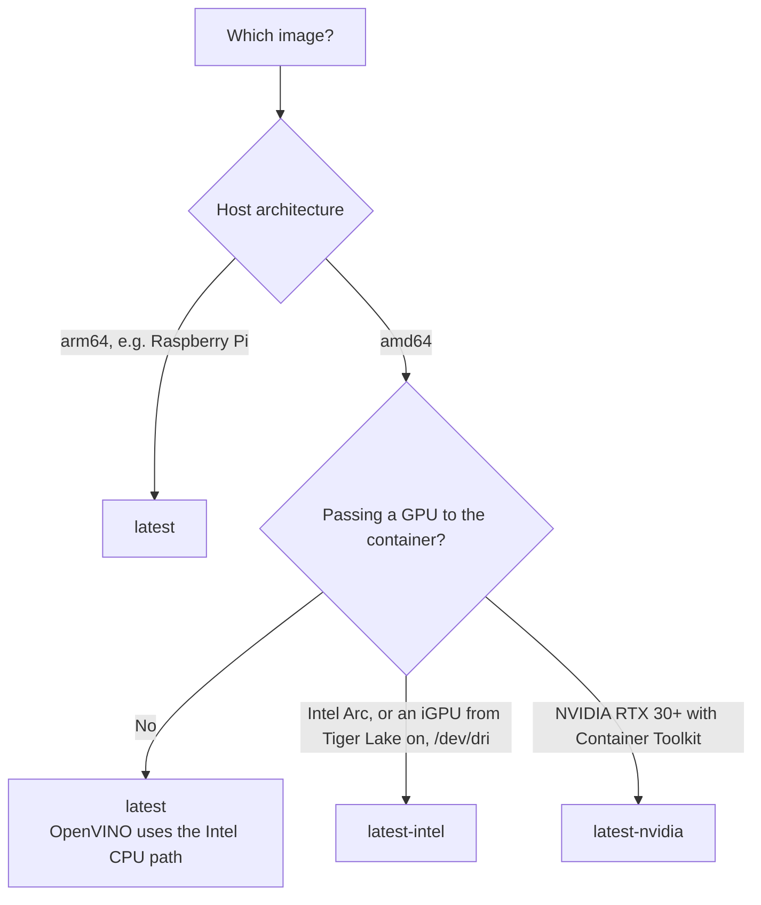

<div align="center">

# Hardware and model runtimes

[Docs](README.md) · [Printers](printers.md) · [Cameras](cameras.md) · [Monitoring](monitoring.md) · [Notifications](notifications.md) · [Training frames](feedback.md) · **Hardware** · [Deployment](deployment.md) · [API & MCP](api.md) · [Plugins](plugins.md) · [Writing plugins](plugin-development.md) · [Architecture](architecture.md) · [Troubleshooting](troubleshooting.md)

</div>

What hardware you actually need, which Docker image to pull, how the three detection models compare, and how PrintGuard picks a runtime or uses a GPU.

- [How much hardware you need](#how-much-hardware-you-need)
- [Image variants](#image-variants)
- [Choosing a variant](#choosing-a-variant)
- [Detection models](#detection-models)
- [Model runtimes](#model-runtimes)
- [Execution providers by platform](#execution-providers-by-platform)
- [Intel GPU](#intel-gpu)
- [NVIDIA GPU](#nvidia-gpu)
- [Reading and pinning the runtime](#reading-and-pinning-the-runtime)

## How much hardware you need

Not much. Even the largest detection model is under 13 MB, so a Raspberry Pi 4 can run all three models on its CPU, and a cheap x86 mini PC handles multiple cameras easily. On my Raspberry Pi 5 inside Docker with camera adjustments enabled, Standard runs at around 40 fps and Light around 60 fps, peaking at about 500 MB of RAM. Usually video decoding is heavier than running the model itself, so high camera resolutions and frame rates matter more than raw model speed.

PrintGuard doesn't require a fixed frame rate. The scheduler measures how fast your machine can actually run inference and splits that budget fairly across active cameras, so adding another camera just lowers each camera's detection rate smoothly instead of letting a queue pile up. See [scheduling inference](architecture.md#scheduling-inference) for how that works.

> [!TIP]
> Keep an eye on the **Capacity** and **Latency** readouts in the top bar (or **Settings** -> **Detection**). If capacity is well above the combined frame rate of your cameras, you've got plenty of headroom to add more.

## Image variants

Every release builds three Docker image variants. They all run the exact same PrintGuard engine and dashboard; the only difference is the GPU runtime bundled inside.

| Tag | Architectures | Extra runtime | When to use it |
|---|---|---|---|
| `latest` | `amd64`, `arm64` | None (smallest image) | Almost everyone, including Raspberry Pi 4 and 5 |
| `latest-intel` | `amd64` | Intel's current GPU compute runtime | When passing `--device /dev/dri` for an Intel Arc card or an 11th-gen (Tiger Lake) or newer iGPU |
| `latest-nvidia` | `amd64` | TensorRT RTX execution provider and CUDA 12 runtime | When you have an NVIDIA RTX 30 series (or newer) GPU with the NVIDIA Container Toolkit installed |

Every variant also gets versioned tags like `X.Y.Z` and `X.Y` (e.g. `3.0.0-intel` or `3.0-nvidia`). Pin `X.Y` if you want bugfix patches without jumping major versions unexpectedly.

> [!NOTE]
> Intel's GPU compute runtime adds roughly 370 MB of drivers and compilers that sit unused unless you pass a GPU device into the container, which is why it lives on its own tag. Intel CPU acceleration through OpenVINO is already built into the standard `amd64` image with no special tag needed.

## Choosing a variant



If you're using the macOS or Windows desktop app, you don't need to pick a variant: the app already ships with the right runtimes for your OS.

## Detection models

PrintGuard 3.0 bundles three detection models. You pick one during the first-run walkthrough and can switch any time under **Settings** -> **Detection**, right alongside an interactive benchmark chart comparing them against Obico's open models.

| Model | Architecture | Size | Latency | Failed prints caught | Good prints alarmed |
|---|---|---|---|---|---|
| **Standard** | ConvNeXt-Atto, distilled (default) | 12.9 MB | 28.7 ms | 10 of 20 | 1 of 70 |
| **Light** | MobileNetV4-Conv-Small, distilled | 9.5 MB | 11.2 ms | 5 of 20 | 1 of 70 |
| **Legacy** | ShuffleNetV2 prototype network (used before 3.0.0) | 4.8 MB | 5.3 ms | 1 of 20 | 1 of 70 |
| Obico, Dec 2025 | Obico's YOLOv2 Spaghetti Detective (for comparison) | 193 MB | 360 ms | 3 of 20 | 0 of 70 |

These numbers come from 1,534 curated frames across 30 PrintGuard hubs that none of the models had seen during training, using PrintGuard's default alert rule (0.75 for 3 frames in a row). Because Obico's outputs aren't calibrated probabilities, its threshold was tuned on a separate validation set to match precision. Latency was measured on a single M1 Max CPU thread using ONNX Runtime 1.32, so expect higher milliseconds on a Pi and lower numbers with a GPU or NPU.


All three models output a calibrated probability from 0 to 1 with 0.5 as the boundary, so your existing monitor thresholds behave consistently whichever one you pick. Switching models finishes any frames already in flight, loads the new weights and re-runs the startup benchmark. If your **Capacity** readout with Standard drops below what your cameras need, switch to **Light**.

## Model runtimes

PrintGuard bundles every model in two formats, one for each inference engine, and lets your hardware decide which is quicker:

| Runtime | What it is | Hardware path |
|---|---|---|
| [LiteRT](https://github.com/google-ai-edge/LiteRT) | Google's on-device runtime (formerly TensorFlow Lite) | Optimised CPU |
| [ONNX Runtime](https://onnxruntime.ai) | Cross-platform runtime with pluggable accelerators | Best available execution provider on the host |

**Automatic** is the default. On startup (and whenever you change models or runtime settings), PrintGuard benchmarks both runtimes on your actual machine for concurrent throughput and sticks with the winner. You can see the benchmark result in the logs, for example on an M1 Max:

```
inference benchmark of the Standard model: Apple Core ML 173.2 fps across 1 workers, LiteRT CPU 195.4 fps across 8 workers
inference ready: the Standard model on LiteRT CPU via litert (8 workers, 195 fps)
```

That same benchmark also works out how many inference workers to run in parallel. It doubles the worker count as long as each step adds at least 10% more throughput, stopping at your machine's real ceiling (which is often lower than the raw core count because GPUs serialise work, Python bindings can contend on the GIL, or Docker CPU quotas cap you). That measured worker count is what the scheduler divides by latency to compute [capacity](architecture.md#scheduling-inference).

## Execution providers by platform

ONNX Runtime picks the first device offered by its providers that can actually run the model, preferring GPU -> NPU -> CPU. PrintGuard doesn't install NPU drivers for you, so NPUs are used only where the OS provider exposes them.

| Platform | Provider | Notes |
|---|---|---|
| macOS (desktop app) | Core ML | Automatically splits work across CPU, GPU and Neural Engine |
| Windows 11 24H2+ (desktop app) | Windows ML | Downloads the certified Intel, NVIDIA, AMD or Qualcomm provider on first launch. Requires [Windows App Runtime](https://learn.microsoft.com/en-us/windows/apps/windows-app-sdk/downloads) 2.x; falls back to DirectML without it |
| Older Windows (desktop app) | DirectML | Uses DirectX 12 GPU drivers with no extra install (shows as `microsoft gpu`), falling back to CPU if no driver is available |
| Linux `amd64` (standard image) | OpenVINO | Uses the OpenVINO CPU path out of the box; GPU needs `latest-intel` plus `/dev/dri` |
| Linux `amd64` (`latest-nvidia`) | TensorRT RTX | Requires the NVIDIA Container Toolkit on the host |
| Linux `arm64` (standard image) | ONNX Runtime CPU | CPU only (Raspberry Pi 4/5 and similar ARM boards) |

If no accelerator works, PrintGuard keeps running on CPU without crashing. On `amd64` images that means OpenVINO's CPU path (even on `latest-nvidia`); elsewhere it's ONNX Runtime's built-in CPU provider. That also covers accelerators that show up but fail to compile or run the model (for example a GPU out of memory or an incompatible driver). When that happens, PrintGuard logs `<device> cannot run the model, so detection is not using it` with the reason, displays a startup warning on the dashboard until restart, and reports the fallback device under **Compute**. Even when ONNX Runtime is pinned, that fallback applies; on **Automatic**, the CPU path still has to beat LiteRT, so **Compute** may show `litert cpu` instead.

## Intel GPU

Pull the `-intel` tag and pass through `/dev/dri`:

```bash
docker run -d --name printguard --restart unless-stopped \
  --device /dev/dri \
  -p 8000:8000 -p 8554:8554 \
  --add-host host.docker.internal:host-gateway \
  -v printguard:/data \
  ghcr.io/oliverbravery/printguard:latest-intel
```

Or in Docker Compose:

```yaml
    image: ghcr.io/oliverbravery/printguard:latest-intel
    devices:
      - /dev/dri:/dev/dri
```

On Unraid, change the repository to `ghcr.io/oliverbravery/printguard:latest-intel` and enable the **Intel GPU** device under the template's advanced view.

The image bundles Intel's current upstream compute runtime rather than Debian's older packages, covering Arc and Battlemage cards plus every iGPU from 11th-gen (Tiger Lake) onwards. Intel no longer provides current compute drivers for older Gen8 to Gen11 integrated graphics, so pre-Tiger-Lake iGPUs stay on OpenVINO's CPU path.

Check the **Compute** readout to confirm it's active: it reads `intel gpu` when using the GPU and `intel cpu` when running on the processor. At startup, the logs also print every device the providers detected:

```
execution providers offer: Intel GPU, Intel CPU
```

If your GPU is missing from that line, the container didn't get access to the driver. Double-check `--device /dev/dri` and make sure you're running the `-intel` tag.

## NVIDIA GPU

Requires an RTX 30 series (or newer) GPU and the [NVIDIA Container Toolkit](https://docs.nvidia.com/datacenter/cloud-native/container-toolkit/latest/install-guide.html) installed on your host:

```bash
docker run -d --name printguard --restart unless-stopped \
  --gpus all \
  -p 8000:8000 -p 8554:8554 \
  --add-host host.docker.internal:host-gateway \
  -v printguard:/data \
  ghcr.io/oliverbravery/printguard:latest-nvidia
```

Or in Docker Compose:

```yaml
    image: ghcr.io/oliverbravery/printguard:latest-nvidia
    runtime: nvidia
```

On Unraid, set the repository to the `-nvidia` tag and put `--runtime=nvidia --gpus all` in **Extra Parameters**.

The image already bundles the CUDA 12 runtime, so the Container Toolkit on the host is the only prerequisite. If you have multiple cards and want to pin one, set `NVIDIA_VISIBLE_DEVICES` to its UUID or index. If the toolkit can't hand the GPU to the container, PrintGuard logs the reason and falls back cleanly to CPU.

## Reading and pinning the runtime

The **Compute** readout tells you what hardware is actually running inference (shown in the top bar on wide screens 1600px and up, and always under **Settings** -> **Detection** as **Active compute**):

| Readout | Meaning |
|---|---|
| `intel gpu`, `intel npu` | OpenVINO running on an Intel GPU or NPU |
| `intel cpu` | OpenVINO running on the CPU (even on AMD chips) |
| `litert cpu` | LiteRT running on the CPU |
| `apple core ml` | Core ML on macOS (manages CPU, GPU and Neural Engine automatically) |
| `onnx cpu` | ONNX Runtime's generic CPU provider, when no other provider was available or able to run the model |

Windows ML and TensorRT devices follow the same `<vendor> <device>` naming style.

Under **Settings** -> **Detection**, **Runtime** lets you choose:

| Option | Behaviour |
|---|---|
| **Automatic** | Benchmark both runtimes on startup and stick with the faster one |
| **LiteRT** | Force LiteRT |
| **ONNX Runtime** | Force ONNX Runtime with its best available provider |

Pinning a runtime skips the head-to-head comparison, though PrintGuard still benchmarks your chosen runtime to pick the best worker count. Pin a runtime if the automatic benchmark gives a surprising result on your machine. If a GPU you expect isn't being picked up, check [Troubleshooting](troubleshooting.md).
