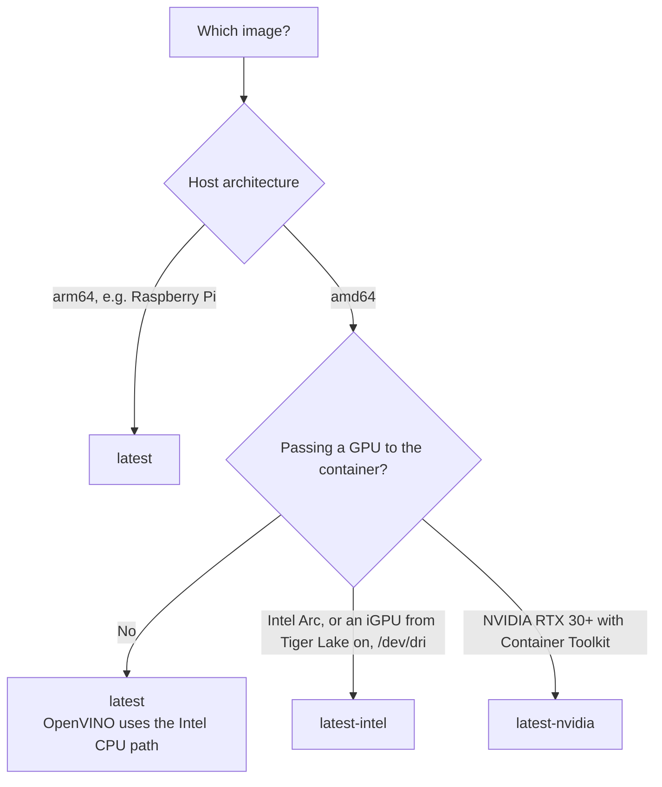
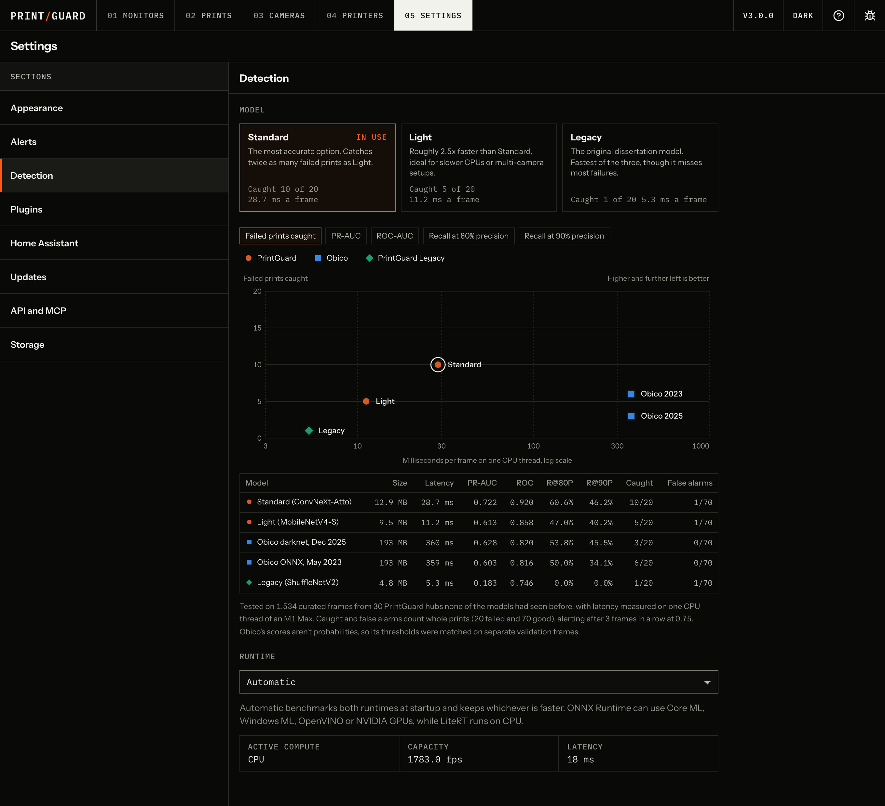

<div align="center">

# Hardware and model runtimes

[Docs](README.md) · [Printers](printers.md) · [Cameras](cameras.md) · [Monitoring](monitoring.md) · [Notifications](notifications.md) · [Training frames](feedback.md) · **Hardware** · [Deployment](deployment.md) · [API & MCP](api.md) · [Plugins](plugins.md) · [Writing plugins](plugin-development.md) · [Architecture](architecture.md) · [Troubleshooting](troubleshooting.md)

</div>

Which image to pull, which detection model to run, how PrintGuard picks a model runtime, and how to
give it a GPU.

- [How much hardware you need](#how-much-hardware-you-need)
- [Image variants](#image-variants)
- [Choosing a variant](#choosing-a-variant)
- [Detection models](#detection-models)
- [Model runtimes](#model-runtimes)
- [Execution providers by platform](#execution-providers-by-platform)
- [Intel GPU](#intel-gpu)
- [NVIDIA GPU](#nvidia-gpu)
- [Reading and pinning the runtime](#reading-and-pinning-the-runtime)

## How much hardware you need

The largest detection model is about 13 MB, not a large model. A Raspberry Pi 4 runs every model on
its CPU, and any modern x86 mini PC handles several cameras. Inference is only one part of the load.
Decoding video costs more than classifying it, so frame rate and resolution matter more than
raw model throughput.

PrintGuard never needs a fixed frame rate. The scheduler measures what the host can
sustain and shares that capacity across the cameras in use, so adding a camera lowers each
camera's rate rather than falling behind. See
[scheduling inference](architecture.md#scheduling-inference).

> [!TIP]
> The dashboard's **capacity** and **latency** readouts show what your host actually
> sustains. If capacity sits far above the sum of your cameras' rates, you have headroom
> for more cameras.

## Image variants

Every release publishes three variants. All three carry the same engine and UI, and differ only
in the acceleration runtime they bundle.

| Tag | Platforms | Adds | Use it when |
|---|---|---|---|
| `latest` | `amd64`, `arm64` | Nothing. Smallest download | Default choice, including Raspberry Pi 4/5 |
| `latest-intel` | `amd64` | Intel's current GPU compute runtime | You pass `--device /dev/dri` for an Arc card, or an iGPU from Tiger Lake (11th gen) onwards |
| `latest-nvidia` | `amd64` | TensorRT RTX execution provider and the CUDA 12 runtime | You have an RTX 30 series or newer and the NVIDIA Container Toolkit |

Each variant is also tagged `X.Y.Z` and `X.Y`, with the same suffix, for example
`X.Y.Z-intel`. Pin `X.Y` if you want patch updates without surprises.

> [!NOTE]
> The Intel GPU compute runtime is roughly 370 MB of compiler and driver libraries that do
> nothing unless a GPU device is passed in, which is why it lives in its own tag rather
> than the default image. Intel CPU acceleration through OpenVINO is in the standard
> `amd64` image and needs no extra tag.

## Choosing a variant



If you run the desktop app on macOS or Windows you don't choose a variant, since the app
carries the runtimes for your platform.

## Detection models

PrintGuard ships three detection models and runs the one you pick, either when you first open the
dashboard or later in Settings, under **Detection**, where a chart compares them with Obico's.

| Model | What it is | Size | Latency | Failed prints caught | Good prints alarmed |
|---|---|---|---|---|---|
| **Standard** | ConvNeXt-Atto, distilled. The default | 12.9 MB | 28.7 ms | 10 of 20 | 1 of 70 |
| **Light** | MobileNetV4-Conv-Small, distilled | 9.5 MB | 11.2 ms | 5 of 20 | 1 of 70 |
| **Legacy** | The ShuffleNetV2 prototype encoder PrintGuard used before 3.0.0 | 4.8 MB | 5.3 ms | 1 of 20 | 1 of 70 |
| Obico, Dec 2025 | Obico's YOLOv2 Spaghetti Detective, for comparison | 193 MB | 360 ms | 3 of 20 | 0 of 70 |

The scores come from 1,534 frames from 30 PrintGuard hubs that no model was trained on, alerting
at the default threshold of 0.75 held for 3 frames. Obico's scores aren't probabilities, so its
threshold was matched on separate validation frames. Latency is one CPU thread of an M1 Max on
ONNX Runtime 1.32, so expect it to be higher on a Raspberry Pi and lower with an accelerator.



Every model gives its own probability that a frame shows a failing print, with 0.5 as its
decision boundary, so a monitor's threshold works the same way whichever one runs. Switching waits for the frames already being
scored, then loads the new model and benchmarks it again. Pick **Light** when the **capacity**
readout with Standard sits below what your cameras need.

## Model runtimes

PrintGuard carries each model twice, once for each runtime, and picks between them:

| Runtime | What it is | Path used |
|---|---|---|
| [LiteRT](https://github.com/google-ai-edge/LiteRT) | Google's on-device runtime, formerly TensorFlow Lite | Optimised CPU |
| [ONNX Runtime](https://onnxruntime.ai) | Cross-platform runtime with pluggable execution providers | The best execution provider the host offers |

**Automatic** is the default. On start, and again whenever you change the model or the runtime,
PrintGuard benchmarks the model on both runtimes for concurrent throughput on the machine it is
actually running on and keeps the faster one. The log shows which model, what won and by how much,
for example on an M1 Max:

```
inference benchmark of the Standard model: Apple Core ML 173.2 fps across 1 workers, LiteRT CPU 195.4 fps across 8 workers
inference ready: the Standard model on LiteRT CPU via litert (8 workers, 195 fps)
```

The same benchmark also decides how many frames PrintGuard infers at once. It doubles the workers
while each step still adds a tenth to throughput and stops at the host's real ceiling, which is
usually below the core count. An accelerator serialises on one device, a runtime's Python binding may hold the
interpreter lock, and a container may be under a CPU quota. Measuring covers all three, and
the result is the `workers` term the scheduler divides by latency to get
[capacity](architecture.md#scheduling-inference).

## Execution providers by platform

ONNX Runtime takes the first device its providers offer that can run the model, preferring a
GPU, then an NPU, then the CPU. Nothing here sets an NPU up, so one is used only where its
provider offers it. What is available depends on the platform:

| Platform | Provider | Notes |
|---|---|---|
| macOS, desktop app | Core ML | Uses CPU, GPU and the Neural Engine |
| Windows 11 24H2 or newer, desktop app | Windows ML | Installs the certified Intel, NVIDIA, AMD or Qualcomm provider on first launch. Needs the [Windows App Runtime](https://learn.microsoft.com/en-us/windows/apps/windows-app-sdk/downloads) 2.x and uses DirectML without it |
| Older Windows, desktop app | DirectML | Runs on the GPU through its DirectX 12 driver, with no provider install, and reads `microsoft gpu`. Stays on the CPU without a driver |
| Linux `amd64`, standard image | OpenVINO | Intel CPU path out of the box, and the GPU needs `latest-intel` and `/dev/dri` |
| Linux `amd64`, `latest-nvidia` | TensorRT RTX | Needs the NVIDIA Container Toolkit on the host |
| Linux `arm64`, standard image | ONNX Runtime's own CPU provider | No accelerator. Raspberry Pi 4/5 and similar |

If no accelerator is usable, PrintGuard keeps working on the CPU. On an `amd64` image that is
OpenVINO's CPU path, which the `latest-nvidia` image carries too, and elsewhere it is ONNX
Runtime's own CPU provider. That covers an accelerator that is offered but can't build or run
the model, such as a GPU out of memory or a driver the provider rejects. The log names the device
and the reason in a warning that it `cannot run the model, so detection is not using it`, and the
dashboard shows the same warning as a startup warning, kept until the hub restarts. **compute**
names the device used instead. It applies with the runtime pinned
to ONNX too. On **Automatic** the CPU path still has to beat LiteRT in the benchmark, so
**compute** may read `litert cpu` instead.

## Intel GPU

Use the Intel image and pass the render device:

```bash
docker run -d --name printguard --restart unless-stopped \
  --device /dev/dri \
  -p 8000:8000 -p 8554:8554 \
  --add-host host.docker.internal:host-gateway \
  -v printguard:/data \
  ghcr.io/oliverbravery/printguard:latest-intel
```

Compose:

```yaml
    image: ghcr.io/oliverbravery/printguard:latest-intel
    devices:
      - /dev/dri:/dev/dri
```

On Unraid, set the repository to `ghcr.io/oliverbravery/printguard:latest-intel` and add
the template's **Intel GPU** device, which is under the advanced view.

The image carries Intel's own current compute runtime rather than the distribution's, which
covers Arc and Battlemage cards and every iGPU from Tiger Lake (11th gen) onwards. Intel
provides no current driver for Gen8 to Gen11 graphics, so a pre-Tiger-Lake iGPU has no GPU
path and inference stays on the OpenVINO CPU path.

The **compute** readout names the hardware in use, so it reads `intel gpu` once the GPU
is running the model, and `intel cpu` while OpenVINO is on the processor. The log lists
everything the providers offered at start:

```
execution providers offer: Intel GPU, Intel CPU
```

A GPU missing from that line is one the driver never handed over. Check that the device is
passed in with `--device /dev/dri` and that the tag ends in `-intel`.

## NVIDIA GPU

Needs an RTX 30 series card or newer and the
[NVIDIA Container Toolkit](https://docs.nvidia.com/datacenter/cloud-native/container-toolkit/latest/install-guide.html)
on the host:

```bash
docker run -d --name printguard --restart unless-stopped \
  --gpus all \
  -p 8000:8000 -p 8554:8554 \
  --add-host host.docker.internal:host-gateway \
  -v printguard:/data \
  ghcr.io/oliverbravery/printguard:latest-nvidia
```

Compose:

```yaml
    image: ghcr.io/oliverbravery/printguard:latest-nvidia
    runtime: nvidia
```

On Unraid, set the repository to the `-nvidia` tag and add `--runtime=nvidia --gpus all` to
**Extra Parameters**.

The image asks the Container Toolkit for every GPU on the host and carries the CUDA 12
runtime the provider needs, so the toolkit is the only thing to install. To pick one card,
set `NVIDIA_VISIBLE_DEVICES` to its UUID or index. If the toolkit cannot hand the GPU over,
PrintGuard logs which provider is unavailable and keeps running on the CPU.

## Reading and pinning the runtime

The **compute** readout names the hardware the model is running on, as the provider's vendor and
the kind of device. It sits in the top bar on a window 1600 pixels wide or more, and always in
**Detection** in Settings, where it reads **Active compute**.

| Readout | Means |
|---|---|
| `intel gpu`, `intel npu` | OpenVINO on that device |
| `intel cpu` | OpenVINO on the processor, whoever made it |
| `litert cpu` | LiteRT on the processor |
| `apple core ml` | Core ML on a Mac, which shares the model between the CPU, GPU and Neural Engine itself |
| `onnx cpu` | ONNX Runtime's own CPU provider, where no other provider offered a device or none of the offered ones could run the model |

A Windows ML or TensorRT device is named the same way as OpenVINO's, by its provider's vendor.
Under **Runtime**, **Detection** in Settings offers:

| Setting | Effect |
|---|---|
| **Automatic** | Benchmark both runtimes on start and keep the faster |
| **LiteRT** | Always use LiteRT |
| **ONNX Runtime** | Always use ONNX Runtime and its best provider |

Pinning skips the comparison between runtimes, not the benchmark, so the one you pin is
still measured for how many workers it sustains. Pin a runtime when a benchmark result surprises
you. If a GPU you expect is not being used, [Troubleshooting](troubleshooting.md) has the
checks.
