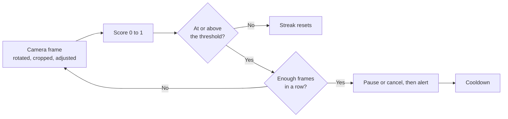
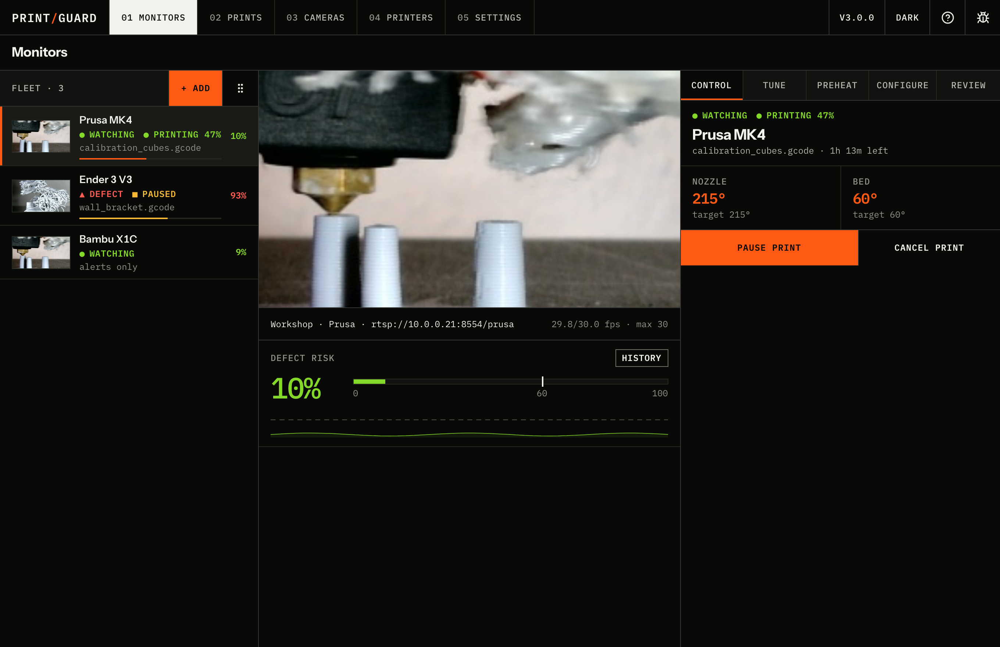
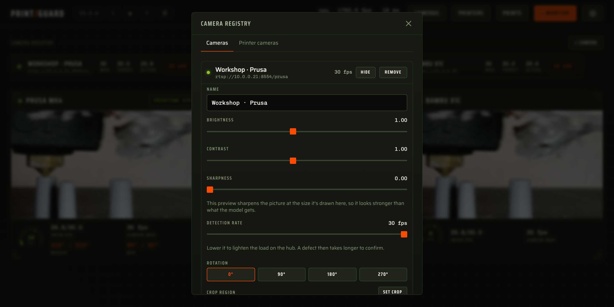
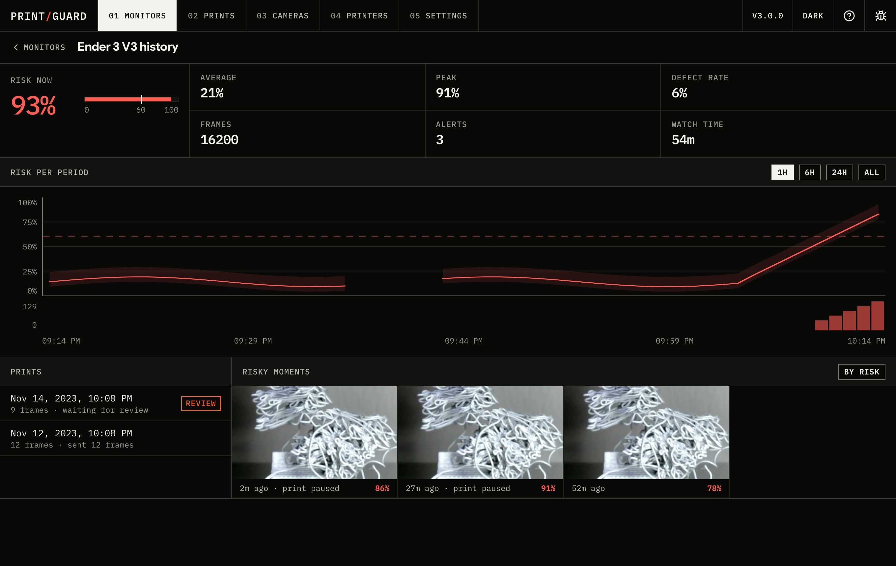
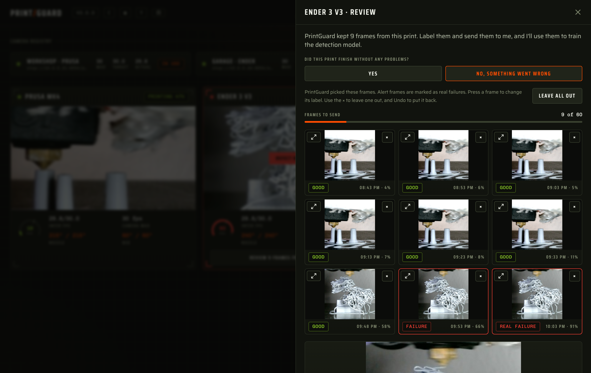

# Monitoring and tuning

[Docs](README.md) · [Printers](printers.md) · [Cameras](cameras.md) · **Monitoring** · [Notifications](notifications.md) · [Training frames](feedback.md) · [Hardware](hardware.md) · [Deployment](deployment.md) · [API & MCP](api.md) · [Plugins](plugins.md) · [Writing plugins](plugin-development.md) · [Architecture](architecture.md) · [Troubleshooting](troubleshooting.md)

A monitor ties a camera and an optional printer together, deciding when a defect is real and what PrintGuard should do about it. This page covers monitor settings, camera adjustments that affect what the model sees, and how to use risk history to dial everything in.

- [How a defect becomes an alert](#how-a-defect-becomes-an-alert)
- [Monitor settings](#monitor-settings)
- [When a monitor watches](#when-a-monitor-watches)
- [Tuning the camera](#tuning-the-camera)
- [Risk history](#risk-history)
- [Reviewing a print](#reviewing-a-print)
- [Choosing values](#choosing-values)

## How a defect becomes an alert

Every scored frame gets a probability from 0 to 1 showing how confident the [detection model](hardware.md#detection-models) is that the print is failing, with 0.5 as the dividing line. Scores only ever approach 1 (and Light only goes above 0.95 on roughly one in twelve real failure frames), which is why the threshold slider caps at 0.95.

With the defaults, a single spiky frame does nothing. The score has to stay above your threshold for several frames in a row before PrintGuard acts, and a cooldown stops the same failure from spamming you with alerts.

## Monitor settings

Select any monitor on the dashboard and open its **Tune** or **Configure** tab. Settings save automatically as you change them.

| Setting | Default | Range | What it does |
|---|---|---|---|
| **Watch this monitor** | On | | Pauses monitoring without deleting the monitor. Switched-off monitors show as **off** in the fleet list |
| **Camera** | Chosen at creation | Any registered camera, or none | The camera feed this monitor scores. With no camera linked, it won't watch |
| **Printer** | Chosen at creation | Any registered printer, or none | The printer to track and pause/cancel. Without one, the monitor only alerts |
| **Alert threshold** | 0.75 | 0.05 to 0.95 | How high a frame's risk score needs to get to count as a defect |
| **Consecutive detections to alert** | 3 | 1 to 30 | How many flagged frames in a row it takes to trigger. A camera disconnect or frozen feed resets the streak |
| **On sustained defect** | Alert only | | Choose between alerting only, pausing the print or cancelling the print. Without a linked printer, pause and cancel fall back to alert only |
| **Cooldown (seconds)** | 60 | 0 to 600 | Quiet period after an alert before the monitor can trigger again. At 0, the next flagged frame acts as soon as the previous action finishes. Cooldown resets when the print ends; if a pause or cancel failed (or couldn't be confirmed as stopped), PrintGuard retries after 30 seconds regardless of cooldown |
| **Pause if the camera drops out** | Off | | Pauses the linked printer once the camera has been offline, frozen or unlinked for longer than the [fault grace period](notifications.md#faults-and-the-grace-period). Resume it from the printer once the camera is back |
| **Push notifications** | Off | | Sends alerts and fault warnings from this monitor to your configured [alert channels](notifications.md) |

> [!IMPORTANT]
> Brand-new monitors only flag defects on the dashboard by default. Switch on **Push notifications** if you want alerts on your phone, and change **On sustained defect** to Pause or Cancel if you want PrintGuard to stop the printer automatically.

From the monitor's **Control** and **Preheat** tabs you can also pause, resume or cancel manually and set [heater temperatures](printers.md#temperatures-and-preheat). Pause is available while printing, Resume while paused, and Cancel while printing or paused.

## When a monitor watches

If a monitor has a camera and no linked printer, it watches continuously. If a printer is linked, it watches unless the printer explicitly reports that it is idle, paused or in an error state (so it also watches before the printer has first responded). A monitor with no camera, or one you've switched off, doesn't watch.

If the printer drops off the network or returns an unrecognised state, PrintGuard sticks with whatever it last reported. That way a printer disconnecting mid-print keeps getting watched, while a printer you power off after a finished job stays quietly on standby. See [failing safely](architecture.md#failing-safely) for the full design.

## Tuning the camera

Camera adjustments live on the **Cameras** page, so every monitor sharing that camera gets the same setup. They apply everywhere: the live view, the frames fed to the model, alert snapshots and frames fetched via the [API](api.md).

| Setting | Default | Range | What it does |
|---|---|---|---|
| **Rotation** | 0° | 0°, 90°, 180°, 270° | Flips or rotates a sideways or upside-down camera upright |
| **Crop region** | Centre square | Square, or freeform up to 4:1 aspect ratio | The area of the frame the model looks at |
| **Brightness** | 1 | 0.25 to 2 | Brightens a dark enclosure or tones down harsh lighting |
| **Contrast** | 1 | 0.25 to 2 | Helps separate the print from a similarly coloured bed or background |
| **Sharpness** | 0 | 0 to 2 | Brings out fine strands on soft cameras. Note that the preview sharpens at display size, so it looks slightly stronger in the UI than in the frame sent to the model |
| **Detection rate** | 60 fps | 0.5 fps up to the camera's own rate (max 60; down to 0.1 via API) | Caps how many frames per second the model scores from this camera |

The models are trained on square images. Until you set a crop, PrintGuard only scores the centre square of the frame, which on a 16:9 webcam leaves the left and right edges of the bed unwatched. Click **Set crop** on the camera's feed and frame it tightly around the build area (leaving a tiny bit of margin, since the model trims a sixteenth off each edge during preprocessing).

Crops stay square by default unless you switch to **Freeform**. Square crops generally catch defects more reliably, so the editor shows a quick warning if you go freeform. A wide crop is sliced into overlapping squares (each overlapping the next by at least 20%), and the frame takes the highest risk score among them. The crop editor outlines those squares for you. Each extra square multiplies the inference work, so a 2:1 wide crop halves the detection rate your hardware can sustain on that camera. Anything wider than 4:1 only watches the middle section. Rotation happens before cropping, so you always draw the crop upright, and rotating by 90° keeps your existing crop in place. Any part of a crop extending outside the frame is clipped back inside.

By default, detection runs as fast as your hardware and camera allow. Lowering **Detection rate** is an easy way to cut CPU usage on a shared server or Pi. Just remember that because **Consecutive detections** counts frames, a lower detection rate means defects take slightly longer to confirm.

## Risk history

The selected monitor shows its live risk bar under the feed, above a sparkline of the last 240 readings (about 48 seconds at full speed, since the dashboard receives at most 5 updates per second). Click **History** next to it for the full history page.

| Section | Shows |
|---|---|
| Stat tiles | Average and peak score, percentage of frames above threshold, total frames scored, alerts fired and watch time |
| Risk per period | Risk score over the last 1 hour, 6 hours, 24 hours or all stored buckets |
| Prints | Finished prints kept from this monitor, with frame counts and review status (prints still running aren't shown yet) |
| Risky moments | Every alert snapshot captured by this monitor |

Watch time counts whole minutes of active monitoring; any gap longer than 30 seconds (such as standby or a camera outage) is excluded.

The chart itself is stored in memory as one-minute buckets covering the last 24 hours (along with the last 50 alert counts), so restarting the hub clears the chart and the alerts tile falls back to counting the alert snapshots saved on disk. Alert snapshots are stored on disk alongside the other [kept print frames](feedback.md#whats-kept-on-your-hub) (up to 40 per print) and survive restarts. Deleting a monitor removes all saved prints from it, including any waiting for review. The [REST API](api.md#rest-api) exposes the same history and snapshots.

## Reviewing a print

PrintGuard saves a small set of frames locally from each print. Once a print finishes, you can open the monitor's **Review** tab to flag any frames where something went wrong and send them to me to help train future detection models. Nothing is ever sent unless you click **Send**. See [Training frames](feedback.md) for everything about what's stored, what's sent and how to switch the review flow off.

## Choosing values

Start with the defaults on one normal print, then look at the risk history and adjust from real numbers rather than guessing:

| What you're seeing | What to tweak |
|---|---|
| False alarms on a clean print | Raise the threshold, or bump consecutive detections so brief blips don't trigger |
| A real failure caught too late | Lower the threshold or the consecutive frame count |
| A failure that barely raises the score | Crop the camera much tighter around the print bed, then check lighting with brightness and contrast |
| Score sitting high on an empty bed | Crop out distracting background clutter, cables or shiny hardware |
| Repeat alerts for the same failure | Raise the cooldown |
| High CPU usage on a shared machine | Lower the camera's detection rate |

If alerts aren't showing up at all, see [Troubleshooting](troubleshooting.md#detection-and-alerts).
