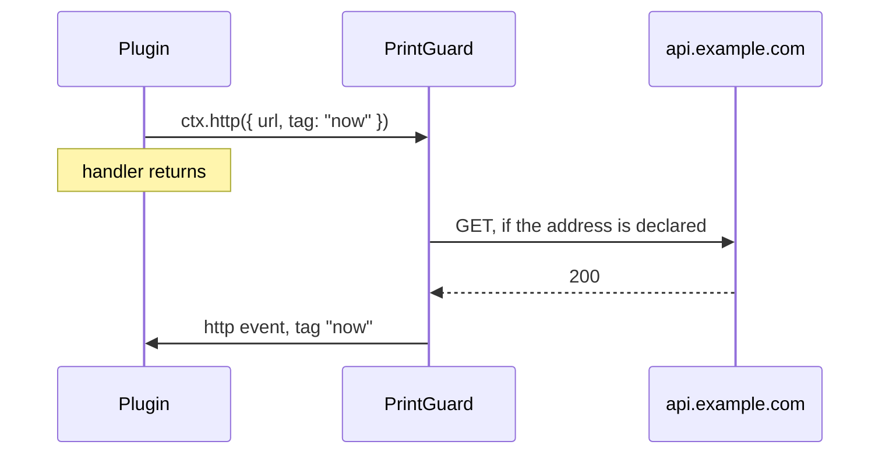

<div align="center">

# Writing plugins

[Docs](README.md) · [Printers](printers.md) · [Cameras](cameras.md) · [Monitoring](monitoring.md) · [Notifications](notifications.md) · [Training frames](feedback.md) · [Hardware](hardware.md) · [Deployment](deployment.md) · [API & MCP](api.md) · [Plugins](plugins.md) · **Writing plugins** · [Architecture](architecture.md) · [Troubleshooting](troubleshooting.md)

</div>

A PrintGuard plugin is just a folder containing a `plugin.json` manifest and up to three plain JavaScript/HTML files. There's no build step and nothing minified, so what you write is exactly what users (and I, if you submit it to the catalogue) read. See [Plugins](plugins.md) for how installation, permissions and the sandbox work.

- [A minimal plugin](#a-minimal-plugin)
- [The manifest](#the-manifest)
- [The three halves](#the-three-halves)
- [The ctx API](#the-ctx-api)
- [Events](#events)
- [Nodes](#nodes)
- [Effects](#effects)
- [Credentials](#credentials)
- [Talking to other plugins](#talking-to-other-plugins)
- [Routes and gate](#routes-and-gate)
- [Limits](#limits)
- [Editor setup](#editor-setup)
- [The shipped plugins](#the-shipped-plugins)
- [Publishing](#publishing)

## A minimal plugin

Two files are enough to build a working plugin that lists your monitors in its own row:

```
hello-monitors/
  plugin.json
  plugin.js
```

```json
{
  "$schema": "https://raw.githubusercontent.com/oliverbravery/PrintGuard/main/plugins/plugin.schema.json",
  "id": "hello-monitors",
  "name": "Hello monitors",
  "version": "1.0.0",
  "permissions": ["state:read"],
  "reasons": {
    "state:read": "To list your monitors and whether each is watching."
  }
}
```

```js
plugin.render((ctx) => ({
  type: "col",
  children: (ctx.state.monitors || []).map((monitor) => ({
    type: "row",
    children: [
      { type: "text", value: monitor.name },
      { type: "chip", value: monitor.watching ? "watching" : "idle", tone: monitor.watching ? "ok" : undefined },
    ],
  })),
}));
```

Zip the folder, install it with **Import a .zip** under **Settings -> Plugins**, and enable it. A zip must contain a single `plugin.json` with its source files alongside it (either at the root or inside one top-level folder; duplicate files or multiple `plugin.json` files are rejected). While iterating, it's even easier to point PrintGuard at your GitHub repo and hit **Update** whenever you push.

## The manifest

`plugin.json` describes your plugin and everything it wants access to. Only `id` and `version` are strictly required (unrecognised keys are ignored), plus at least one of the three source files (`plugin.js`, `panel.html` or `worker.js`):

```
my-plugin/
  plugin.json     the manifest
  plugin.js       renders native dashboard nodes    (optional)
  panel.html      renders custom HTML/CSS/JS panel  (optional)
  worker.js       runs in the background on the hub (optional)
  alarm.mp3       bundled asset                     (optional)
  README.md       shown on the store/detail page    (optional)
  icon.png        plugin icon                       (optional)
  shots/*.png     screenshots or GIFs               (optional)
```

```json
{
  "$schema": "https://raw.githubusercontent.com/oliverbravery/PrintGuard/main/plugins/plugin.schema.json",
  "id": "bed-clearance",
  "name": "Bed clearance",
  "version": "1.0.0",
  "min_printguard": "3.0.0",
  "description": "One line about what it does.",
  "author": "you",
  "homepage": "https://github.com/you/bed-clearance",
  "icon": "icon.png",
  "media": ["shots/panel.png", "shots/alert.gif"],
  "permissions": ["state:read", "notify", "sound", "net"],
  "reasons": {
    "state:read": "To see which monitors are printing.",
    "notify": "To tell you when the bed needs clearing.",
    "sound": "To play an alarm when it does.",
    "net": "To log each clearance with the service you use."
  },
  "surfaces": ["panel"],
  "platforms": ["docker", "windows"],
  "assets": ["alarm.mp3"],
  "urls": ["https://api.example.com/v1/*"],
  "secrets": { "api_key": "The key from your account page" },
  "events": ["alert", "http"],
  "tick_s": 300
}
```

| Key | Rules |
|---|---|
| `id` | Required. 3 to 40 lowercase letters, digits or hyphens, starting and ending with a letter or digit |
| `version` | Required. Up to 32 letters, digits, underscores, dots, hyphens or plus signs |
| `min_printguard` | Oldest PrintGuard version supported (e.g. `3.0.0`). Older hubs refuse to install it and flag it in the catalogue |
| `name` | Max 80 chars (defaults to `id`) |
| `description` | Max 400 chars |
| `author` | Max 80 chars |
| `homepage` | `http://` or `https://` URL (max 200 chars) |
| `icon`, `media` | Relative paths (`png`, `jpg`, `jpeg`, `webp`, `gif`, `svg`, exact case). Up to 8 media items |
| `permissions` | List of IDs from the [permissions table](plugins.md#permissions) |
| `reasons` | Plain-English reason for every requested permission (max 200 chars each) |
| `surfaces` | Any of `panel`, `monitor`, `settings` (defaults to `["panel"]`) |
| `platforms` | Target host platforms (omitted = runs everywhere) |
| `assets` | Bundled files shipped alongside your code |
| `urls` | Allowed outbound URL patterns (requires `net`) |
| `secrets` | Up to 8 user-supplied secrets: key (1 to 40 lowercase letters/digits/`_`/`-`) mapped to a description (max 200 chars) |
| `oauth` | OAuth PKCE config (requires `oauth` permission) |
| `provides` | Up to 8 inter-plugin channels: name (2 to 40 lowercase letters/digits/hyphens) mapped to a description (requires `link:provide`) |
| `consumes` | Up to 16 `plugin-id:channel` targets (requires `link:consume`) |
| `events` | Event names to receive |
| `tick_s` | Worker timer interval in seconds (5 to 86400; under 5 disables the timer) |

Installation is refused if any requested permission lacks a reason, if `urls` is declared without `net`, if a [local address](#addresses) (including local wildcards) or local OAuth URL is listed without `net:local`, if `oauth` and the `oauth` permission don't match, or if `provides`/`consumes` are declared without their link permissions.

`oauth` fields (see [Credentials](#credentials) for how the flow runs):

| Key | Rules |
|---|---|
| `authorize_url`, `token_url` | Required. Plain `https://` URLs with no wildcards |
| `label` | Provider name shown in the UI (max 80 chars; defaults to `authorize_url` host) |
| `register_url` | `http://` or `https://` link where users create their own developer app (max 200 chars) |
| `scopes` | Up to 20 scopes |

### Reasons

Write one clear sentence per permission explaining what *your plugin* uses it for, not a generic definition of the permission. Users read your reason right next to PrintGuard's own permission summary when deciding whether to enable the plugin.

### Icon, media and README

`icon`, `media` and `README.md` power your plugin's detail page (icon beside the title, media images in a gallery at the top, README rendered below). GitHub installs load these from the pinned commit; zip installs read them from inside the archive. Because they never execute inside the sandbox, SVGs are allowed here even though they aren't allowed in `assets`.

READMEs render as strict Markdown: headings, paragraphs, lists, links, images, code blocks, tables and blockquotes are preserved (along with `align` on table cells/paragraphs and `width`/`height` on images). Everything else (`<details>`, forms, video, inline SVG, `style`, `class`, task checkboxes) is stripped to plain text. On GitHub installs, relative links and images resolve against your plugin folder at the pinned commit (external images from other hosts are blocked). Zip installs have no base URL, so relative links are inactive and only images listed in `media` show in the gallery.

### Surfaces

| Surface | Where it renders |
|---|---|
| `panel` | Its own row under **Plugins**, below the fleet |
| `monitor` | Alongside the selected monitor's feed and on its row in the fleet list |
| `settings` | Inside every monitor's **Configure** tab under its own section heading |

Anything scoped to an individual monitor belongs on `settings`.

### Platforms

Use `platforms` if your plugin only makes sense on certain deployments. The store filters by platform automatically and rejects manual installs on unsupported hosts.

| Platform | Matches |
|---|---|
| `docker` | Any Docker hub image (including GPU variants) |
| `docker-nvidia`, `docker-intel` | Only that specific GPU image |
| `macos`, `windows` | Desktop apps |

Declaring `docker` covers all Docker variants, so only specify `docker-nvidia` or `docker-intel` if you actually depend on that variant.

### Assets

Files listed in `assets` are bundled, hash-pinned and accessible to your plugin:

| Kind | Extensions | How to use |
|---|---|---|
| Images | `png`, `jpg`, `jpeg`, `webp`, `gif` | `image` node or `pg.asset()` in `panel.html` |
| Audio | `mp3`, `ogg`, `wav` | `ctx.sound("alarm.mp3")` or `pg.asset()` |
| Text | `json`, `csv`, `txt` | `ctx.assets["name.txt"]` (as a string) |
| Video | `mp4`, `webm` | `pg.asset()` in `panel.html` |

Filenames must be at most 40 lowercase letters, digits, dots, underscores or hyphens (no subdirectories). File headers are magic-byte checked against their extensions (so a script renamed to `.png` won't install). SVG is disallowed because it can contain markup.

### Addresses

`urls` restricts outbound requests using browser-extension match patterns (`scheme://host/path`):

| Pattern | Matches |
|---|---|
| `https://api.example.com/v1/*` | Any path under `/v1/` on that host |
| `https://*.example.com/*` | `example.com` and all subdomains |
| `*://example.com/*` | `http` or `https` on that host |
| `wss://hub.local:8123/api/*` | WebSocket endpoint on that specific port |
| `*://*/*` | Any HTTP/HTTPS URL (broadest possible grant) |

`*` in the scheme matches `http` and `https`; `ws`, `wss`, `rtsp` and `rtsps` must be explicit. Omitting the port allows any port. Wrap IPv6 literals in brackets (`http://[fd00::1]/*`).

Scheme and host matching are case-insensitive; paths are case-sensitive (so `/bot*/sendMessage` doesn't match `/bot1/sendmessage`). `*` in a path matches any characters including `/`. Query strings are ignored unless your pattern includes `?` (so `/bot*/sendMessage` allows any query string on that path, while `/search?q=*` matches the query too). Paths containing `.` or `..` segments (plain or percent-encoded) never match.

Any pattern targeting local/private networks requires `net:local` in addition to `net`: non-public IPs, `localhost`, `.local`, `.lan`, `.home`, `.home.arpa`, `.internal`, `.localhost`, wildcard hosts (`*`, `*.local`, `*.168.1.50`), alternate IPv4 notations (`127.1`, `2130706433`), IPv4-in-IPv6 (`[64:ff9b::c0a8:101]`), and multicast/site-local addresses (`224.0.0.1`, `[fec0::1]`). Without `net:local`, PrintGuard resolves DNS once at connect time, rejects the request if any returned IP is non-public, connects directly to the checked IP and bypasses environment proxy variables.

Plugins can never call PrintGuard's own API (even with `net:local`): every plugin request, OAuth call and socket sends `X-PrintGuard-Plugin: 1`, which the hub answers with `403`. Setting `X-PrintGuard-Plugin`, `Host` or `Connection` manually is rejected. Use `state:read`, `camera:frames` and `history:read` instead.

## The three halves

A plugin can include any combination of the three source files, all sharing one key-value store (note that `panel.html` reads `pg.store` as it was when drawn, so writes from other halves don't auto-push into it without reloading):

| | `plugin.js` | `panel.html` | `worker.js` |
|---|---|---|---|
| Sandbox | Hidden opaque-origin iframe | Visible opaque-origin iframe | QuickJS in WebAssembly (hub) |
| Active while | Dashboard is open | Dashboard is open | Plugin is enabled |
| Renders | Native dashboard node tree | Custom HTML/CSS/JS (or `pg.view`) | Nothing |
| Global API | `plugin` | `pg` | `plugin` |
| `render`, `action` | Yes | No (`pg.view` + `pg.on("action")`) | No |
| `on`, `serve` | Yes | `on` only | Yes |
| `route`, `gate` | No | No | Yes |
| In-memory variables | Persist until page reload | Persist until reload or panel redraw (e.g. toggling **Layout**) | Never (fresh VM per invocation) |

`plugin.js` and `worker.js` execute inside a wrapper function with `plugin` in scope (`import` is a syntax error, and there is no direct network). Treat `plugin.js` as DOM-less (its hidden iframe blocks styles/images and storage); `worker.js` has no DOM at all.

Neither browser iframe has `fetch`, `WebSocket` or `RTCPeerConnection`, and nested iframes can't run scripts (see [What a browser still allows](plugins.md#what-a-browser-still-allows)). Both iframes are also protected by `frame-ancestors` so external sites can't embed them.

### plugin.js

`plugin.render` returns a tree of [nodes](#nodes) that PrintGuard renders using its own UI components, so your plugin matches the dashboard and user themes automatically.

`render` runs whenever state or store changes, and after every action or hooked event, so keep it a pure function of `ctx`. On `monitor` and `settings` surfaces it runs once per monitor with `ctx.target` (monitor ID) and `ctx.surface` set. Returning `null` renders nothing.

`plugin.action` handles button clicks, toggles, selects and inputs:

```js
plugin.action((name, arg, ctx) => {
  if (name === "watch") ctx.command({ cmd: "monitor.update", id: arg, patch: { enabled: true } });
});

plugin.render((ctx) => ({
  type: "col",
  children: (ctx.state.monitors || []).map((monitor) => ({
    type: "row",
    children: [
      { type: "text", value: monitor.name },
      { type: "chip", value: monitor.enabled ? "watching" : "idle", tone: monitor.enabled ? "ok" : undefined },
      { type: "button", label: "Watch", action: "watch", arg: monitor.id },
    ],
  })),
}));
```

For a `panel` surface, returning an [`item`](#nodes) node renders a full dashboard row matching your monitors (thumbnail on the left, title and description in the middle, action buttons on the right):

```js
plugin.render((ctx) => ({
  type: "item",
  image: "spool.png",
  title: `${ctx.store.left || 0} g left`,
  description: "PLA, Galaxy Black",
  actions: [{ type: "button", icon: "refresh", label: "Weigh again", action: "weigh" }],
}));
```

### panel.html

If a node tree isn't flexible enough, ship a `panel.html` to draw your `panel` surface with custom HTML, CSS and inline JavaScript:

```html
<style>
  .risk { font-family: var(--font-display); color: var(--color-accent); font-size: 32px; }
</style>
<p class="risk" id="worst">0</p>
<video id="loop" autoplay muted loop></video>
<script>
  document.getElementById("loop").src = pg.asset("loop.mp4");
  pg.on("state", (state) => {
    const scores = (state.monitors || []).map((m) => (m.result ? m.result.score : 0));
    document.getElementById("worst").textContent = Math.max(0, ...scores).toFixed(2);
  });
</script>
```

Because `panel.html` runs in an opaque origin with `connect-src 'none'`, all communication goes through `pg`. Playing `<audio>` or `<video>` (even muted) requires the `sound` permission. Inline event attributes (`onclick="..."`), `<script src>` and dynamic `import()` are blocked by CSP, so write inline `<script>` tags with `addEventListener`. Navigating the iframe away kills the plugin with `sandbox navigated away`.

| Member on `pg` | What it does |
|---|---|
| `pg.on("ready", fn)` | Fires with initial state once mounted |
| `pg.on("state", fn)` | Fires with state on every update |
| `pg.state` | Latest state snapshot |
| `pg.secrets` | Array of configured secret names (never values) |
| `pg.store` | Key-value store; reassign the object to save (`pg.store = { ...pg.store, on: true }`) |
| `pg.theme` | Dashboard CSS variables (also injected directly so `var(--color-accent)` works in CSS) |
| `pg.asset(name)` | Local URL for a bundled asset (audio/video requires `sound`) |
| `pg.view(tree)` | Renders a native dashboard node tree (like `item`) instead of your HTML while keeping your script running in the background |
| `pg.on("action", fn)` | Receives `{ name, arg }` when a user interacts with a `pg.view` node |

The panel background is transparent and auto-sizes up to 900px tall. To display remote images (since `panel.html` can't fetch directly), request them via `pg.http` with `binary: true` and build a `data:` URL from the returned base64.

Example using `pg.view` to draw a native row from `panel.html`:

```html
<script>
  const draw = (playing) =>
    pg.view({
      type: "item",
      title: playing ? "Playing" : "Paused",
      actions: [{ type: "button", icon: playing ? "pause" : "play", label: playing ? "Pause" : "Play", action: "toggle" }],
    });
  let playing = false;
  pg.on("action", ({ name }) => name === "toggle" && draw((playing = !playing)));
  pg.on("ready", () => draw(playing));
</script>
```

### worker.js

`worker.js` runs headlessly on the hub even when nobody has the dashboard open. It wakes on manifest-declared events, its `tick_s` timer, and incoming HTTP routes/gate checks. Every invocation gets a fresh QuickJS VM, so persist anything you need in `ctx.store`:

```js
plugin.on("alert", (event, ctx) => {
  ctx.store.alerts = (ctx.store.alerts || 0) + 1;
});

plugin.on("tick", (event, ctx) => ctx.log(`${ctx.store.alerts || 0} alerts so far`));
```

If a worker is still busy when a new event arrives, the event is skipped rather than building a backlog. Crashing, exceeding fuel/memory limits or returning malformed output (such as overriding `toJSON` on built-in prototypes) disables the plugin and logs the reason.

Workers have standard JS built-ins plus `plugin`, `atob`, `btoa`, `performance`, `navigator` and `queueMicrotask`. There is no `console` (use `ctx.log`), no timers and no `fetch`. Execution ends as soon as your synchronous handler returns, so promises and microtasks won't complete.

Store updates from `worker.js`, `plugin.js` and `panel.html` are merged at key level (tracking added, modified and removed keys), so concurrent writes to different keys never clobber each other (last write wins on the same key).

## The ctx API

Handlers in `plugin.js` and `worker.js` receive `ctx` (in `panel.html`, the same methods live on `pg` under the same permissions):

| Member | What it does | Permission |
|---|---|---|
| `ctx.state` | Permission-filtered hub state | |
| `ctx.store` | Persisted plugin key-value store | |
| `ctx.assets` | Bundled text assets keyed by filename (not on `pg`) | |
| `ctx.target`, `ctx.surface` | Active monitor ID and surface name (in `render` only) | |
| `ctx.command(cmd)` | Send an engine command | Command's permission |
| `ctx.http(request)` | Make an HTTP request to a declared URL | `net` |
| `ctx.socket({ url, tag })` | Open a managed WebSocket | `net` |
| `ctx.socketSend(tag, text)` | Send a text frame on an open socket | |
| `ctx.socketClose(tag)` | Close an open socket | |
| `ctx.call(request)` | Call another plugin's channel | `link:consume` |
| `ctx.publish(request)` | Broadcast on your own channel | `link:provide` |
| `ctx.notify(text)` | Show a dashboard toast | `notify` |
| `ctx.sound(tones)` | Play synth tones or a bundled audio asset | `sound` |
| `ctx.background(image)` | Set (or clear) the dashboard background image | `background` |
| `ctx.log(text)` | Write to the PrintGuard log | |

What appears in `ctx.state` depends on your granted permissions (`ctx.state.version` is always included):

| Permission | Exposed in `ctx.state` |
|---|---|
| `state:read` | `monitors`, `cameras`, `printers` |
| `printer:manage` | `integrations` (adapter schemas) |
| `settings` | `notifiers` (notifier schemas) |

See [`plugins/plugin.d.ts`](../plugins/plugin.d.ts) for full TypeScript definitions (aside from `integrations` and `notifiers`).

Because handlers run synchronously and return immediately, async operations like `ctx.http` take a `tag` and deliver their response later as an event carrying that tag:



## Events

Register listeners with `plugin.on(name, handler)` (or `pg.on(name, handler)` in `panel.html`). Every event you listen to must be listed in `events` in `plugin.json` (except `tick`, which is controlled by `tick_s`, and `call`/`answer`/`message`, which are added automatically when using `provides`/`consumes`).

| Event | Trigger | Payload | Permission |
|---|---|---|---|
| `http` | Response to your `ctx.http` call | `tag`, `status`, `body` | |
| `socket` | Socket opened, received text, or closed | `tag`, `state`, `text` | |
| `frame` | Response to `camera.snapshot` | `camera_id`, `jpeg` | `camera:frames` |
| `history` | Response to `history.get` | `monitor_id`, `now`, `buckets`, `alerts`, `stats` | `history:read` |
| `call` | Another plugin called your channel | `from`, `channel`, `body`, `call_id` | `link:provide` |
| `answer` | Reply to your `ctx.call` | `tag`, `from`, `channel`, `body` | `link:consume` |
| `message` | Broadcast from a consumed plugin channel | `from`, `channel`, `body` | `link:consume` |
| `result` | Inference result (up to 5 Hz per monitor) | `monitor_id`, `camera_id`, `score`, `prediction`, `ms`, `ts` | `state:read` |
| `alert` | Sustained defect triggered | `monitor_id`, `score`, `action`, `ts` | `state:read` |
| `warning` | Watchdog fault or recovery | `monitor_id`, `message`, `recovered` | `state:read` |
| `device` | Printer status/temp/progress changed | `printer_id`, `status`, `progress`, `job`, `remaining_s`, `nozzle`, `bed` | `state:read` |
| `error` | Hub-level error (command errors go only to their caller) | `message` | `state:read` |
| `state` | Periodic state snapshot (1 Hz; UI halves also receive post-command snapshots) | Permission-filtered state | `state:read` |
| `tick` | Worker timer fired | None | `tick_s` set |

Registering a second handler for the same event name replaces the first. `plugin.js` and `worker.js` receive `(event, ctx)`; `panel.html` receives `(event)`.

Note that `result` fires on every raw inference before streak/threshold logic, so if you react directly to `result`, track consecutive hits in `ctx.store` if you don't want single-frame spikes:

```js
plugin.on("result", (event, ctx) => {
  if (event.score < (ctx.store.limit || 0.8)) return;
  ctx.command({ cmd: "printer.action", id: ctx.store.printer, action: "pause" });
  ctx.notify(`${event.monitor_id} hit ${event.score}`);
});
```

## Nodes

| Node type | Properties |
|---|---|
| `row`, `col` | `children` |
| `text` | `value`, `muted` |
| `chip` | `value`, `tone` (`ok`, `warn`, `bad`, `accent`) |
| `camera` | `camera_id` |
| `image` | `asset`, `label` |
| `float` | `camera_id`, `label`, `value` |
| `button` | `label`, `action`, `arg`, `icon`, `disabled` |
| `item` | `title`, `description`, `image`, `actions` |
| `select` | `value`, `options`, `action`, `label` |
| `input` | `value`, `action`, `label`, `kind` (`text` or `number`), `placeholder`, `secret` |
| `toggle` | `on`, `action`, `label` |

`false`, `null` and unknown node types are ignored (handy for conditional rendering). `button` clicks pass `(action, arg)`; `select` passes the selected value; `input` commits on blur or Enter; `toggle` passes `true`/`false`. Supported `button` icons are `play`, `pause`, `stop`, `previous`, `next` and `refresh` (with `label` used as the accessible label). Give `input` and `select` a `label` so they render cleanly.

An `item` node renders as a full plugin row matching monitor rows (`image` accepts a bundled asset filename or a base64 `data:` image URL; `item` must be the root node of the view).

`camera` and `float` require `camera:view`. `camera` mounts PrintGuard's native player directly so video never enters your sandbox. `float` triggers browser Picture-in-Picture directly on user click (preserving user-gesture permission; hides automatically if unsupported, and displays the raw unadjusted stream).

## Effects

Every call on `ctx` queues an effect executed after your handler returns. Each effect is checked individually against your granted permissions; a refused effect is dropped without blocking valid ones.

### Commands

`ctx.command` sends standard engine commands (see [Architecture](architecture.md#the-protocol) for payloads and secret-handling rules):

| Permission | Allowed commands |
|---|---|
| `monitor:control` | `monitor.update` |
| `monitor:manage` | `monitor.add`, `monitor.remove` |
| `camera:control` | `camera.update` |
| `camera:manage` | `camera.add`, `camera.remove`, `discover` |
| `camera:frames` | `camera.snapshot` |
| `history:read` | `history.get` |
| `printer:control` | `printer.action` |
| `printer:manage` | `printer.add`, `printer.update`, `printer.remove`, `printer.test`, `printer.cameras.refresh` |
| `settings` | `settings.update`, `notify.test` |
| `tokens` | `token.create`, `token.remove` |
| `alert:send` | `notify.send` |

Snapshots and risk history request via `ctx.command` and reply on `frame` and `history` events (declare both in `events`):

```js
plugin.on("tick", (event, ctx) => {
  for (const monitor of ctx.state.monitors || []) ctx.command({ cmd: "history.get", monitor_id: monitor.id });
  ctx.command({ cmd: "camera.snapshot", camera_id: "cam-1" });
});

plugin.on("history", (event, ctx) => { ctx.store.peak = event.stats.max; });
plugin.on("frame", (event, ctx) => { ctx.store.last = event.jpeg.length; });
```

### Requests

`ctx.http` accepts `method` (default `GET`), `url`, `headers`, `json` (only body format supported), `tag` and `binary`:

```js
plugin.on("tick", (event, ctx) => ctx.http({ url: "https://api.example.com/v1/now", tag: "now" }));

plugin.on("http", (event, ctx) => {
  if (event.tag === "now") ctx.store.latest = event.body;
});
```

JSON responses arrive parsed, other responses arrive as strings, and `binary: true` returns base64. Remember to include `"http"` in `events`.

Redirects aren't followed (the 3xx status comes back in `http`), setting a custom `Host` header is refused, and responses over 256 KB (decompressed, before base64) or non-gzip encodings fail without emitting `http` (UI requests show an error toast; worker requests log to the hub log). Error messages omit URLs, headers and names (since any `state:read` plugin hears hub errors), reporting only the error class like `ConnectTimeout` while full details go to the log.

### Sockets

`ctx.socket({ url, tag })` opens a managed WebSocket whose lifecycle arrives on `socket` events (`state`: `open`, `message`, `closed`). Declare `"socket"` in `events` and a `ws`/`wss` pattern in `urls`. Sockets close automatically if the plugin is disabled, reinstalled, removed, crashes or loses `net`/`net:local` (note that closing a dashboard tab alone doesn't close hub-held sockets). Redirects fail the handshake, and opening an already-open tag is a no-op.

Sockets receiving more than 300 frames in 10 seconds are closed (with the reason in `event.text` and an `error` event). Dashboards more than 256 events behind are disconnected and reconnected, so overly chatty sockets can drop UI frames.

```js
plugin.on("tick", (event, ctx) => ctx.socket({ url: "wss://hub.local:8123/api/websocket", tag: "hub" }));

plugin.on("socket", (event, ctx) => {
  if (event.state === "open") ctx.socketSend("hub", JSON.stringify({ type: "ping" }));
  if (event.state === "message") ctx.store.last = event.text;
});
```

### Notices, sound and the background

Worker calls to `ctx.notify`, `ctx.sound` and `ctx.background` forward to all currently open dashboards (no-op if none are open).

`ctx.sound` takes either an array of synth tones (`hz`, `ms`, optional `together`, optional `shape`: `sine`/`square`/`sawtooth`/`triangle`) or a bundled audio asset name. Trigger it from event handlers rather than `render` (which runs every second). Browsers mute audio until the user interacts with the page at least once.

```js
plugin.on("alert", (event, ctx) => {
  ctx.sound([
    { hz: 880, ms: 1400 },
    { hz: 1320, ms: 1100, together: true },
  ]);
});
```

`ctx.background` takes a base64 `data:` image URL (PNG/JPEG/WebP/GIF) to display behind the Glass theme, or any other value (like `null`) to clear it.

## Credentials

Declare user secrets in `secrets` and reference them as `{{secret.<name>}}` inside headers, JSON bodies, or URL paths/queries. PrintGuard renders the password fields and substitutes values right before sending:

```json
"secrets": {
  "api_key": "The key from your account page"
}
```

```js
ctx.http({ url: "https://api.example.com/v1/me", headers: { Authorization: "Bearer {{secret.api_key}}" }, tag: "me" });
```

Requests referencing an unset secret, or placing a secret placeholder in the URL scheme/user/host, are refused; URLs are re-checked against `urls` after substitution.

For OAuth services, declare `oauth` and use `{{secret.oauth}}` (PrintGuard runs PKCE auth-code flow and refreshes tokens automatically; `oauth_refresh` and `oauth_client_id` can't be referenced). If refresh fails, PrintGuard signs the plugin out and drops `"oauth"` from `pg.secrets` until the user reconnects.

```json
"permissions": ["net", "oauth"],
"oauth": {
  "label": "Spotify",
  "authorize_url": "https://accounts.spotify.com/authorize",
  "token_url": "https://accounts.spotify.com/api/token",
  "register_url": "https://developer.spotify.com/dashboard",
  "scopes": ["user-read-playback-state"]
}
```

Never hardcode a client ID in the manifest (it's stripped on install); users register their own app using the redirect URI shown in PrintGuard (see [Credentials](plugins.md#credentials)). Both `authorize_url` and `token_url` must be plain `https://` URLs with ASCII hosts and no wildcards or credentials (query strings on `authorize_url` are kept; local URLs need `net:local`). Changing either URL in an update signs users out and requires re-consent, and token responses over 64 KB fail the sign-in.

## Talking to other plugins

Plugins can talk to each other only when both sides declare it and the user accepts both manifests. Neither side ever sees the other's code or store.

Provider plugin:

```json
"permissions": ["link:provide"],
"provides": { "now-playing": "The track playing right now" }
```

```js
plugin.serve((request, ctx) => ({ track: ctx.store.track, artist: ctx.store.artist }));
```

Consumer plugin:

```json
"permissions": ["link:consume"],
"consumes": ["spotify:now-playing"]
```

```js
plugin.on("tick", (event, ctx) => ctx.call({ to: "spotify", channel: "now-playing", tag: "np" }));
plugin.on("answer", (event, ctx) => { ctx.store.track = event.body.track; });
```

Providers can also push unsolicited updates with `ctx.publish`, delivered to subscribed consumers as `message` events:

```js
plugin.on("tick", (event, ctx) => ctx.publish({ channel: "now-playing", body: { track: "Blue" } }));
```

Disabled plugins don't answer, unanswered calls expire after 30 seconds, and only the first reply to a call is kept.

## Routes and gate

Both live in `worker.js`.

`plugin.route` serves requests under `/plugins/<id>/` (requires `routes`):

```js
plugin.route((request, ctx) => ({
  status: 200,
  type: "text/html",
  body: `<h1>${ctx.store.alerts || 0} alerts</h1>`,
}));
```

| Incoming `request` | Contents |
|---|---|
| `method` | `GET`, `POST`, `PUT` or `DELETE` |
| `path`, `query` | Full path and parsed query object |
| `headers` | `cookie`, `authorization`, `accept`, `content-type`, `x-forwarded-for`, `user-agent` (when present) |
| `body` | String, truncated at 64 KB |

| Returned response | Rules |
|---|---|
| `status` | Integer 100 to 599 (default `200`; anything else returns `502` and disables the plugin) |
| `type` | Content-Type (default `text/plain`) |
| `body` | String (counts toward the 512 KB worker output cap) |
| `headers` | Object of strings; only `set-cookie`, `location` and `cache-control` are forwarded |

Route responses are served with `sandbox allow-forms allow-scripts` and `frame-ancestors 'none'`, giving them an isolated opaque origin:

| Feature on a route page | Policy |
|---|---|
| Scripts & styles | Inline only (external `<script src>` / `<link>` blocked, even to your own routes) |
| Images, audio, video, fonts | `data:` URLs (plus `blob:` for everything except fonts) |
| `fetch`, `XHR`, `WebSocket`, `sendBeacon` | Blocked; communicate with your worker via form posts or links |
| Forms | Can post only to the hub (your own routes) |
| Links / `location` | Can navigate the tab anywhere |

`plugin.gate` authorises every other request to the hub (requires `gate`):

```js
plugin.gate((request, ctx) => request.path.startsWith("/api/") || Boolean(ctx.store.session));
```

| Rule | Behaviour |
|---|---|
| Denial & fail-closed | Anything other than strict `true` (or a crash/limit hit) returns `403`. A crashed gate is disabled and blocks all requests until re-enabled, reinstalled, removed or booted with `PRINTGUARD_PLUGINS=off` |
| Request shape | Same as `route` without `body`; WebSocket handshakes arrive as `GET` |
| Queue timeout | Waiting >5 s for the worker rejects just that request without disabling the gate |
| Always allowed | `/api/health` and the gate plugin's own `/plugins/<id>/` routes |
| Caching | `true` caches for 10 seconds keyed on method, path, query and inspected headers; denials are never cached |

## Limits

| Resource | Limit |
|---|---|
| Source file | 256 KB each |
| Zip upload | 12 MB (checked client- and server-side; only stored/deflate compression allowed) |
| Bundled assets | 4 MB per file, 12 MB total |
| Zip README / gallery image | 64 KB README, 4 MB per image (oversized items skipped) |
| Media gallery | 8 images |
| Secrets | 8 keys, 4 KB per value |
| OAuth scopes | 20 |
| Link channels | 8 `provides`, 16 `consumes` |
| Store | 16 KB (no-op writes skipped; bursts coalesced within 1 s) |
| Inter-plugin payload | 16 KB |
| JSON nesting depth | 32 levels in store/`ctx.http`, 31 in `call`/`answer`/`publish` |
| `tick_s` | 5 to 86400 s (evaluated on a 5 s clock, so 7 rounds up to 10) |
| Effects per call | 32 (extras dropped) |
| `plugin.js` execution | 4 s timeout (enforced in Chromium; an infinite loop in Safari/WebKit freezes the tab) |
| Worker execution | 96 MB RAM, 400M wasmtime fuel, 5 s queue timeout |
| Worker output | 512 KB combined (store + effects + route body) |
| Node tree | 400 nodes max; `label` 80 chars, `action`/`placeholder` 60 chars; `select` 60 options |
| `panel.html` height | 900px max |
| `ctx.http` rate & timeout | 60 req/min (including socket opens), 10 s timeout, 256 KB max decompressed response. Denied URL/Host/secret-position calls don't count against the 60; blank-secret or failed-OAuth calls do |
| Sockets | 4 open max, 64 KB sent / 256 KB received per frame, 10 s connect timeout, >300 frames/10 s closes socket |
| Sandbox boot | 8 s |
| OAuth login window | 10 min |
| `notify.send` | 20/min hub-wide |
| `ctx.notify` / worker `ctx.log` | 200 chars / 400 chars |
| `ctx.sound` | 24 tones, 4 s max, 20 to 12000 Hz |
| `ctx.background` | 3 MB |
| Route request body | 64 KB |
| Unanswered `ctx.call` | Expires after 30 s |

## Editor setup

Adding the `$schema` line to `plugin.json` gives you autocomplete and validation in VS Code, JetBrains, Zed and any JSON-schema-aware editor automatically.

For JS autocomplete and inline docs on `plugin`, `ctx` and `pg`, drop these two files into your plugin folder:

```bash
curl -O https://raw.githubusercontent.com/oliverbravery/PrintGuard/main/plugins/plugin.d.ts
curl -O https://raw.githubusercontent.com/oliverbravery/PrintGuard/main/plugins/jsconfig.json
```

[`plugin.d.ts`](../plugins/plugin.d.ts) carries TSDoc on every member (note: `binary` on `ctx.http` isn't typed there yet). Without `jsconfig.json`, adding `// @ts-check` at the top of a file gives the same checking per file.

## The shipped plugins

All four official plugins in [`plugins/`](../plugins) are commented specifically to serve as examples:

| Plugin | Files | Good example of |
|---|---|---|
| [`picture-in-picture`](../plugins/picture-in-picture) | `plugin.js` | Minimal 5-line `monitor` surface returning a `float` node |
| [`alert-sounds`](../plugins/alert-sounds) | `plugin.js` | Per-monitor `settings` controls, watching `alert` state and playing synth tones |
| [`progress-reports`](../plugins/progress-reports) | `plugin.js`, `worker.js` | Sharing `store` between UI settings and a background worker sending `notify.send` |
| [`spotify`](../plugins/spotify) | `panel.html` | Native row via `pg.view`, OAuth sign-in, polling with `pg.http`, `binary: true` album art and `ctx.background` |

## Publishing

Push your plugin folder to any public GitHub repo and anyone can install it straight from **Settings -> Plugins**. Make sure the built-in static linter shows no unused or missing permissions first.

To get reviewed and listed as **verified** in the official catalogue, open a PR adding your folder under `plugins/` in [PrintGuard](https://github.com/oliverbravery/PrintGuard), commit your plugin files, and run:

```bash
cd web && npm install && cd ..
uv run python plugins/pin.py
```

`pin.py` runs the static permission linter over every plugin (refusing mismatches, while noting dynamic runtime URLs/commands), pins each plugin to the last commit touching its folder, and rewrites `plugins/catalogue.json` with canonical SHA-256 digests of the manifest, source files and assets. Always commit your plugin changes *before* running `pin.py` so the pinned commit matches what's in git history.

Remember that any update expanding permissions, URLs, links or OAuth settings disables the plugin on users' hubs until they re-accept it (see [Updates](plugins.md#updates)).

Example catalogue entry:

```json
{
  "version": 1,
  "plugins": [
    {
      "id": "picture-in-picture",
      "name": "Picture in picture",
      "description": "Puts a button on every monitor that floats its camera above your other windows.",
      "author": "oliverbravery",
      "version": "1.0.0",
      "icon": "icon.png",
      "media": ["shots/monitor.png"],
      "permissions": ["state:read", "camera:view"],
      "surfaces": ["monitor"],
      "platforms": [],
      "repo": "oliverbravery/PrintGuard",
      "path": "plugins/picture-in-picture",
      "ref": "ef5c6ee564f905eb56292feb52ab000344dec287",
      "digests": {
        "plugin.json": "c6675a27abbf6c09fdbfabaff7dd8283ae2124796cfadccc44cc26dee9887d39",
        "plugin.js": "9625952af0f6765e172104bea611cf27eb48fed6034cea4a154ca98ac6ccf233"
      }
    }
  ]
}
```

If you want to host your own custom catalogue, publish a JSON file in that format and point `catalogue_url` at it via a `settings.update` command on the [engine protocol](architecture.md#the-protocol) (there's intentionally no UI or REST setting for it).
