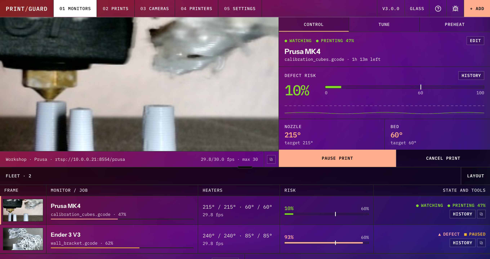
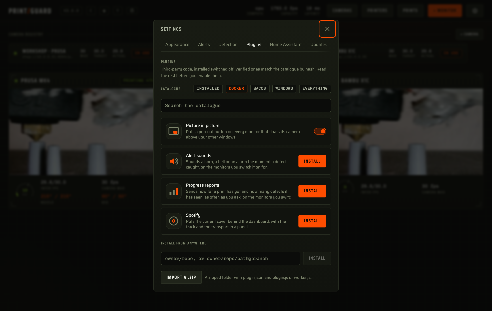
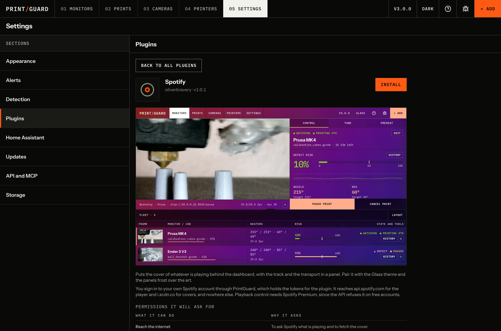
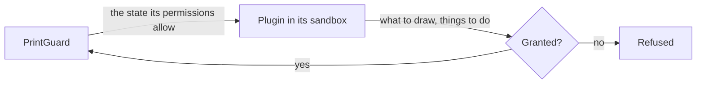

# Plugins

[Docs](README.md) · [Printers](printers.md) · [Cameras](cameras.md) · [Monitoring](monitoring.md) · [Notifications](notifications.md) · [Training frames](feedback.md) · [Hardware](hardware.md) · [Deployment](deployment.md) · [API & MCP](api.md) · **Plugins** · [Writing plugins](plugin-development.md) · [Architecture](architecture.md) · [Troubleshooting](troubleshooting.md)

PrintGuard's plugin system lets you add extra features in JavaScript without bloating the core app, with everything locked inside a sandbox. This page explains how to install and manage plugins and what they're allowed to touch. If you want to build your own, head to [Writing plugins](plugin-development.md).

- [What plugins are](#what-plugins-are)
- [The shipped plugins](#the-shipped-plugins)
- [Installing a plugin](#installing-a-plugin)
- [Verified and third party](#verified-and-third-party)
- [Enabling a plugin](#enabling-a-plugin)
- [Updates](#updates)
- [Permissions](#permissions)
- [What a plugin can and cannot do](#what-a-plugin-can-and-cannot-do)
- [Credentials](#credentials)
- [Switching plugins off at boot](#switching-plugins-off-at-boot)
- [Writing a plugin](#writing-a-plugin)

## What plugins are

A plugin can add a row to the dashboard, run background logic on the hub, or both. Plugins talk to PrintGuard through a permission-gated internal API, so fun or niche features can live outside the core codebase and ship on their own schedule.

Plugin rows show up under **Plugins** below your fleet list and participate in the same dashboard layout, so you can drag, pin and hide them just like monitors. Plugins can also add small buttons onto each monitor row or add their own section to a monitor's **Configure** tab.

## The shipped plugins

Four official plugins live in the catalogue, with full source code in [`plugins/`](../plugins):

| Plugin | What it does | Permissions |
|---|---|---|
| [Picture in picture](../plugins/picture-in-picture) | Adds a button on every monitor to pop its live camera out into a floating window | `state:read`, `camera:view` |
| [Alert sounds](../plugins/alert-sounds) | Plays a horn, bell or alarm sound when a defect triggers on monitors you choose | `state:read`, `sound` |
| [Progress reports](../plugins/progress-reports) | Sends periodic print progress and defect summaries through your alert channels | `state:read`, `alert:send` |
| [Spotify](../plugins/spotify) | Puts your currently playing album art behind the dashboard (in Glass theme) with track info and playback controls in a row under the fleet | `net`, `oauth`, `background` |

## Installing a plugin

Open **Settings -> Plugins** to see installed plugins and browse the catalogue.

| Source | How to install |
|---|---|
| The catalogue | Click any plugin card to inspect its screenshots, README and requested permissions, then click **Install** |
| A GitHub repository | Enter `owner/repo` or `owner/repo/path@branch` (full `https://github.com/owner/repo` URLs and `@tag` / `@sha` refs work too) |
| A local `.zip` | Click **Import a .zip** (up to 12 MB) containing a single `plugin.json` and its accompanying files |

When installing or updating from GitHub, any non-404 error fails the install with GitHub's status code (only a 404 is treated as an optional file not existing).

Clicking any installed plugin opens the same detail page. Plugin READMEs are rendered as strict Markdown, stripping any raw HTML beyond plain text, links, images, tables and code blocks.

The catalogue filters automatically to plugins compatible with your host platform, and manual installs are rejected if the plugin targets a different platform. Plugins that declare a newer `min_printguard` version than your hub are flagged in the catalogue and refused until you update PrintGuard.

## Verified and third party

**Verified** means the plugin's manifest and every source file hash-match a commit pinned in the catalogue. With the default catalogue, that means I have personally read and approved the exact code you're installing (if you point `catalogue_url` at another catalogue, it verifies against that one). Anything else shows as **third party**, so read its source before turning it on. Verified and third-party plugins both run inside the exact same sandbox.

If you import a `.zip` whose hashes match a verified catalogue entry, PrintGuard recognises it as verified and loads its store page assets (README, icon, screenshots) from that pinned commit.

Before you enable any plugin, PrintGuard also runs a static check over its JavaScript and flags any mismatch between the code and manifest right inside the enable dialog:

| Finding | What it means |
|---|---|
| Asks for a permission but never uses it | The manifest requests more than the code actually touches |
| Uses a permission without asking. PrintGuard will refuse it | The sandbox will block this call anyway; consider it a heads-up |
| Uses something, so its reach cannot be read from the code | The code builds a command, URL or channel name dynamically at runtime |

This check is purely informational so you know what to look out for; a plugin building a dynamic URL isn't automatically suspicious, and the real enforcement always happens at the sandbox boundary.

## Enabling a plugin

Every plugin installs switched off. Flipping it on opens a consent dialog showing each permission it wants, what that permission allows, and the author's stated reason for needing it. Permissions are all or nothing. Disabling a plugin later pauses it while remembering your granted permissions.

The consent dialog also lists every URL pattern covered by network permissions, every OAuth sign-in/token endpoint, and any other plugins it communicates with, so you can see its full reach up front. If an update ever asks for extra permissions, the same dialog pops up again before it can run.

## Updates

GitHub installs pin the exact commit they resolved to. Clicking **Update** on the plugin's page re-resolves the branch it came from (or the default branch) and re-checks the hashes.

If an update expands what the plugin asks for, PrintGuard switches it off until you review and accept the new list. "More" includes any new permission, new URL pattern, new inter-plugin link, new OAuth scope or a changed sign-in URL (changing a sign-in URL also signs the plugin out).

| Reinstalling over | Saved grants, plugin data and credentials |
|---|---|
| Same GitHub repo and path | Preserved |
| A `.zip` over a previous `.zip` | Data and credentials carry over if nothing new is requested; permissions are re-prompted |
| A different source | Starts fresh |

If you upgraded from before 2.6.0 and had a plugin accessing local network addresses without `net:local`, it stays installed (with its data and credentials intact) but switched off, with a startup warning prompting you to accept **Reach your own network**. Pre-2.6.0 plugins with plain `http://` OAuth URLs are removed on startup with a warning since insecure OAuth endpoints are no longer allowed.

## Permissions

| Permission | What it allows |
|---|---|
| `state:read` | Read monitor names, scores and alerts plus camera/printer status, and receive live score, alert, warning, printer and error events |
| `camera:view` | Embed a live camera player in its panel |
| `sound` | Play short alert sounds or media inside its panel |
| `monitor:control` | Enable, disable and retune monitors |
| `printer:control` | Pause, resume and cancel prints |
| `notify` | Show toast messages on the dashboard |
| `alert:send` | Push notifications through your configured ntfy, Pushover, Telegram, Discord or desktop channels |
| `net` | Make HTTP/WebSocket requests to the public URLs declared in its manifest |
| `net:local` | Reach addresses on this machine or your local network (private IPs, `localhost`, `.local`, `.lan`, `.home`, `.home.arpa`, `.internal`, `.localhost`, wildcards matching them like `*.local` or `*.168.1.50`, and IPv4-mapped IPv6 addresses) |
| `monitor:manage` | Create and delete monitors |
| `camera:control` | Rename cameras and adjust brightness, contrast, sharpness, crop, rotation and detection rate |
| `camera:manage` | Register/delete cameras and scan for unregistered devices |
| `camera:frames` | Grab still frames from cameras and read raw image pixels |
| `history:read` | Read monitor risk history and past alerts |
| `printer:manage` | Add, edit, test and delete printers, refresh printer webcams and list integrations |
| `settings` | Modify Settings (alert channels, theme, etc.), send test alerts and list notifiers |
| `tokens` | Create and revoke API tokens |
| `oauth` | Run an OAuth sign-in flow and use the resulting token |
| `link:provide` | Expose channels that other plugins can call |
| `link:consume` | Call channels exposed by specific other plugins |
| `background` | Set a background image behind the dashboard (visible through Glass theme panels) |
| `routes` | Serve custom HTTP pages/endpoints under `/plugins/<id>/` (can read incoming request headers) |
| `gate` | Inspect and allow/reject every other HTTP request to the hub (allow decisions cache for 10 seconds per identical method, path, query and inspected headers) |

Every requested permission in a manifest must include a plain-English reason from the author, or the plugin won't install. That reason appears right next to PrintGuard's own description in the consent dialog.

A plugin can trigger a device scan (`camera:manage`), printer test (`printer:manage`) or test alert (`settings`), though PrintGuard never passes the test results back to the plugin.

Basic key-value storage doesn't need a permission; each plugin gets up to 16 KB saved inside PrintGuard's state file.

## What a plugin can and cannot do

Plugins never act directly on the system. PrintGuard hands them only the slice of state their permissions allow, and the plugin returns what to draw plus a list of requested effects. PrintGuard validates every single effect against your granted permissions before running it.

A plugin can include up to three code files, each isolated in its own sandbox:

| File | Where it runs |
|---|---|
| `plugin.js` | A hidden opaque-origin iframe in the dashboard with `default-src 'none'` |
| `panel.html` | A visible opaque-origin iframe allowing only its own markup, styles and inline scripts |
| `worker.js` | [QuickJS](https://github.com/quickjs-ng/quickjs) compiled to WebAssembly inside wasmtime on the hub |

Dashboard iframes are only allowed to load once from the hub; if a plugin tries to navigate its iframe elsewhere, PrintGuard destroys it immediately with `sandbox navigated away`.

| Threat | How PrintGuard stops it |
|---|---|
| Exfiltrating data | Neither sandbox has direct sockets. Browser iframes run with `connect-src 'none'`, block external scripts and strip WebRTC; the hub worker has no WASI network and no filesystem. All outbound requests go through PrintGuard to manifest-declared URLs only (aside from the three config permissions noted below), redirects are never followed, and without `net:local`, hostnames are resolved once and blocked if any resolved IP is non-public (see [What a browser still allows](#what-a-browser-still-allows)) |
| Reading stored credentials | Engine state is filtered down to permission-allowed fields. Printer passwords, notifier keys, MQTT credentials and API tokens aren't exposed by any permission (except `routes` and `gate`, which receive `Cookie` and `Authorization` headers on requests they handle) |
| Spying on camera feeds | Cameras in plugin panels are placeholders rendered by PrintGuard's own player, so video frames never enter the sandbox. Reading actual pixels requires the separate `camera:frames` permission, and plugin routes can't access live streams |
| Freezing or crashing the hub | Workers run with strict memory and CPU budgets, and calls queued longer than 5 seconds are dropped. Any plugin that errors or returns malformed data is disabled immediately with an error report |
| Calling the hub's own API | Every outbound request, OAuth exchange and WebSocket made on behalf of a plugin carries an `X-PrintGuard-Plugin` header the plugin can't forge or strip; the hub returns `403` to any request bearing that header, and MediaMTX requires a per-boot hub credential |
| Bypassing a broken `gate` plugin | If a `gate` plugin crashes, gets switched off by a permission-expanding update, or fails to load on boot, the hub fails closed and rejects requests until you re-enable, reinstall, remove or restart with plugins off |
| Exceeding granted permissions | Every command maps to a permission enforced at the sandbox edge |
| Spoofing PrintGuard UI | `plugin.js` returns abstract UI nodes that PrintGuard renders itself. `panel.html` renders inside a clearly labelled plugin panel. Custom `routes` pages run in a separate sandboxed origin |
| Tampering after review | Catalogue entries pin SHA-256 hashes of the manifest and every source file at a specific commit |

Note that `settings`, `printer:manage` and `camera:manage` let a plugin configure addresses that PrintGuard itself will then contact (for example testing a notifier, adding a printer/camera or changing the catalogue URL). Because those bypass declared `urls`, each is highlighted as risky in the consent dialog.

### What a browser still allows

Browser-side isolation relies on standard web security primitives, which leave three narrow edges:

| What's still possible | Impact |
|---|---|
| An iframe navigates to another URL on your hub | One request to the hub; the dashboard destroys the iframe as soon as it loads |
| An iframe injects `<link rel="preconnect">` in Safari | No HTTP request or body, though the chosen hostname leaks a few bytes via DNS lookup |
| A page served via `routes` under `/plugins/<id>/` navigates the tab to another site or opens WebRTC | It can pass data in the target URL (the page itself can't load external resources or make fetch calls, though a browser tab can always navigate away) |

The browser sandbox test suite runs in both Chromium and WebKit (Safari's engine). Firefox isn't currently part of the automated sandbox tests.

## Credentials

Plugins can write credentials (like a printer password if granted `printer:manage`), though they can never read them back. A plugin with `printer:manage` or `settings` can test an already-saved printer or notifier using its stored key at its saved address.

A plugin's own secrets work the same way. Once enabled, any secret declared in its manifest shows up as a password field on its **Settings -> Plugins** page. PrintGuard stores the value and injects it into outgoing requests on the plugin's behalf.

Be realistic about what that protects: your secret never enters the plugin's sandbox, stored data, dashboard state or bug reports, though it doesn't stop a plugin with `net` permission from sending that secret to a URL it declared in its manifest. That's why declared URLs are shown up front, statically checked against the code, and reviewed for verified plugins.

Plugins that sign into an external service (like Spotify) ask you to register your own developer app with that service rather than sharing one central client ID (which hits shared rate limits and violates most API terms):

1. Open the plugin's page and click **Create one** to open the service's developer portal.
2. Register an app using the exact **redirect URI** shown on the plugin page.
3. Paste the new **client ID** back into PrintGuard.
4. Click **Connect** and sign in.

The redirect URI is your PrintGuard origin plus `/oauth/callback` (using `127.0.0.1` instead of `localhost`, since providers like Spotify reject `localhost`). Sign-in uses PKCE so no client secret is needed. Clicking **Disconnect** forgets your tokens while keeping your client ID saved.

## Switching plugins off at boot

Because a plugin with **Authorise every request** (`gate`) sits in front of the whole hub, a misbehaving or disabled `gate` plugin locks everyone out by design.

To recover, start the hub with `PRINTGUARD_PLUGINS=off` in its environment so every plugin stays disabled at boot, then remove or re-enable the plugin.

See [Deployment](deployment.md#plugins) for the Docker Compose snippet and extra notes on exposing a hub with `routes` or `gate` plugins.

## Writing a plugin

A plugin is just a folder with a `plugin.json` manifest and up to three JavaScript/HTML files, with no bundler or build step needed. Head to [Writing plugins](plugin-development.md) for a walkthrough, full API reference, limits and how to submit yours to the catalogue.
