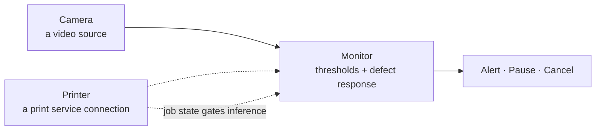
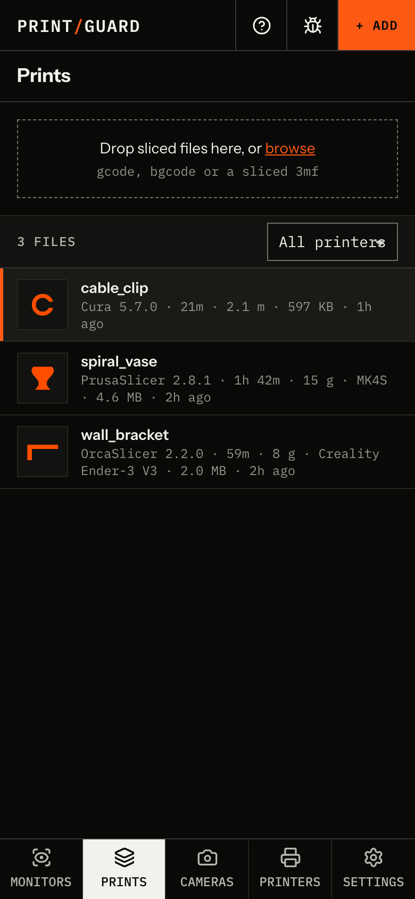
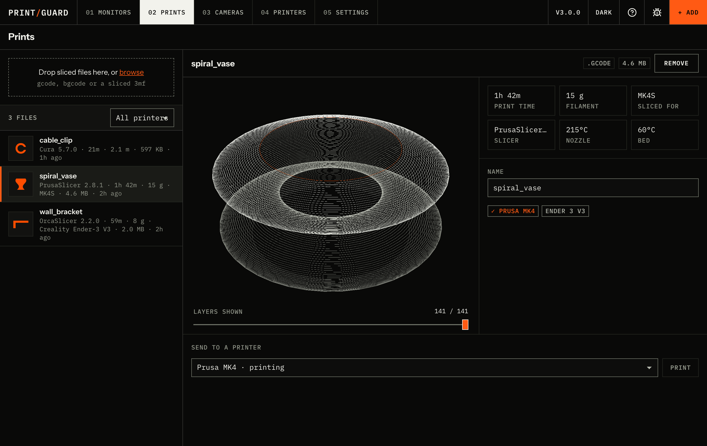

# Printers

[Docs](README.md) · **Printers** · [Cameras](cameras.md) · [Monitoring](monitoring.md) · [Notifications](notifications.md) · [Training frames](feedback.md) · [Hardware](hardware.md) · [Deployment](deployment.md) · [API & MCP](api.md) · [Plugins](plugins.md) · [Writing plugins](plugin-development.md) · [Architecture](architecture.md) · [Troubleshooting](troubleshooting.md)

How to connect your printer to PrintGuard, send sliced files from the print library and control temperatures.

- [How the pieces fit](#how-the-pieces-fit)
- [Register a printer](#register-a-printer)
- [Supported print services](#supported-print-services)
- [Sending prints](#sending-prints)
- [Temperatures and preheat](#temperatures-and-preheat)
- [Networking caveats](#networking-caveats)

## How the pieces fit

Cameras and printers are registered once on their own pages, then linked together inside a monitor. One printer can be shared across multiple monitors (for example if you have two camera angles on the same machine), and a monitor with no printer still watches and alerts you. You can rename cameras, printers and monitors any time on their respective pages.

The dotted lines are optional. Without a printer linked, PrintGuard still spots defects and alerts you, it just can't pause or cancel the job. See [Cameras](cameras.md) for video sources, [Monitoring](monitoring.md) for thresholds and [Notifications](notifications.md) for alert channels.

## Register a printer

Go to **Printers**, click **+ Add**, pick your print service, fill in the form and hit **Test connection** before saving. The optional **Printer model** field (like `Prusa MK4` or `Bambu P1S`) is only used to tag reviewed frames if you [share them for training](feedback.md). If a required field is left blank, PrintGuard refuses to save and tells you which one is missing. Invalid API keys, wrong passwords, non-API pages or redirecting URLs all fail the connection test with the reason shown.

Once saved, keys, passwords and access codes are never displayed again. Their fields stay blank with "Saved. Leave blank to keep it", and **Test connection** uses the saved secret automatically. Type a new value to replace it, or press **Clear** and save to wipe it. If you change a printer's address, PrintGuard asks you to re-enter both the full address (since saved URLs hide embedded logins) and any saved credentials, because saved secrets are only ever sent to the address they were originally saved with.

After saving, link the printer to a monitor and choose whether a sustained defect should just alert you, pause the print or cancel it.

Linked printers display job name, progress, temperatures and status on every monitor using them, and they also control when detection runs. PrintGuard watches while the printer is printing and drops into standby when the printer reports idle, paused or an error, so idle printers don't burn CPU. If the printer loses contact or returns an unrecognised state, PrintGuard sticks with its last known answer: a printer powered off after finishing stays on standby, while one that drops off mid-print stays watched and triggers a warning. See [failing safely](architecture.md#failing-safely).

## Supported print services

| Service | Authentication | [Exposes a camera](cameras.md#printer-cameras) |
|---|---|---|
| [OctoPrint](https://octoprint.org) | Application key (Settings -> Application Keys in OctoPrint) | Yes, its webcam stream |
| [Klipper (Moonraker)](https://moonraker.readthedocs.io) | None on a trusted LAN. Otherwise add your hub's IP to `trusted_clients` under `[authorization]` in `moonraker.conf`, or enter an API key | Yes, its configured webcams |
| [Creality](https://github.com/CrealityOfficial/CrealityPrint/tree/v7.3.0/resources/web/deviceMgr) | None (keep it on a trusted LAN) | MJPEG stream on port 8080 on models that serve one |
| [Elegoo](https://github.com/ELEGOO-3D/elegoo-link) | Access code on Centauri Carbon 2, or optional Moonraker API key | Centauri chamber camera, or Moonraker webcams |
| [Prusa (PrusaLink)](https://help.prusa3d.com/guide/wi-fi-and-prusa-connect-link-setup-core-one-mk4-s-mk3-9-mk3-5-xl-mini_413293) | HTTP Digest (username `maker` by default) | No local stream |
| [Bambu Lab](https://github.com/Doridian/OpenBambuAPI) | LAN access code and serial number | Chamber camera |
| [Ultimaker](https://github.com/Ultimaker/Cura/tree/main/plugins/UM3NetworkPrinting) | None (keep it on a trusted LAN) | Yes, its MJPEG stream on port 8080 |

<b>Bambu Lab</b>: LAN Only Mode and Developer Mode

Bambu Lab printers talk over local MQTT over TLS rather than HTTP.

1. On the printer screen, turn on **LAN Only Mode**, then turn on **Developer Mode** under Settings -> Network. Developer Mode is required for PrintGuard to pause, cancel, set heater temperatures or start prints.
2. Grab the **access code** shown on that screen, plus the **serial number** under Settings -> Device.
3. Add the printer in PrintGuard with its IP address, serial number and access code.

PrintGuard registers the chamber camera automatically: RTSPS on port `322` for X1 and H2 series printers, or Bambu's proprietary port `6000` stream for A1 and P1 series. The setup form also links straight to Bambu's [Enable LAN Mode](https://wiki.bambulab.com/en/knowledge-sharing/enable-lan-mode) guide.

Because Bambu printers use self-signed certificates, PrintGuard skips certificate verification for them. Your access code is only ever sent to the IP you registered, so keep the printer on a trusted LAN.

PrintGuard maintains a single persistent connection and listens to pushed reports. If nothing arrives for a minute, it reconnects and marks the printer offline until reports resume. With Developer Mode disabled, status updates still come through, though pause, cancel, preheat and print start commands are rejected by the printer and reported as failed.

<b>Creality</b>: K1, K2, Ender-3 V3, Hi and CR-10 SE on stock firmware

Stock firmware on the K1, K2, Ender-3 V3, Hi series and CR-10 SE exposes the same local WebSocket that Creality Print uses. Add the printer by IP or hostname. PrintGuard connects on port `9999` for status/control and port `80` for uploading prints. There is no password, so keep the printer on a trusted network. If your printer is rooted and running Moonraker, add it as **Klipper (Moonraker)** instead.

PrintGuard holds one persistent WebSocket connection and reconnects if the printer stays silent for 20 seconds. Because the firmware doesn't send direct command acknowledgements, PrintGuard confirms a pause, resume, cancel or heater change by waiting up to 10 seconds for the printer's pushed state to reflect it. While the printer is pausing, stopping, resuming or starting a print, its state shows as unknown and monitors keep their current watching state.

K1 printers on firmware older than 1.3.5.22, plus K1 SE and Ender-3 V3 printers with Creality's camera fitted, serve an MJPEG stream on port `8080` which PrintGuard registers automatically. The K2, Hi and newer K1 firmware use custom WebRTC signalling instead; put [go2rtc](https://github.com/AlexxIT/go2rtc) in front of the camera and add it as a [stream URL](cameras.md#stream-urls).

<b>Elegoo</b>: Centauri Carbon and Neptune / OrangeStorm

Pick the family that matches your machine:

**Centauri Carbon 1 / 2** covers both the Centauri Carbon and Centauri Carbon 2. PrintGuard automatically detects which local protocol the printer speaks and registers its chamber camera.

- **Carbon 2**: turn on **LAN Only Mode** in network settings and enter the access code shown on the screen.
- **Original Carbon**: the IP address alone is enough.

While a Carbon 2 is booting, loading/unloading filament, levelling or calibrating outside a print, its state reads as unknown and monitors stay as they were.

**Neptune 4 / OrangeStorm Giga** covers the Neptune 4 Pro, Plus and Max, OrangeStorm Giga and other Moonraker-based Elegoo printers. PrintGuard connects to stock Moonraker on port `7125`, supports an optional API key and pulls in any webcams listed in Moonraker.

Everything stays on your local network; Elegoo's cloud is never used.

<b>Prusa</b>: PrusaLink (not PrusaConnect)

Prusa printers connect through **PrusaLink**, the local API built into the MK4, MK4S, MK3.9, MK3.5, MINI, XL and CORE One (or running on a Raspberry Pi wired to an MK3 or MK2.5), using HTTP Digest auth.

1. Turn on **PrusaLink** on the printer under Settings -> Network -> PrusaLink.
2. Add the printer with its URL and password. On stock printer firmware the username is `maker`; if you set up PrusaLink on a Raspberry Pi with a custom username, enter that under **Username**.

PrusaLink's `ERROR` maps to error, while `ATTENTION` and `BUSY` map to unknown. Buddy firmware sometimes displays a warning (`ATTENTION` or paused) while a job keeps running, so PrintGuard holds onto its last known state while one is shown. When no job is active, PrintGuard reads the printer's own state (or unknown if none is reported).

PrusaConnect is never used, so nothing leaves your local network. Since PrusaLink's camera feature pushes stills to PrusaConnect rather than serving a local video stream, add any camera separately as a [stream URL](cameras.md#stream-urls).

<b>Ultimaker</b>: local Cura network printing API

Supports the Ultimaker 3, 3 Extended, S3, S5, S7 and Factor 4 via the same local API Cura uses. There is no authentication on read/print endpoints, so keep the printer on a trusted network.

1. Look up the printer's IP on its touchscreen under Preferences -> Network.
2. Register each printer with its address, e.g. `http://192.168.1.60`.

A finished or aborted job waiting for you to confirm the bed is clear reports as idle. While booting, running maintenance or paused waiting for user input mid-print, its state reads as unknown and monitors stay as they were.

## Sending prints

The **Prints** page stores sliced files right on your hub. Drag files onto the drop zone or click **browse** to upload them.

Before uploading, a side panel renders the toolpath in your browser so you can rename the print, tag which printers it's for, and adjust its first-layer nozzle and bed temperatures. PrintGuard inspects the start and end of the file to read print time, filament usage and temperatures. If you change a first-layer temperature, every subsequent print temperature set by the slicer shifts by the same offset while start-G-code probing/wiping temperatures stay untouched. On multi-filament files, only the first-layer filament's temperatures shift, capped at 350°C (nozzle) and 150°C (bed). If the slicer didn't write temperature metadata, every non-zero setpoint shifts together. Any adjustment that would push a later layer down to 0°C or below is rejected so a heater never gets turned off mid-print (for example, a bed sliced at 60°C then 55°C can't have its first layer lowered below 6°C). Binary `.bgcode` files keep their original sliced temperatures, as do host-numbered/checksummed lines like `N5 M104 S215*33`.

Slicer thumbnails, estimated print times, filament estimates and printer models are preserved automatically. For slicers that don't embed a thumbnail (like Cura), your browser renders one from the toolpath and injects it during upload. Files uploaded via the REST API without a thumbnail show their file extension instead. Click any file in the library to explore its 3D toolpath layer by layer.

Tagging a file with specific printers locks it so it can only ever start on those machines (only compatible printers are selectable). Untagged files can be sent to any compatible printer. If you delete a printer, files tagged exclusively for it keep their tag and won't start anywhere until you retag them. Either way, the printer must be idle when you hit **Print**, preventing accidental prints on top of an active job.

Clicking **Print** pops up the printer's live bed camera first so you can double-check that the plate is on and clear before clicking **Start print**. It shows the camera linked to that printer's monitor (or the printer's own webcam if no monitor exists). Prints triggered via the REST API or MCP start immediately without the camera check.

| Service | Accepted formats | How it starts |
|---|---|---|
| OctoPrint | `.gcode`, `.gco`, `.g` | Uploads to local storage, selects and starts |
| Klipper (Moonraker) | `.gcode`, `.gco`, `.g` | Uploads to the gcodes root and starts |
| Creality | `.gcode` | Uploads over HTTP and starts once the printer lists it at full size |
| Elegoo | `.gcode` | Centauri Carbon: uploads to internal storage and starts. Neptune/OrangeStorm: via Moonraker |
| Prusa (PrusaLink) | `.gcode`, `.bgcode` | Uploads as `text/x.gcode` to the first writable storage (USB stick or Pi local storage) and prints |
| Bambu Lab | `.3mf` sliced in Bambu Studio or OrcaSlicer | Uploads over FTPS and starts plate 1 via MQTT |

If a service accepts the upload but fails to start the job (or rejects it), PrintGuard reports the start as failed. Older OctoPrint versions (before 1.8.0) don't report whether printing started, so a successful upload counts as started. If Moonraker is configured to queue uploads, PrintGuard reports the file as queued.

Actions (pause, cancel, preheat, print start) only count as successful when the service returns its expected API response, so an expired auth proxy returning a login HTML page is properly flagged as failed.

When sent to a printer, filenames are sanitised from the library name (non-alphanumeric characters become `_`, stems trimmed to 60 characters), so rename files first if you care about how they appear on the printer's screen. PrusaLink overwrites an existing file with the same name. Uploads are capped at 512 MB (including unpacked `.3mf` contents). Empty files, `.3mf` files with empty plate G-code, `.bgcode` with no G-code or over 16 MB of metadata/previews, corrupt `.3mf` archives, unsupported `.3mf` compression methods (anything other than stored/deflate), and files with nonsensical metadata (print times over a year, impossible filament/temperature values) are rejected.

Text G-code files over 32 MB skip browser toolpath rendering (parsing takes roughly 9x file size in RAM), so they won't have a 3D preview or browser-generated thumbnail, though they still upload, print and show slicer stats normally. Devices without WebGL behave the same way. Binary `.bgcode` files can't be rendered in 3D either since their toolpaths are compressed, so they display PrusaSlicer's embedded thumbnail (and note that compressed time/filament metadata may appear blank).

Bambu Lab prints use the settings sliced into the `.3mf`, with bed levelling enabled, flow/vibration calibration off, and external spool selected (not AMS). Starting prints requires Developer Mode, and unsliced `.3mf` project files without G-code are rejected at upload. Note that Bambu printers keep reporting a cancelled or failed print as failed until the next job begins; PrintGuard displays that as idle, so always check the bed before starting the next print.

Ultimaker accepts `.gcode` (not `.ufp`) and queues it; if the printer is waiting for bed-clear confirmation from the previous print, the new print starts once you confirm on the printer's screen.

Library files live under `prints/` inside your hub's data directory so they survive restarts and backups. On startup, PrintGuard cleans up orphaned generated files in `prints/` that aren't referenced by `state.json`, while keeping files for any print record that failed to parse (with a startup warning).

## Temperatures and preheat

Linked printers show their progress in the fleet list, and live nozzle and bed temperatures in the selected monitor's **Control** panel (alongside a progress bar and remaining time during a print). Open the **Preheat** tab to type custom targets (applied on Enter or blur) or tap one of the shared preheat presets. Click **Edit** to customise your presets, or **Heaters off** to cool everything down.

| Service | Reads temperatures | Sets targets |
|---|---|---|
| OctoPrint | Yes | Yes (tool0 and bed endpoints) |
| Klipper (Moonraker) | Yes | Yes (`SET_HEATER_TEMPERATURE`) |
| Creality | Yes | Yes (whole degrees) |
| Elegoo | Yes | Yes (both families) |
| Prusa (PrusaLink) | Yes | No (PrusaLink has no heater-target endpoint) |
| Bambu Lab | Yes | Yes (`M104` / `M140` commands, same as Bambu Studio) |
| Ultimaker | Yes (first nozzle) | No (requires screen-approved API credentials) |

Targets above 350°C (nozzle) or 150°C (bed) or non-numeric values are rejected by the engine; the UI clamps inputs and presets to those caps, and your printer's firmware still enforces its own safety limits on top. Temperatures poll every ~5 seconds alongside printer status, independently per printer so one offline machine never slows the others down.

## Networking caveats

The hub itself connects to your printers, never your browser. That means the address you enter must be reachable from the hub machine, and you can safely connect `http://` printers even if you access the PrintGuard dashboard over HTTPS.

Always include `http://` or `https://` in printer URLs; bare hostnames like `192.168.1.50:5000` are rejected.

Enter the final URL the print service answers on rather than one that redirects (such as an `http://` proxy redirecting to `https://`). PrintGuard never follows redirects on printer or alert requests so keys and commands can't accidentally be forwarded somewhere you didn't configure. If an address redirects, both **Test connection** and live actions tell you the destination URL to use instead.

### Where a printer's webcam is read from

OctoPrint and Moonraker normally report relative webcam paths like `/webcam/?action=stream`, which their web UIs resolve against the address you loaded them from. PrintGuard follows the same convention using the address you registered:

| Registered address | Where PrintGuard looks for the webcam |
|---|---|
| Moonraker port (`7125` to `7199`, e.g. `http://pi.lan:7126`) | Same host on port 80 (`http://pi.lan/webcam2/?action=stream`) |
| OctoPrint default port (`http://octopi.local:5000`) | Same host on port 80 (`http://octopi.local/webcam/?action=stream`) |
| Any other port (e.g. reverse proxy on `http://nas.lan:8080`) | That same port (`http://nas.lan:8080/webcam/?action=stream`) |
| No explicit port | The exact registered address |

If you run OctoPrint in Docker mapped as `5000:80`, PrintGuard can't tell it apart from a bare port-5000 OctoPrint install, so it checks port 80 for the webcam. Either publish it on a different port or configure an absolute webcam URL inside OctoPrint (PrintGuard uses absolute URLs as given). If a webcam URL points to loopback (`127.0.0.1`), PrintGuard substitutes the printer's registered host IP, so the webcam server needs to bind to the network rather than loopback only. Existing working cameras aren't overwritten by refreshes or updates.

For Moonraker webcams configured as MediaMTX or go2rtc WebRTC streams, PrintGuard pulls from their WHEP endpoint. For `camera-streamer` (which doesn't expose WHEP), PrintGuard looks for its MJPEG stream beside the snapshot or WebRTC path. Janus (without an MJPEG/snapshot fallback), iframe and jMuxer webcams aren't auto-registered; add their RTSP or MJPEG feed manually as a [stream URL](cameras.md#stream-urls).

### Running in Docker

Inside Docker, `localhost` refers to the container itself, not your host machine, so `http://localhost:5000` will fail with *all connection attempts failed*. Use `http://host.docker.internal:5000` instead (already mapped in the shipped [`docker-compose.yaml`](../docker-compose.yaml)). On Linux hosts, make sure the print service listens on `0.0.0.0` rather than `127.0.0.1`.

### The desktop app

The desktop app runs directly on your computer rather than inside a container, so `http://localhost:5000` works for services on the same machine, and other printers just use their LAN IP or hostname.

Check [Troubleshooting](troubleshooting.md) if a printer still won't connect.
